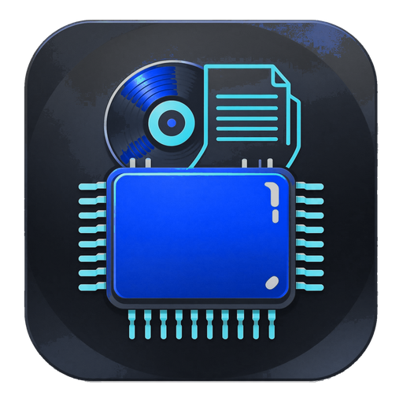

<p align="center">
  
</p>

<h1 align="center">音序管家 · SeqAudio Manager</h1>

<p align="center">
  <b>中文</b> · <a href="#english">English</a>
</p>

<p align="center">
  Windows 本地音乐元数据批量处理工具 · A local batch audio metadata processor for Windows
</p>

<p align="center">
  
  
  
  
</p>

---

# 中文

Windows 本地音乐元数据批量处理工具。批量导入 → 联网补全 → 清标签水印 → 安全写标签 → 批量重命名 → 导出报表，一键跑完。

面向本地音乐收藏玩家，**无损优先**：FLAC / APE / WAV / WV / TTA / ALAC / DSF / DFF 全部支持，只改标签区块、绝不重新编码音频。

进阶能力：

- **真假无损鉴定** —— 频谱分析判断「无损」是真无损还是 MP3 转码伪装的（含 DSD 专门判据）；
- **一键清理假无损** —— 判定可疑的文件移入回收站或软件隔离区，随时可还原，附频谱图可自行复核；
- **每个文件夹一张封面** —— 处理完成后为每个文件夹写入 `cover` 图，专辑封面优先、匹配不到自动用歌手照片兜底（Deezer / 网易云，一个失效自动切换）；

> 授权：**GNU General Public License v3.0**。界面字体 Noto Sans SC / JetBrains Mono 为 SIL OFL 1.1，随包分发。

### V1.4.0 更新摘要

- 移除星空动态背景，界面改为纯主题底色；
- 「文件名」列默认显示，新增采样率/位深/DSD 规格筛选与右键「复制完整路径」；
- 真假无损判定重构：不再用带宽百分比单独判假，升位深改用 s24 最低字节零比例，截断文件判「无法判定」；
- DSD 边界判据增加可靠性保护，修复扫频/窄带测试信号误伤；
- 无损格式识别按 codec 判定：Ogg-FLAC、WMA Lossless 正确标为无损，AIFF 内 IMA ADPCM 标为有损；
- CUE 分轨修复末轨只有 0.1 秒的问题，新增「在下一轨 INDEX 00 截止」选项，并自动保护含隐藏音频的预间隙。

---

## 界面

主界面（1080×720，1366 笔记本的真实可用宽度）：


清理假无损 —— 默认送回收站，彻底删除需要额外勾选确认：


关于与开源协议（GPLv3 全文内嵌，离线可查）：


---

## 技术选型

| 层 | 选择 | 理由 |
|---|---|---|
| 语言 | Python 3.10+ | 音频标签生态最成熟，开发迭代快 |
| 标签引擎 | **mutagen** | 唯一同时覆盖 FLAC/APE/WV/TTA/DSF/DFF/MP4/ID3 的成熟库；`save()` 只替换标签区块，天然满足无损要求 |
| 界面 | **PySide6 (Qt 6)** | Qt 官方维护，Win10/11 高分屏与 125%/150% 缩放表现稳定；LGPL 授权，商业分发无负担 |
| 网络 | 标准库 `urllib` | 目标 API 都是简单 GET，无需 HTTP/2；少一层依赖就少一层 DLL 冲突，打包更小 |
| 频谱分析 | **numpy** + 内置 **ffmpeg** | 真假无损鉴定要解码后做 FFT；ffmpeg 是唯一能同时解 DSD/APE/WV/TTA 的方案，随包内置保证开箱即用 |
| 字体 | **Noto Sans SC** + **JetBrains Mono** | 均为 SIL OFL 1.1，可随软件分发与商用；系统自带的微软雅黑等字体不允许随包分发 |
| 压缩 | **py7zr** | 纯 Python 实现 7z，构建期用，不依赖外部 7-Zip |
| 打包 | **PyInstaller** + 自研 Qt 安装器 | PyInstaller 零编译依赖，装完即出包；本机无 Inno/NSIS，安装向导直接用 PySide6 写 |

被排除的方案：C# + TagLib#（DSD/TTA/WV 支持残缺、DFF 基本没有）、Rust + Tauri + lofty（DFF 仍需手写，周期过长）、C++ + Qt（维护成本高）。

---

## 目录结构

```
src/seqaudio/
├── app.py                  应用入口（高 DPI、主题、异常兜底、免责声明）
├── core/                   纯 Python 核心层，不依赖 Qt，可独立测试
│   ├── model.py            Track / Tags / AudioInfo / CueSheet / MatchCandidate
│   ├── tags.py             标签读写适配：VorbisComment / ID3 / APEv2 / MP4 四套体系
│   ├── probe.py            格式探测、技术参数、流式读取（4GB 文件不进内存）
│   ├── writer.py           安全写入：备份 → 影子副本 → 写后校验 → 原子替换
│   ├── cue.py              CUE 解析（UTF-8/UTF-16/GBK 编码自识别）
│   ├── watermark.py        标签水印清理（强规则整段清空 / 片段删除 / 自定义词）
│   ├── rename.py           模板重命名（非法字符、保留名、循环改名安全）
│   ├── lyrics.py           LRC 清洗、同步歌词判定、同名 .lrc 读写
│   ├── integrity.py        FLAC / DSDIFF 结构校验
│   ├── authenticity.py     真假无损鉴定（转码/升采样/升位深三类判据 + DSD 噪声整形）
│   ├── quarantine.py       隔离区：回收站 / 隔离 / 彻底删除，manifest 可还原
│   ├── uninstall.py        卸载：延时删除 + 数据迁移
│   ├── report.py           CSV 报表（UTF-8-SIG，Excel 直开不乱码）
│   ├── config.py           设置与预设方案持久化
│   ├── paths.py            绿色优先的目录解析（EXE 同级 → AppData 回落）
│   └── logging_setup.py    文件日志 + UI 实时日志双通道
├── net/                    联网数据源
│   ├── http.py             零依赖 HTTP：重试退避、按主机限流、熔断、磁盘缓存
│   ├── musicbrainz.py      元数据主源（Lucene 查询 + 发行版优选）
│   ├── itunes.py           元数据/封面次源（Apple 公开接口）
│   ├── netmusic.py         网易云（元数据/歌词/封面，社区接口）
│   ├── qqmusic.py          QQ 音乐（元数据/歌词/封面，社区接口）
│   ├── coverart.py         封面源（体积与次数双重限制）
│   └── lrclib.py           歌词主源（精确匹配 → 模糊检索）
├── pipeline/
│   ├── matcher.py          多源聚合 + 置信度评分（简繁归一、版本惩罚）
│   └── processor.py        单首流程 + 批量调度 + 失败隔离
└── ui/
    ├── main_window.py      主窗口：表格、工具栏、日志、右键菜单、拖拽
    ├── track_model.py      表格模型 + 筛选代理（无损 / 问题 / 鉴定结论）
    ├── delegate.py         自绘状态胶囊、等宽数字、选中高亮条
    ├── settings_panel.py   参数面板
    ├── cleanup.py          清理假无损 / 隔离区管理对话框
    ├── spectrum.py         频谱查看器（整首瀑布图 + 平均曲线，QPainter 绘制）
    ├── about.py            关于：协议全文、第三方组件、诊断信息
    ├── dialogs.py          标签编辑 / 候选选择 / 重命名预览
    ├── fonts.py            开源字体注册与选择
    ├── worker.py           QThread 包装，保证 UI 不阻塞
    ├── disclaimer.py       启动免责声明
    └── theme.py            半透明深色主题 QSS

installer/installer.py      安装向导（独立 Qt 应用，打包成 Setup.exe）
build.py                    构建：便携版 7z + 安装程序
```

---

## 图标

`assets/app.ico`（7 个尺寸：16/24/32/48/64/128/256）与 `assets/app.png`（512px）由
`tools/make_icon.py` 从源图生成：

```bash
python tools/make_icon.py --source 源图.jpg          # 生成正式图标
python tools/make_icon.py --source 源图.jpg --preview # 只出预览图，便于调参
```

处理做了三件事：

1. **抠透明底** —— 白色既是背景又是高光（芯片反光、唱片中心孔都接近纯白），
   按颜色一刀切会把高光一起抠掉。改用形态学填洞：从画面边界填背景，
   被图标围住的白自动保留；圆角外侧的装饰则用测出的圆角半径做几何裁剪清掉。
2. **配色映射到软件主题** —— 在 HSV 空间分区替换：青绿线条 → `#22d3ee`，
   亮蓝芯片 → `#4d7cfe`，灰蓝底板压暗去饱和向近黑靠拢。
   低饱和高光单独保护成中性灰，否则会变成一块突兀的蓝斑。
3. **各尺寸留白** —— 内容占画布 90%，四周透明，16px 下不至于贴边糊成一团。

## 开发与运行

```bash
pip install -r requirements.txt
python run.py
```

跑核心层自测（不启动界面）：

```bash
python tests/test_core.py
```

生成测试样本音频（纯字节构造，不需要 ffmpeg）：

```bash
python tests/make_samples.py
```

## 打包：安装版 + 便携绿色版

```bash
pip install pyinstaller py7zr

python build.py                  # 一次产出两个发行物（默认）
python build.py --target portable   # 只出便携版
python build.py --target installer  # 只出安装程序（会复用已有 .7z）
python build.py --target onefile    # 单个 EXE，仅用于快速自测
python build.py --debug             # 保留控制台窗口，排查启动异常
```

产物：

```
dist/音序管家-v1.4.0-x86-x64.7z            便携绿色版（解压即用，约 90 MB）
dist/音序管家-v1.4.0-x86-x64-Setup.exe     安装程序（约 90 MB）
```

**便携版**用 PyInstaller 的 onedir 模式再压成 7z。不用 onefile 的原因很实际：
onefile 每次启动都要把 250MB 内容解压到临时目录，首次要 3~5 秒；onedir 直接加载，
秒开。便携版的使用场景本来就是「解压到 U 盘直接跑」，目录结构更合适。

**安装程序**是一个用 PySide6 写的三页向导（欢迎/授权 → 选择目录 → 安装进度）：

- 装到 `%LOCALAPPDATA%\Programs\SeqAudioManager`，**不需要管理员权限**；
- **自动识别安装模式**：注册表无记录 → 全新安装；已装同版本 → 修复安装；已装旧版本 → 升级安装（装回原路径，`data/` 里的配置、日志与备份始终保留）；
- **程序运行中会拦下来**：动手前按完整路径枚举进程（不是按进程名猜），发现 `音序管家.exe` 在跑就提示「请先关闭」，关掉后点「重试」直接继续，不用重开安装包；安装失败时完成页也给「重试安装」；
- 写 HKCU 卸载项，在「设置 → 应用」里能正常卸载；**安装目录与开始菜单都创建「卸载 音序管家」快捷方式**，双击即进入卸载流程（安装目录那个始终创建，不依赖快捷方式选项）；
- 桌面与开始菜单快捷方式可取消；
- 卸载由主程序 `--uninstall` 完成：先把 `data/`（配置、日志、**备份的原始音频**）
  移到 `%APPDATA%`，再删安装目录 —— 顺序反了备份就找不回来了；
- 安装包与便携版共用同一份 7z 载荷，一次压缩两处使用。

安装器的实现见 `installer/installer.py`，卸载逻辑见 `src/seqaudio/core/uninstall.py`。

### 为什么不恢复 Nuitka

Nuitka 编译版启动更快、误报更少，但本机走不通：Python 3.13 起 Nuitka 已禁用
`--mingw64`，必须用 MSVC；而 MSVC 探测依赖 `reg.exe`，被这台机器的安全策略拦截，
进程会静默卡死 20 分钟以上。如需 Nuitka 版本，请降到 Python 3.12 并安装
Visual Studio Build Tools。

---

## 真假无损鉴定

针对三类常见的「注水」：**转码**（MP3 冒充无损）、**升采样**（44.1kHz 冒充 48/96kHz）、
**升位深**（16bit 冒充 24bit）。三类问题独立成立，可以同时存在。

判据的取舍参考了 Lossless Audio Checker（AES 2015）、Derrien（JAES 2019）与
2026 年的几个开源实现（lossless-checker、FlacCompagnon、audiojs measure-lossy）。
最重要的一条结论是：**截止频率只是证据，不是结论** —— 母带自然滚降与编码器低通在
频谱上无法用单一阈值分开，所以三类问题要各自找**不可伪造的物理事实**。

| 判据 | 物理事实 | 用来判 |
|---|---|---|
| 带宽 + 扩展带能量 | 升采样后原 Nyquist 之上只剩插值残余（-100dB 以下），真母带仍有 -60~-80dB 内容 | 升采样 |
| **源码带宽台阶** | 44.1k→48k 升采样后 22.05kHz 处有 ≥18dB 台阶；有些工具加 dither 把台阶填成噪声伪装成内容，但台阶本身仍在 | 升采样（噪声填充型） |
| **谐波相干性（扩展带平坦度）** | 真实乐器的超声内容是离散谐波峰（平坦度→0），dither 填充是平坦白噪声（→1）；dither 加到把台阶填平（<18dB）时台阶判据失效，但"噪声本质"藏不住 | 升采样（噪声填充型兜底） |
| **最低字节零比例** | 16bit 内容零填充成 24bit 后，s24 解码的最低 8 位恒为零；真 24bit 只有约 0.4% 的样本恰为零 | 升位深 |
| 截止之上是否数字静音 | 编码器砍完高频留下数字空白（-100dB）；磁带/母带总有模拟底噪（-70~-85dB） | 转码 |
| 截止位置 + 陡度 | 128k≈16kHz、192k≈18.5kHz、320k≈20kHz、CD≈22.05kHz | 转码分档 |
| 陡度（dB/oct） | 编码器 >60dB/oct，话筒/磁带更平缓 | 辅助 |
| 频谱空洞 / sfb21 凹陷 | 低码率编码器「位不够」留下的窄凹，MP3 在 16kHz 有特征凹陷 | 辅助证据 |
| **SBR copy-up（高低频去趋势相关）** | HE-AAC 用 SBR 把低频子带平移复制到高频，去趋势后高频仍是低频镜像（≈0.97）；普通音乐去趋势后各自独立（0.19~0.46） | HE-AAC 转码 |
| 频谱粗糙度（相邻频点差 RMS） | 有损量化把频谱打成锯齿，相邻频点幅度跳变大（真 CD 抓轨实测 0.05~0.12dB，128k 转码 0.13dB 以上） | 诊断指标 |

**「噪声填充型升采样」是 V1.2.8 新抓的一类**。44.1kHz 升到 48kHz 时，正经的重采样器
会在 22.05kHz 以上留下数字静音（-100dB 以下）；但有些工具故意加 dither 把上面填成
-50~-70dB 的噪声，伪装成「有超声内容」—— 单看扩展带能量会把它当成真无损。
真正的破绽是**台阶本身**：自然滚降不会在某个采样率边界上突然跌 18dB。
实测 Avril Lavigne 的 Nobody's Home、Who Knows 两首，22.05kHz 处就有 21~28dB 台阶，
台阶之上是平坦噪声，被这条判据抓了出来。

实现细节上还有两点：

- **截止的参考系取「峰值相对」与「主体中位数相对」的较严格者**。只用峰值，低频能量强的
  流行/摇滚会把编码器残留的量化噪声也算作内容（实测 128k 被读成满带宽）；只用中位数，
  高频本来就弱的管弦/人声会被读成「早早就截止」。取交集两头都不走偏。
- **陡度同时输出 dB/kHz 与 dB/oct**，后者便于和文献阈值对照。

| 判定 | 含义 |
|---|---|
| 真无损 | 带宽接近满值，无数字静音、无位深注水 |
| 疑似假无损 | 截止之上是数字静音，但带宽仍 >85%（320kbps 特征） |
| 假无损 | 带宽 <85% 且截止之上数字静音（128/192kbps 特征） |
| 疑似升频 | 声明高采样率，带宽不足且扩展带为空 |
| 疑似升位深 | 声明 24bit，但样本从未越过 16bit 上限 |
| 真 DSD / 疑似假 DSD | 见下 |

**DSD 的判据和 PCM 完全不同**（参考 check-dsd）。关键认知：**CD 转 DSD 经过调制器后
同样会产生噪声整形**，所以只看「超声能量」会把 CD 转制的假 DSD 判成真货。

V1.2.6 起用两条**互相正交**的判据 —— 只看电平台阶不够，因为调制器带内噪声高的
转制文件（实测 DSD128 在 22kHz 处噪声高到 -40dB）会把台阶彻底盖住：

1. **PCM 带宽断崖** —— 源码的带宽边界会原封不动留在基带上：44.1k 源在 22.05kHz、
   48k 源在 24kHz、96k 源在 48kHz。断崖之上若是数字静音（< -75dB），说明那片高频
   从来就不存在，只是被调制器抬起来了；
2. **信号边界**（V1.2.6，主判据）—— 分频段统计**帧间电平波动**：音乐随乐句起伏
   （实测标准差 5~12dB），调制器噪声不随音乐走（0.6~1.5dB）。波动跌回噪声水平的
   位置就是源码的带宽边界。这条**完全不看绝对电平**，噪声抬得再高也盖不住 ——
   实测台阶消失的 DSD128 转制文件，波动曲线照样在 48kHz 处塌下来；
3. **带宽不足 CD** —— 边界低于 21.5kHz 直接判假：那正是 128k / 192k / 320k MP3
   的低通位置；
4. **噪声整形斜率**（50→100kHz，dB/oct）—— 确认比特流本身是真的
   （PCM 改后缀的假 DSD 在超声区是平坦的）；
5. **超声基底**（辅助）—— 真 DSD 在 30~40kHz 已有 -29 ~ -46dB 的能量；
6. **边界可靠性保护**（V1.4.0）—— 边界之上若仍有谐波内容（能量 > -80dB 且频谱平坦度 < 0.5），说明这是扫频/窄带信号造成的假边界，直接跳过边界判据，避免把扫频测试信号或高频稀疏的真实录音误判成 PCM 转制。

基带截止只扫 ≤24kHz，避免把 DXD 工作流的 176kHz 缺口误当 CD 墙。

**全库实测（282 首 DSD，边界 = 内容不再随音乐起伏的频率）：**

| 边界位置 | 对应源码 | 数量 | 判定 |
|---|---|---|---|
| 16 / 18 / 20 kHz | 128k / 192k / 320k MP3 | 34 | 疑似假 DSD（连 CD 带宽都不到） |
| 22~26 kHz | 44.1k / 48k PCM | 215 | 疑似假 DSD（CD 级带宽） |
| 44~52 kHz | 96k PCM | 5 | 疑似假 DSD（hi-res 转制） |
| 28~38 kHz | 不落在任何 PCM 网格 | 28 | 保留（符合模拟母带转录的真实 DSD） |

也就是说：**282 首里 249 首（88%）是 PCM 转制**，其中 34 首甚至是有损文件转的。
这个比例与发烧圈「市面 DSD 九成是假的」的经验吻合。

几个具体样本：

```
周杰伦 七里香.dff      → 疑似假 DSD  边界 22kHz（CD），22.05kHz 39dB 断崖、之上 -81dB
Adele He Won't Go.dsf → 疑似假 DSD  边界 22kHz（CD），台阶仅 16dB、被噪声半掩
Taylor Cornelia.dsf   → 疑似假 DSD  边界 48kHz（96k 源），22kHz 处噪声高到 -40dB
李健 一辈子的10分钟.dsf → 疑似假 DSD  边界 20kHz（320k MP3），带宽连 CD 都不到
甄妮 忍痛說謊.dsf      → 真 DSD      边界 38kHz，不落在任何 PCM 网格
```

**同一个文件里的「猫腻」**：Taylor 那 5 首是 DSD128（5.6MHz、体积是 CD 的 128 倍），
但音频内容只到 48kHz —— 等于用两倍于 DSD64 的体积装 96k PCM 的内容。采样率越高
不等于内容越多，这也是「看文件规格判断真假」为什么完全不可靠。

### 同批一致性：一批资源不会真假混杂

边界判据有一类必然漏网：**源码音乐在 PCM 的 Nyquist 之前就自然滚降完了**。
人声、民谣在 20kHz 以上只剩气声，30kHz 前已经低于 DSD 噪声底 —— 这时 PCM 的硬边界
被调制器噪声盖住，看不到，文件就被放行。

但**转换器的噪声整形曲线是一枚稳定的指纹**。实测赵雷 18 首（跨四张专辑、同一批次）：

```
18 首的噪声整形斜率：均值 26.79 dB/oct，标准差 0.09，范围 26.61 ~ 26.91
```

一台硬件调制器不可能把 18 首不同录音压到 0.09 的离散度上。而全库不同转换器之间
从 6.5 到 43.5 不等，量级差得远。所以同目录里已确认转制过半、且剩余曲目指纹
与之一致时，就是同一次转换的产物 —— 判定为「同批推定」，理由里写明依据。

指纹还能看出更大的问题：**王菲、李健、邓紫棋、张国荣、陈慧琳、皇后乐队 6 个不同歌手，
斜率全是 12.6 dB/oct（±0.1）** —— 不可能是 6 家不同唱片公司的硬件调制器，
只可能是同一个软件转换器批量产的。

加上这条之后，282 首的结论：**269 首判假（95%）**，只剩甄妮 13 首保留为真
（那批斜率 6.0~6.5 dB/oct，与全库其他转换器都不同，确实像模拟母带转录）。

**V1.2.10 起同批推定改为「边界集中度」双向判定**。上一版只看「已确认转制过半 →
把真改假」，会漏掉反向的误判：**老模拟录音做成的真 SACD**，每首歌高频本就稀疏、
边界随内容自然滚降（16~36kHz 分散），信号边界判据会把边界落在 22k/24k 网格附近
的那些歌误判成 PCM 转制，导致同一张真 SACD 里真假混杂。而真 PCM 转制的源码采样率
统一，边界**高度集中**在 22k/24k（实测王菲 15/16、林子祥 15/20 首都在 22k）。

所以判据改为看两个物理信号：**斜率一致 + 边界集中（众数 ≥65%）→ PCM 转制，整批
判假；斜率一致 + 边界分散（众数 ≤45%）→ 真 SACD 老录音，把无 PCM 断崖强证据的
「假」改判真**。斜率容差自适应（新录音 ±0.09，老录音超声弱、测量波动 ±1.5dB）。

华语 03 库 1105 首实测：真 DSD 从 257 提到 **624**（+367 个被误判的老录音 SACD
纠正回来），同时王菲/林子祥/周杰伦等真 PCM 转制仍全判假、无回归。

**PCM 部分的实测样本**（真实音乐，非合成）：

```
24bit/48kHz（实为 44.1k 升采样）→ 疑似升频   带宽 92% / 扩展带 -140dB
同上转 192k MP3                → 假无损      带宽 84% / 截止之上 -101dB（数字静音）
同上转 320k MP3                → 疑似假无损  带宽 92% / 截止之上 -101dB
同上降回 44.1kHz/24bit          → 真无损      带宽 99%
16bit 内容装进 24bit 容器        → 疑似升位深  峰值 -4.9dBFS，未越过 16bit 上限
```

速度约 0.3~3 秒/首（DSD 文件更大，解码更久），一千首约 10~30 分钟。

**V1.4.0 判定修订**（对照 63 个真实/测试样本逐条复核后落地）：

- **不再用带宽百分比单独判假**：截止之上有模拟底噪（> −95dB）且滚降平缓（dB/kHz 与 dB/oct 任一侧满足自然衰减）→ 判为母带自然滚降，给「真无损」；
- **Nyquist 保护**：内容到达声明 Nyquist 的 95% 以上时，不再把 Nyquist 附近的必然空白误判成编码器低通（22.05kHz 采样测试文件、满带宽 96k 母带因此纠正）；
- **升位深改用 s24 最低字节零比例 + 有效位深**，不再依赖「峰值是否越过 16bit 上限」——峰值 −12dBFS 的真 24bit 录音不再被误判；20bit 源会注明「源精度 20bit」而不是判假；
- **样本截断/解码不完整**（如 1MB partial 测试文件）直接给「无法判定」，不再用残缺频谱判假；
- **证据优先级**：SBR copy-up 先于带宽判断；MP3 频谱空洞 / sfb21 凹陷先于「平滑滚降」；绝对带宽 <14kHz 且 <65% 时最高只给「疑似」；
- **无损格式识别按 codec 而不是扩展名**：Ogg-FLAC、WMA Lossless 正确标为无损，AIFF 里的 IMA ADPCM 正确标为有损；
- **DSD 单音测试信号**：基带能量集中在极少数频点时，帧间波动边界判据不适用，改按噪声整形确认比特流；
- **DSD 边界可靠性保护**：边界之上仍有谐波（且不是编码器噪声）时跳过边界判据 —— 修复扫频/窄带信号被误判为 PCM 转制的问题。

**已知盲区**：Opus 与透明码率（Vorbis q8+）本来就没有低通墙，任何基于频谱的方法都
判不出来；要抓这类只能靠 Derrien 的量化格点检测（单首约数秒，暂未集成）。
边界落在 28~38kHz 的文件会保留为「真 DSD」—— 那既可能是模拟母带转录的真实 DSD，
也可能是极慢滤波的 PCM 转换，现有信息不足以区分，所以不做断言。
所有「假」结论一律标为「疑似」。

## 安全设计（无损部分最关键）

写入流程做了三层保护，任何一层失败都不会留下损坏文件：

1. **备份**：原文件先复制到 `backup/`，保留原盘符与目录结构；
2. **影子副本**：常规文件复制出 `*.seqaudio.tmp`，标签只写在副本上；≥2GB 的大文件改为「原地写入 + 异常自动从备份恢复」，避免双份拷贝撑爆磁盘；
3. **写后校验**：重开副本比对时长 / 采样率 / 声道数，确认音频流未被截断，才 `os.replace` 原子替换。

任何环节抛异常 → 删除副本 → 原文件一个字节都没动。

## 匹配准确性

置信度 = 源相关度 34% + 标题相似度 28% + 歌手 20% + 专辑 10% + 时长 8%，低于 62% 不自动写入，转入「待人工确认」。

针对中文曲库与无损资源的专门处理：

- **简繁归一**：MusicBrainz 中文条目多为繁体（陳奕迅 / 富士山下），不归一会导致相似度偏低；检索时对中文歌手名自动降级（精确 phrase 命中为空时去掉歌手限定重查），再由繁→简归一打分；
- **版本惩罚**：候选专辑名含「演唱会 / Live / Remix / 伴奏」等而本地曲目没有时扣分；
- **伪专辑名过滤**：`[unknown]`、`[unknown xxx bootleg release]` 这类社区占位名不会被写进标签；
- **目录专辑先验**：`周杰伦 -七里香 DSD DFF` 这种目录名会被解析出专辑名「七里香」，命中候选直接加分 —— 否则整批曲目会被 MusicBrainz 分散匹配到演唱会版、精选集、重发版；
- **专辑一致性收敛**：同一目录的曲目在写入前按多数投票统一专辑名与年份，避免「一张专辑十个年份」；
- **文件名拆解**：`歌手 - 02.歌名` 会拆成 歌手 / 轨号 / 歌名 三段，而不是把轨号并进歌名拖低检索准确率。

## 网络健壮性

- MusicBrainz 严格 1.1s/次限流（官方要求），LRCLIB 1.2s，其余按主机分别计时；
- 429 / 5xx 指数退避重试，404 立即失败不浪费配额；
- **熔断**：某源连续失败 3 次后冷却 180 秒（封面源 2 次 / 300 秒），避免 1000 首的批量任务被单个失效源拖成几小时；
- 检索结果落盘缓存（默认 30 天），重复曲目不重复请求。

---

## 功能完成度

**P0（已实现）**
- 全格式导入解析、流式读取、无损/采样率/位深展示与筛选
- MusicBrainz / iTunes / 网易云 / QQ音乐 元数据 + Cover Art Archive 封面 + LRCLIB 歌词
- 标签水印清理、模板重命名、CSV 报表
- 安全写入（不重编码 + 备份 + 回滚 + 写后校验）
- CUE 解析与整轨标签补全（模式 1）、GBK/UTF-16 乱码修复
- CUE 整轨分轨显示 ✅（多轨 CUE 展开成列表里的每一首，标题/歌手/时长/轨号取自 CUE）
- CUE 分轨导出 ✅（整轨切成独立 FLAC，标签取自 CUE，歌词按「歌名+歌手+分轨时长」联网匹配）
- 数据源优先级、限流、熔断、缓存

**P1+（已实现）**
- 真假无损鉴定 ✅（转码/升采样/升位深三类独立判据：峰值-中位数双参考截止、扩展带数字静音、源码带宽台阶（噪声填充升频）、16bit 上限检查、频谱空洞与 sfb21；DSD 额外用「信号边界」帧间波动判据定位源码带宽，可识别有损/CD/48k/96k 四类转制；同批一致性按调制器指纹推定；多段中位数稳健判定）
- 一键切换 7 套主题 ✅（深空/春/夏/秋/冬/黑白极简/太极）
- 8 语言界面 ✅（简/繁/英/日/韩/俄/法/德，首屏核心字符串已翻译）
- 多源数据自动切换 ✅（元数据 MusicBrainz→iTunes→网易云→QQ音乐；歌词 LRCLIB→网易云→QQ音乐；封面 CAA→远程）
- 标题去序号清洗 ✅ / 封面批量导出 ✅
- 批量标签编辑 ✅（字段打勾才修改，支持选中/全选曲目，可批量清空字段）
- 每文件夹封面 ✅（专辑封面 → 歌手照片 Deezer/网易云 三级兜底）
- 艺术家名字简繁统一 ✅（同目录按多数投票统一为简体，纯繁体库保持原样）
- 一键清理假无损 ✅（回收站 / 隔离区 / 彻底删除三级，隔离区可还原）
- 频谱查看器 ✅（整首完整瀑布图 + 平均曲线双视图、截止标记、判定依据）
- 按鉴定结论筛选 ✅ / 鉴定结果进 CSV 报表 ✅

**P1（部分已实现）**
- 多源聚合置信度评分 ✅
- 封面管理 ✅（替换/清除，导出未做）
- 标签乱码修复 ✅（读取时按编码探测）
- FLAC 结构校验 ✅（深度 MD5 需系统装 flac.exe）
- 预设方案 ✅ / CSV 报表 ✅
- AcoustID 音频指纹 ⬜（接口已预留 `acoustid_key`）
- CUE 分轨导出（模式 2）✅（切分 + CUE 标签 + 歌词匹配；可选「在下一轨 INDEX 00 截止」，并自动保护含隐藏音频的预间隙）

**P2（未实现）**
- 音频人声水印降噪、转码、任务断点续处理

## 需求差距

实现与需求文档的逐项对照见 [docs/GAP.md](docs/GAP.md)。主要未实现项：
AcoustID 音频指纹、曲库查重、按采样率/位深筛选、任务断点续处理。

## 已知限制

- DFF（DSDIFF）标签写入走 `tags.save()` 追加 ID3 chunk 的路径（mutagen 只是没在 `DSDIFF` 类上暴露 `save()`）。已实测：142MB 母带只增加约 1.2KB，DSD 音频块一字节未动，FRM8 声明长度与实际文件大小始终一致；
- 老国产播放器的 GBK 标签：ID3 无 GBK 标准，兼容模式采用 v2.3 + UTF-16（业界通行做法，兼容性最好）；
- 加密格式（ncm/qmc/kgm）不做解密，导入时直接标记跳过。

## 授权与致谢

本项目以 **GNU General Public License v3.0**（`GPL-3.0-or-later`）发布，协议全文见
`LICENSE`。这意味着你可以自由使用、修改、再分发；如果分发修改版，需要同样以
GPLv3 提供源代码。

第三方组件与字体授权见 `THIRD-PARTY.md`，字体授权全文在 `assets/fonts/` 下。
软件内「关于 → 开源协议」也能离线查看完整文本。

## 法律边界

仅用于整理用户本人合法拥有或已获授权的音频。启动时强制展示免责声明并需勾选确认。歌词版权归原词曲权利人，本软件不存储、不分发歌词内容。

---

<a name="english"></a>
# English

A Windows local batch audio metadata processor. Batch import → online completion → tag watermark cleanup → safe tag writing → batch rename → report export, all in one pass.

Built for local music collectors, **lossless-first**: FLAC / APE / WAV / WV / TTA / ALAC / DSF / DFF are all supported. Only the tag blocks are modified — audio is never re-encoded.

Advanced capabilities:

- **Fake-lossless detection** — spectrum analysis tells whether a "lossless" file is genuine or a disguised MP3 transcode (with dedicated DSD criteria);
- **One-click cleanup** — suspicious files go to the Recycle Bin or the app's quarantine (recoverable), with a spectrum chart you can verify yourself;
- **One cover per folder** — after processing, every folder gets a `cover` image: album art first, artist photo as fallback (Deezer / NetEase Cloud Music / QQ Music, automatic failover);

> License: **GNU General Public License v3.0**. The bundled fonts Noto Sans SC / JetBrains Mono are SIL OFL 1.1.

### V1.4.0 highlights

- Starfield background removed; the UI now uses a flat theme background;
- The filename column is shown by default; added sample-rate/bit-depth/DSD filters and a "copy full path" action;
- Lossless detection reworked: bandwidth alone no longer condemns a file, bit-depth padding uses the s24 low-byte zero ratio, and truncated files return "undetermined";
- DSD edge criteria gained a reliability guard, fixing false positives on sweeps/narrowband test signals;
- Lossless formats are detected by codec: Ogg-FLAC and WMA Lossless are marked lossless, IMA ADPCM inside AIFF is marked lossy;
- CUE splitting now fills the last track duration (previously 0.1 s), adds an "end at next INDEX 00" option, and preserves pregaps that contain hidden audio.

---

## Screenshots

Main window (1080×720, the usable width of a 1366 laptop):


Fake-lossless cleanup — goes to the Recycle Bin by default; permanent deletion requires an extra confirmation:


About & open-source license (full GPLv3 text embedded, readable offline):


---

## Tech stack

| Layer | Choice | Why |
|---|---|---|
| Language | Python 3.10+ | Maturest audio-tag ecosystem, fast iteration |
| Tag engine | **mutagen** | The only mature library covering FLAC/APE/WV/TTA/DSF/DFF/MP4/ID3 at once; `save()` rewrites only the tag block, preserving lossless audio |
| UI | **PySide6 (Qt 6)** | Officially maintained; stable HiDPI behavior at 125%/150% scaling on Win10/11; LGPL, no burden for distribution |
| Network | stdlib `urllib` | Target APIs are simple GETs, no HTTP/2 needed; fewer deps = fewer DLL conflicts and a smaller bundle |
| Spectrum | **numpy** + bundled **ffmpeg** | Fake-lossless detection decodes audio then runs FFT; ffmpeg is the only decoder covering DSD/APE/WV/TTA, bundled for out-of-the-box use |
| Fonts | **Noto Sans SC** + **JetBrains Mono** | Both SIL OFL 1.1 — redistributable and commercially usable; system fonts like Microsoft YaHei may not be redistributed |
| Compression | **py7zr** | Pure-Python 7z, build-time only, no external 7-Zip |
| Packaging | **PyInstaller** + self-written Qt installer | Zero-compile dependency; no Inno/NSIS on this machine, so the wizard is written directly in PySide6 |

Rejected options: C# + TagLib# (incomplete DSD/TTA/WV, almost no DFF), Rust + Tauri + lofty (DFF still hand-written, too slow), C++ + Qt (high maintenance cost).

---

## Development

```bash
pip install -r requirements.txt
python run.py
```

Run the core self-tests (no UI):

```bash
python tests/test_core.py
```

Generate sample audio (pure bytes, no ffmpeg needed):

```bash
python tests/make_samples.py
```

## Packaging: installer + portable

```bash
pip install pyinstaller py7zr

python build.py                  # build both artifacts (default)
python build.py --target portable   # portable only
python build.py --target installer  # installer only (reuses the existing .7z)
python build.py --target onefile    # single EXE, quick self-test only
python build.py --debug             # keep a console window for debugging
```

Artifacts:

```
dist/音序管家-v1.4.0-x86-x64.7z            portable edition (extract-and-run, ~90 MB)
dist/音序管家-v1.4.0-x86-x64-Setup.exe     installer (~90 MB)
```

The **portable edition** uses PyInstaller's onedir mode packed into 7z. onefile is avoided for a practical reason: it extracts ~250 MB to a temp directory on every launch (3–5 s the first time), while onedir loads instantly. Portable usage is "extract to a USB drive and run", so a directory layout fits better.

The **installer** is a three-page wizard (welcome/license → choose directory → progress) written in PySide6:

- Installs to `%LOCALAPPDATA%\Programs\SeqAudioManager`, **no admin rights required**;
- **Detects the install mode automatically**: no registry entry → fresh install; same version present → repair; older version present → upgrade (reuses the original directory, always keeping config, logs and backups under `data/`);
- **Refuses to run while the app is open**: before touching any file it enumerates processes and matches their full image path (not just the process name); if `音序管家.exe` is running it asks you to close it and offers a **Retry** button — no need to restart the installer. A failed install also shows "Retry install";
- Writes an HKCU uninstall entry (visible in Settings → Apps), and creates an **"Uninstall SeqAudio Manager" shortcut in both the install directory and the Start menu** — double-click it to start uninstalling (the install-directory shortcut is always created, independent of the shortcut options);
- Desktop and Start-menu shortcuts are optional;
- Uninstall runs through the main program's `--uninstall`: it moves `data/` (config, logs, **backed-up original audio**) to `%APPDATA%` first, then removes the install directory — reversing the order would lose the backups;
- The installer and the portable edition share the same 7z payload — compress once, use twice.

See `installer/installer.py` for the installer and `src/seqaudio/core/uninstall.py` for uninstall.

---

## Fake-lossless detection

Targets three common "watering down" tricks: **transcoding** (MP3 posing as lossless),
**upsampling** (44.1 kHz sold as 48/96 kHz) and **bit-depth padding** (16-bit sold as 24-bit).
They are judged independently and can co-exist.

The criteria follow Lossless Audio Checker (AES 2015), Derrien (JAES 2019) and several
2026 open-source implementations (lossless-checker, FlacCompagnon, audiojs measure-lossy).
The most important conclusion: **the cutoff frequency is evidence, not a verdict** — a
master's natural roll-off and an encoder's low-pass cannot be separated by any single
threshold, so each of the three problems is matched against a *physical fact that cannot
be forged*.

| Criterion | Physical fact | Detects |
|---|---|---|
| Bandwidth + edge energy | After upsampling, above the original Nyquist there is only interpolation residue (below −100 dB); a real master still carries −60 to −80 dB | Upsampling |
| **Source-bandwidth step** | A 44.1k→48k upsample leaves a ≥18 dB step at 22.05 kHz; some tools add dither to fill the step with noise and fake content, but the step itself remains | Noise-filled upsampling |
| **Harmonic coherence (extended-band flatness)** | A real instrument's ultrasonic content is discrete harmonic peaks (flatness→0), dither fill is flat white noise (→1); when dither fills the step below 18 dB the step check fails, but the "noise nature" of the fill is exposed | Noise-filled upsampling fallback |
| **Low-byte zero ratio** | 16-bit content zero-padded to 24-bit has its lowest 8 bits always zero in an s24 decode; genuine 24-bit content is zero only ~0.4% of the time | Bit-depth padding |
| Digital silence above cutoff | An encoder leaves digital blankness (below −100 dB); tape and masters always keep analogue noise floor (−70 to −85 dB) | Transcoding |
| Cutoff position + steepness | 128k≈16 kHz, 192k≈18.5 kHz, 320k≈20 kHz, CD≈22.05 kHz | Transcode grading |
| Steepness (dB/oct) | Encoders exceed 60 dB/oct; microphones and tape roll off far more gently | Supporting |
| Spectral holes / sfb21 notch | Narrow gaps left where a low-bitrate encoder ran out of bits; MP3 has a characteristic notch at 16 kHz | Supporting |
| **SBR copy-up (detrended low/high correlation)** | HE-AAC's SBR shifts low sub-bands up to the highs; after detrending the highs remain a mirror of the lows (≈0.97), while normal music is independent (0.19–0.46) | HE-AAC transcode |
| Spectral roughness (adjacent-bin RMS) | Lossy quantisation turns the spectrum jagged; adjacent-bin level jumps grow (real CD rips measure 0.05–0.12 dB, 128k transcodes 0.13 dB+) | Diagnostic |

**"Noise-filled upsampling" is newly caught in v1.2.8.** A proper resampler leaves digital silence above 22.05 kHz; some tools deliberately add dither to fill it to −50 to −70 dB and fake ultrasonic content — edge energy alone would then read it as genuine. The tell is the step itself: a natural roll-off never drops 18 dB exactly on a sample-rate boundary. Two Avril Lavigne tracks (Nobody's Home, Who Knows) show a 21–28 dB step at 22.05 kHz with flat noise above it, and are now caught.

Two implementation details matter:

- **The cutoff reference takes the stricter of "relative to spectral peak" and "relative to
  mid-band median"**. Peak-only lets bass-heavy pop/rock read encoder residue as content
  (a 128k transcode measured as full-band); median-only makes naturally dark orchestral or
  vocal material look "cut off early". The intersection avoids both.
- **Steepness is reported in both dB/kHz and dB/oct**, the latter for comparison with the literature.

| Verdict | Meaning |
|---|---|
| Genuine lossless | Bandwidth near full, no digital silence, no bit-depth padding |
| Suspect fake | Digital silence above cutoff but bandwidth still >85% (320 kbps) |
| Fake | Bandwidth <85% with digital silence above cutoff (128/192 kbps) |
| Suspect upsample | High declared sample rate, insufficient bandwidth, empty edge band |
| Suspect bit-depth padding | 24-bit declared, but samples never cross the 16-bit ceiling |
| Genuine DSD / suspect fake DSD | See below |

**DSD criteria are completely different from PCM** (following check-dsd). Key insight: **a CD-sourced DSD also has noise shaping** — the modulator generates it — so ultrasonic energy alone cannot separate it from a genuine master.

Since v1.2.6 two **orthogonal** criteria are used, because level steps alone are not enough: when the modulator's in-band noise is high (a DSD128 conversion measured at −40 dB around 22 kHz), the step is completely buried.

1. **PCM bandwidth cliff** — the source's bandwidth boundary stays exactly where it was: 44.1k at 22.05 kHz, 48k at 24 kHz, 96k at 48 kHz. If the region above the cliff is digital silence (< −75 dB), that high frequency never existed — it was merely lifted by the modulator;
2. **Signal edge** (v1.2.6, primary) — measures **frame-to-frame level variation** per band: music follows the phrases (5–12 dB standard deviation measured), while modulator noise does not (0.6–1.5 dB). Where the variation drops back to the noise level is the source's bandwidth boundary. This criterion **never looks at absolute level**, so no amount of noise can hide it — the DSD128 conversions whose step vanished still collapse at 48 kHz in the variation curve;
3. **Sub-CD bandwidth** — an edge below 21.5 kHz is flagged outright: that is exactly where 128k / 192k / 320k MP3 apply their low-pass;
4. **Noise-shaping slope** (50→100 kHz, dB/oct) — confirms the bitstream itself is real (a PCM file renamed to .dsf/.dff is flat in the ultrasonic region);
5. **Ultrasonic base** (supporting) — genuine DSD already carries −29 to −46 dB across 30–40 kHz;
6. **Edge reliability guard** (V1.4.0) — if harmonic content still exists above the edge (energy > −80 dB and spectral flatness < 0.5), the edge was produced by a sweep/narrowband signal rather than a real content boundary; the edge criteria are skipped, preventing sweeps and high-frequency-sparse masters from being flagged as PCM conversions.

The baseband cutoff is scanned only up to 24 kHz, so a DXD workflow's 176 kHz corner is never mistaken for a CD wall.

**Library-wide measurement (282 DSD files; the edge is where content stops following the music):**

| Edge position | Implied source | Count | Verdict |
|---|---|---|---|
| 16 / 18 / 20 kHz | 128k / 192k / 320k MP3 | 34 | Suspect fake DSD (below CD bandwidth) |
| 22–26 kHz | 44.1k / 48k PCM | 215 | Suspect fake DSD (CD-grade bandwidth) |
| 44–52 kHz | 96k PCM | 5 | Suspect fake DSD (hi-res conversion) |
| 28–38 kHz | matches no PCM grid | 28 | Kept as genuine (consistent with analogue-master DSD transfers) |

In other words **249 of 282 files (88%) are PCM conversions**, 34 of them sourced from lossy files — consistent with the audiophile community's rule of thumb that nine out of ten DSD releases on the market are fake.

Concrete samples:

```
Jay Chou 七里香.dff        → suspect fake DSD  edge 22 kHz (CD), 39 dB cliff at 22.05 kHz, −81 dB above
Adele He Won't Go.dsf     → suspect fake DSD  edge 22 kHz (CD), only a 16 dB step, half-buried in noise
Taylor Cornelia.dsf       → suspect fake DSD  edge 48 kHz (96k source), −40 dB noise at 22 kHz
Li Jian 一辈子的10分钟.dsf   → suspect fake DSD  edge 20 kHz (320k MP3), below CD bandwidth
Jenny Tseng 忍痛說謊.dsf    → genuine DSD       edge 38 kHz, matching no PCM grid
```

**The tell inside a single file**: those five Taylor Swift files are DSD128 (5.6 MHz, 128× the data of a CD) yet their audio content stops at 48 kHz — twice the size of DSD64 carrying 96k PCM content. A higher sample rate does not mean more content, which is exactly why judging by file specs never works.

### Batch consistency: one batch never mixes genuine and fake

The edge criterion has one inevitable blind spot: **when the source music rolls off naturally before the PCM Nyquist**. Vocals and folk material carry nothing but breath above 20 kHz, dropping below the DSD noise floor before 30 kHz — the PCM wall is buried, the edge is invisible, and the file passes.

But **a converter's noise-shaping curve is a stable fingerprint**. Measured across 18 Zhao Lei files (four albums, one batch):

```
noise-shaping slope across 18 files: mean 26.79 dB/oct, std 0.09, range 26.61–26.91
```

No hardware modulator flattens 18 different recordings to a spread of 0.09. Across the whole library, different converters range from 6.5 to 43.5 dB/oct — orders apart. So when more than half a folder is confirmed converted and the remaining files carry the same fingerprint, they came from the same conversion job — reported as "batch inference", with the evidence written into the verdict.

The fingerprint exposes something larger: **six different artists (Faye Wong, Li Jian, G.E.M., Leslie Cheung, Kelly Chen, Queen) all show exactly 12.6 dB/oct (±0.1)** — six different labels' hardware modulators cannot agree to that precision; one software converter can.

With this rule the 282-file result becomes **269 fake (95%)**, leaving only 13 Jenny Tseng files genuine (slope 6.0–6.5 dB/oct, unique in the library — consistent with an analogue-master transfer).

**PCM samples** (real music, not synthetic):

```
24-bit/48 kHz (really 44.1k upsampled) → suspect upsample  bandwidth 92% / edge −140 dB
same, transcoded to 192k MP3           → fake              bandwidth 84% / −101 dB above cutoff
same, transcoded to 320k MP3           → suspect fake      bandwidth 92% / −101 dB above cutoff
same, downsampled to 44.1 kHz/24-bit   → genuine lossless  bandwidth 99%
16-bit content in a 24-bit container   → suspect padding   peak −4.9 dBFS, never crosses 16-bit
```

About 0.3–1 s per track (4 parallel decodes), ~5 minutes for a thousand tracks.

**V1.4.0 criteria revision** (validated against 63 real/synthetic samples):

- **Bandwidth percentage is no longer a verdict on its own**: if the edge band still carries analogue noise (> −95 dB) and the roll-off is gentle, the file is treated as a naturally rolled-off master (genuine);
- **Nyquist protection**: when content reaches ≥95% of the declared Nyquist, the inevitable empty band near Nyquist is no longer mistaken for an encoder low-pass;
- **Bit-depth padding now uses the s24 low-byte zero ratio + effective depth**, not the 16-bit peak ceiling — a genuine 24-bit recording peaking at −12 dBFS is no longer flagged; 20-bit sources are annotated instead of condemned;
- **Truncated files / incomplete decodes** (e.g. 1 MB partial test files) return "undetermined" instead of a verdict based on a partial spectrum;
- **Evidence order**: SBR copy-up before bandwidth; MP3 spectral holes / sfb21 notch before "smooth roll-off"; absolute bandwidth below 14 kHz and 65% caps the verdict at "suspect";
- **Lossless detection follows the codec, not the extension**: Ogg-FLAC and WMA Lossless are marked lossless; IMA ADPCM inside AIFF is marked lossy;
- **DSD pure-tone test signals**: when baseband energy concentrates in a few bins, the frame-variation edge criterion is skipped and the bitstream is confirmed by noise shaping;
- **DSD edge reliability guard**: when harmonic content still exists above the edge (and it is not encoder noise), the edge criteria are skipped — this fixes sweeps/narrowband signals being flagged as PCM conversions.

**Known blind spots**: Opus and transparent bitrates (Vorbis q8+) apply no low-pass wall at
all, so no spectral method can flag them; catching those requires Derrien's quantization-lattice
detector (a few seconds per track, not integrated yet). Files whose edge lands at 28–38 kHz stay
"genuine DSD" — that could be a real analogue-master transfer, or a PCM conversion with a very
slow filter; the available evidence cannot separate them, so no claim is made. Every "fake"
verdict is worded as "suspect".

## Safety design (most critical for lossless)

Three layers of protection — no layer failure leaves a corrupted file:

1. **Backup**: the original file is copied to `backup/` first, preserving drive letter and directory structure;
2. **Shadow copy**: normal files are copied to `*.seqaudio.tmp` and tags are written only on the copy; large files (≥2 GB) switch to "in-place write + auto-restore from backup on error" to avoid filling the disk with a second copy;
3. **Post-write verification**: the copy is reopened to compare duration / sample rate / channels, confirming the audio stream wasn't truncated, before `os.replace` atomically swaps it in.

Any exception → delete the copy → the original file is untouched.

## Match accuracy

Confidence = source relevance 34% + title similarity 28% + artist 20% + album 10% + duration 8%. Below 62% nothing is auto-written — it goes to "needs manual review".

Dedicated handling for Chinese libraries and lossless resources:

- **Simplified/traditional normalization**: MusicBrainz Chinese entries are mostly traditional (陳奕迅 / 富士山下); without normalization similarity scores drop. For Chinese artist names the query degrades automatically (drop the artist constraint when the exact phrase returns nothing), then scores via traditional→simplified normalization;
- **Version penalty**: candidates whose album contains "live / remix / 伴奏" etc. while the local track doesn't are penalized;
- **Placeholder album filtering**: `[unknown]`, `[unknown xxx bootleg release]` and similar community placeholders are never written into tags;
- **Folder-album prior**: a folder like `周杰伦 -七里香 DSD DFF` is parsed to album "七里香", giving a direct bonus to matching candidates — otherwise MusicBrainz scatters a batch across live/compilation/reissue versions;
- **Album-consistency convergence**: tracks in the same directory vote to unify album name and year before writing, avoiding "one album, ten years";
- **Filename parsing**: `Artist - 02.Title` is split into artist / track number / title instead of merging the track number into the title and hurting search accuracy.

## Network robustness

- MusicBrainz strictly rate-limited at 1.1 s/req (official requirement), LRCLIB 1.2 s, others per-host;
- 429 / 5xx exponential backoff retry, 404 fails fast without wasting quota;
- **Circuit breaker**: a source that fails 3 times in a row cools down for 180 s (cover source: 2 times / 300 s), so a 1000-track batch isn't dragged to hours by one dead source;
- Results cached on disk (default 30 days) so repeated tracks don't re-request.

---

## Known limitations

- DFF (DSDIFF) tag writing appends an ID3 chunk via `tags.save()` (mutagen just doesn't expose `save()` on its `DSDIFF` class). Measured: a 142 MB master grows only ~1.2 KB, the DSD audio block is byte-for-byte untouched, and the declared FRM8 length always matches the actual file size;
- GBK tags from old Chinese players: ID3 has no GBK standard; compatibility mode uses v2.3 + UTF-16 (the industry-standard choice for best compatibility);
- Encrypted formats (ncm/qmc/kgm) are not decrypted — flagged and skipped on import.

## License & acknowledgements

Released under the **GNU General Public License v3.0** (`GPL-3.0-or-later`); see `LICENSE`. You may freely use, modify and redistribute; if you distribute a modified version you must provide the source under GPLv3 as well.

Third-party components and font licenses are in `THIRD-PARTY.md`; the full font license texts are under `assets/fonts/`. The complete GPLv3 text is also available offline via About → Open-source license.

## Legal boundary

Intended only for organizing audio that the user legally owns or is authorized to use. A disclaimer is shown on first launch and must be accepted. Lyrics copyright belongs to their authors; this software neither stores nor redistributes lyrics.
