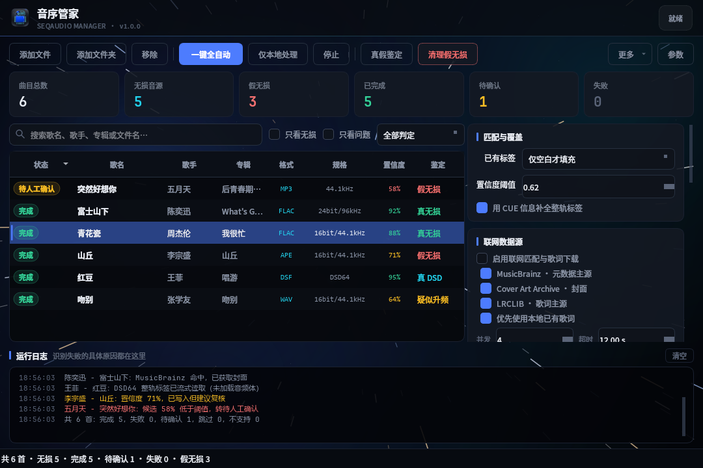
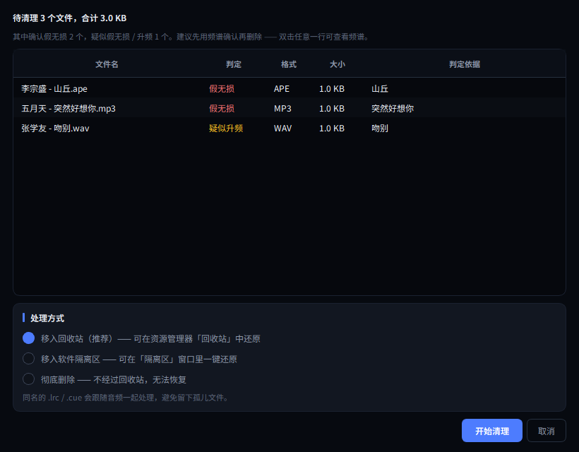
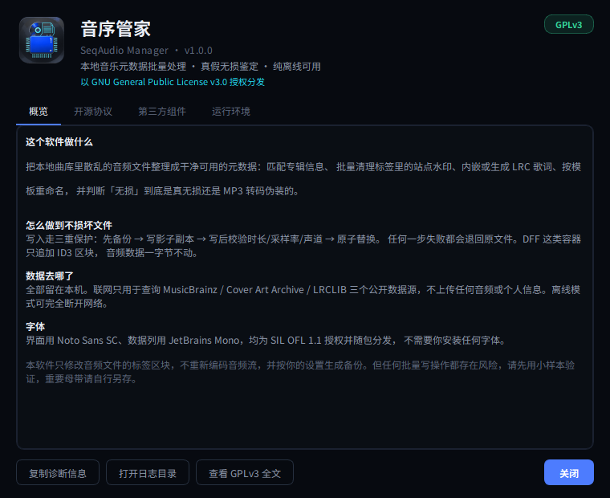

# 音序管家 · SeqAudio Manager

Windows 本地音乐元数据批量处理工具。批量导入 → 联网补全 → 清标签水印 → 安全写标签 → 批量重命名 → 导出报表，一键跑完。

面向本地音乐收藏玩家，**无损优先**：FLAC / APE / WAV / WV / TTA / ALAC / DSF / DFF 全部支持，只改标签区块、绝不重新编码音频。

进阶能力：

- **真假无损鉴定** —— 频谱分析判断「无损」是真无损还是 MP3 转码伪装的（含 DSD 专门判据）；
- **一键清理假无损** —— 判定可疑的文件移入回收站或软件隔离区，随时可还原，附频谱图可自行复核；
- **星空动态背景** —— 界面在宇宙中持续穿行，每 24 秒切换星区，可一键关闭省电。

> 授权：**GNU General Public License v3.0**。界面字体 Noto Sans SC / JetBrains Mono 为 SIL OFL 1.1，随包分发。

---

## 界面

主界面（1080×720，1366 笔记本的真实可用宽度）：



清理假无损 —— 默认送回收站，彻底删除需要额外勾选确认：



关于与开源协议（GPLv3 全文内嵌，离线可查）：



---

## 技术选型

| 层 | 选择 | 理由 |
|---|---|---|
| 语言 | Python 3.10+ | 音频标签生态最成熟，开发迭代快 |
| 标签引擎 | **mutagen** | 唯一同时覆盖 FLAC/APE/WV/TTA/DSF/DFF/MP4/ID3 的成熟库；`save()` 只替换标签区块，天然满足无损要求 |
| 界面 | **PySide6 (Qt 6)** | Qt 官方维护，Win10/11 高分屏与 125%/150% 缩放表现稳定；LGPL 授权，商业分发无负担 |
| 网络 | 标准库 `urllib` | 目标 API 都是简单 GET，无需 HTTP/2；少一层依赖就少一层 DLL 冲突，打包更小 |
| 频谱分析 | **numpy** + 内置 **ffmpeg** | 真假无损鉴定要解码后做 FFT；ffmpeg 是唯一能同时解 DSD/APE/WV/TTA 的方案，随包内置保证开箱即用 |
| 字体 | **Noto Sans SC** + **JetBrains Mono** | 均为 SIL OFL 1.1，可随软件分发与商用；系统自带的微软雅黑等字体不允许随包分发 |
| 压缩 | **py7zr** | 纯 Python 实现 7z，构建期用，不依赖外部 7-Zip |
| 打包 | **PyInstaller** + 自研 Qt 安装器 | PyInstaller 零编译依赖，装完即出包；本机无 Inno/NSIS，安装向导直接用 PySide6 写 |

被排除的方案：C# + TagLib#（DSD/TTA/WV 支持残缺、DFF 基本没有）、Rust + Tauri + lofty（DFF 仍需手写，周期过长）、C++ + Qt（维护成本高）。

---

## 目录结构

```
src/seqaudio/
├── app.py                  应用入口（高 DPI、主题、异常兜底、免责声明）
├── core/                   纯 Python 核心层，不依赖 Qt，可独立测试
│   ├── model.py            Track / Tags / AudioInfo / CueSheet / MatchCandidate
│   ├── tags.py             标签读写适配：VorbisComment / ID3 / APEv2 / MP4 四套体系
│   ├── probe.py            格式探测、技术参数、流式读取（4GB 文件不进内存）
│   ├── writer.py           安全写入：备份 → 影子副本 → 写后校验 → 原子替换
│   ├── cue.py              CUE 解析（UTF-8/UTF-16/GBK 编码自识别）
│   ├── watermark.py        标签水印清理（强规则整段清空 / 片段删除 / 自定义词）
│   ├── rename.py           模板重命名（非法字符、保留名、循环改名安全）
│   ├── lyrics.py           LRC 清洗、同步歌词判定、同名 .lrc 读写
│   ├── integrity.py        FLAC / DSDIFF 结构校验
│   ├── authenticity.py     真假无损鉴定（频谱截止 + 陡度 + 位深 + DSD 噪声整形）
│   ├── quarantine.py       隔离区：回收站 / 隔离 / 彻底删除，manifest 可还原
│   ├── uninstall.py        卸载：延时删除 + 数据迁移
│   ├── report.py           CSV 报表（UTF-8-SIG，Excel 直开不乱码）
│   ├── config.py           设置与预设方案持久化
│   ├── paths.py            绿色优先的目录解析（EXE 同级 → AppData 回落）
│   └── logging_setup.py    文件日志 + UI 实时日志双通道
├── net/                    联网数据源（全部开源平台）
│   ├── http.py             零依赖 HTTP：重试退避、按主机限流、熔断、磁盘缓存
│   ├── musicbrainz.py      元数据主源（Lucene 查询 + 发行版优选）
│   ├── coverart.py         封面源（体积与次数双重限制）
│   └── lrclib.py           歌词主源（精确匹配 → 模糊检索）
├── pipeline/
│   ├── matcher.py          多源聚合 + 置信度评分（简繁归一、版本惩罚）
│   └── processor.py        单首流程 + 批量调度 + 失败隔离
└── ui/
    ├── main_window.py      主窗口：表格、工具栏、日志、右键菜单、拖拽
    ├── space.py            星空背景：三层视差飞行 + 星区渐变切换
    ├── track_model.py      表格模型 + 筛选代理（无损 / 问题 / 鉴定结论）
    ├── delegate.py         自绘状态胶囊、等宽数字、选中高亮条
    ├── settings_panel.py   参数面板
    ├── cleanup.py          清理假无损 / 隔离区管理对话框
    ├── spectrum.py         频谱查看器（QPainter 绘制）
    ├── about.py            关于：协议全文、第三方组件、诊断信息
    ├── dialogs.py          标签编辑 / 候选选择 / 重命名预览
    ├── fonts.py            开源字体注册与选择
    ├── worker.py           QThread 包装，保证 UI 不阻塞
    ├── disclaimer.py       启动免责声明
    └── theme.py            半透明深色主题 QSS

installer/installer.py      安装向导（独立 Qt 应用，打包成 Setup.exe）
build.py                    构建：便携版 7z + 安装程序
```

---

## 图标

`assets/app.ico`（7 个尺寸：16/24/32/48/64/128/256）与 `assets/app.png`（512px）由
`tools/make_icon.py` 从源图生成：

```bash
python tools/make_icon.py --source 源图.jpg          # 生成正式图标
python tools/make_icon.py --source 源图.jpg --preview # 只出预览图，便于调参
```

处理做了三件事：

1. **抠透明底** —— 白色既是背景又是高光（芯片反光、唱片中心孔都接近纯白），
   按颜色一刀切会把高光一起抠掉。改用形态学填洞：从画面边界填背景，
   被图标围住的白自动保留；圆角外侧的装饰则用测出的圆角半径做几何裁剪清掉。
2. **配色映射到软件主题** —— 在 HSV 空间分区替换：青绿线条 → `#22d3ee`，
   亮蓝芯片 → `#4d7cfe`，灰蓝底板压暗去饱和向近黑靠拢。
   低饱和高光单独保护成中性灰，否则会变成一块突兀的蓝斑。
3. **各尺寸留白** —— 内容占画布 90%，四周透明，16px 下不至于贴边糊成一团。

## 开发与运行

```bash
pip install -r requirements.txt
python run.py
```

跑核心层自测（不启动界面）：

```bash
python tests/test_core.py
```

生成测试样本音频（纯字节构造，不需要 ffmpeg）：

```bash
python tests/make_samples.py
```

## 打包：安装版 + 便携绿色版

```bash
pip install pyinstaller py7zr

python build.py                  # 一次产出两个发行物（默认）
python build.py --target portable   # 只出便携版
python build.py --target installer  # 只出安装程序（会复用已有 .7z）
python build.py --target onefile    # 单个 EXE，仅用于快速自测
python build.py --debug             # 保留控制台窗口，排查启动异常
```

产物：

```
dist/音序管家-v1.0.0-x86-x64.7z            便携绿色版（解压即用，约 90 MB）
dist/音序管家-v1.0.0-x86-x64-Setup.exe     安装程序（约 90 MB）
```

**便携版**用 PyInstaller 的 onedir 模式再压成 7z。不用 onefile 的原因很实际：
onefile 每次启动都要把 250MB 内容解压到临时目录，首次要 3~5 秒；onedir 直接加载，
秒开。便携版的使用场景本来就是「解压到 U 盘直接跑」，目录结构更合适。

**安装程序**是一个用 PySide6 写的三页向导（欢迎/授权 → 选择目录 → 安装进度）：

- 装到 `%LOCALAPPDATA%\Programs\SeqAudioManager`，**不需要管理员权限**；
- 写 HKCU 卸载项，在「设置 → 应用」里能正常卸载；
- 桌面与开始菜单快捷方式可取消；
- 卸载由主程序 `--uninstall` 完成：先把 `data/`（配置、日志、**备份的原始音频**）
  移到 `%APPDATA%`，再删安装目录 —— 顺序反了备份就找不回来了；
- 安装包与便携版共用同一份 7z 载荷，一次压缩两处使用。

安装器的实现见 `installer/installer.py`，卸载逻辑见 `src/seqaudio/core/uninstall.py`。

### 为什么不恢复 Nuitka

Nuitka 编译版启动更快、误报更少，但本机走不通：Python 3.13 起 Nuitka 已禁用
`--mingw64`，必须用 MSVC；而 MSVC 探测依赖 `reg.exe`，被这台机器的安全策略拦截，
进程会静默卡死 20 分钟以上。如需 Nuitka 版本，请降到 Python 3.12 并安装
Visual Studio Build Tools。

---

## 真假无损鉴定

针对「拿 MP3 转码冒充无损」「44.1kHz 升频冒充高解析」这两类常见坑。

原理是有损编码必然砍高频，在频谱上留下悬崖：128kbps 切在 16kHz、320kbps 切在 20kHz，
而 CD 真无损平滑延伸到 22.05kHz。所以取 4 个时间点各解码 2 秒，做 FFT 后从 Nyquist
往回扫，找能量跌破阈值的点，再结合**下降陡度**与**有效位深**判定。

| 判定 | 含义 |
|---|---|
| 真无损 | 频谱平滑延伸到接近 Nyquist |
| 疑似假无损 | 在 20kHz 附近断崖截止（320kbps 转码特征） |
| 假无损 | 在 16~19kHz 截止（128/192kbps 转码特征） |
| 疑似升频 | 采样率很高但带宽利用率不足 55% |
| 真 DSD / 疑似假 DSD | 见下 |

**DSD 的判据和 PCM 完全不同**：真 DSD 会把量化噪声整形到超声区，40kHz 以上能量
高达 -14dB（实测数据），而 20~40kHz 反而是个 -60dB 的「谷」。所以 DSD 只看 40kHz 以上，
用 20kHz 附近判断会把所有真 DSD 判成假的。

**验证过的样本**（同一段音乐）：

```
真无损 WAV 44.1k    → 真无损      截止 21.7kHz / 上限 22.1kHz
128kbps 转码        → 假无损      截止 16.1kHz
320kbps 转码        → 疑似假无损  截止 20.0kHz（陡度 6dB/kHz）
44.1k 升频到 96k    → 疑似升频    截止 23.3kHz / 上限 48.0kHz（带宽利用率 49%）
真 DSD64 母带       → 真 DSD      40kHz 以上能量 -14dB
```

速度约 0.3~1 秒/首（4 次解码并行），一千首约 5 分钟。

## 安全设计（无损部分最关键）

写入流程做了三层保护，任何一层失败都不会留下损坏文件：

1. **备份**：原文件先复制到 `backup/`，保留原盘符与目录结构；
2. **影子副本**：常规文件复制出 `*.seqaudio.tmp`，标签只写在副本上；≥2GB 的大文件改为「原地写入 + 异常自动从备份恢复」，避免双份拷贝撑爆磁盘；
3. **写后校验**：重开副本比对时长 / 采样率 / 声道数，确认音频流未被截断，才 `os.replace` 原子替换。

任何环节抛异常 → 删除副本 → 原文件一个字节都没动。

## 匹配准确性

置信度 = 源相关度 34% + 标题相似度 28% + 歌手 20% + 专辑 10% + 时长 8%，低于 62% 不自动写入，转入「待人工确认」。

针对中文曲库与无损资源的专门处理：

- **简繁归一**：MusicBrainz 中文条目多为繁体（陳奕迅 / 富士山下），不归一会导致相似度偏低；
- **版本惩罚**：候选专辑名含「演唱会 / Live / Remix / 伴奏」等而本地曲目没有时扣分；
- **伪专辑名过滤**：`[unknown]`、`[unknown xxx bootleg release]` 这类社区占位名不会被写进标签；
- **目录专辑先验**：`周杰伦 -七里香 DSD DFF` 这种目录名会被解析出专辑名「七里香」，命中候选直接加分 —— 否则整批曲目会被 MusicBrainz 分散匹配到演唱会版、精选集、重发版；
- **专辑一致性收敛**：同一目录的曲目在写入前按多数投票统一专辑名与年份，避免「一张专辑十个年份」；
- **文件名拆解**：`歌手 - 02.歌名` 会拆成 歌手 / 轨号 / 歌名 三段，而不是把轨号并进歌名拖低检索准确率。

## 网络健壮性

- MusicBrainz 严格 1.1s/次限流（官方要求），LRCLIB 1.2s，其余按主机分别计时；
- 429 / 5xx 指数退避重试，404 立即失败不浪费配额；
- **熔断**：某源连续失败 3 次后冷却 180 秒（封面源 2 次 / 300 秒），避免 1000 首的批量任务被单个失效源拖成几小时；
- 检索结果落盘缓存（默认 30 天），重复曲目不重复请求。

---

## 功能完成度

**P0（已实现）**
- 全格式导入解析、流式读取、无损/采样率/位深展示与筛选
- MusicBrainz 元数据 + Cover Art Archive 封面 + LRCLIB 歌词
- 标签水印清理、模板重命名、CSV 报表
- 安全写入（不重编码 + 备份 + 回滚 + 写后校验）
- CUE 解析与整轨标签补全（模式 1）、GBK/UTF-16 乱码修复
- 数据源优先级、限流、熔断、缓存

**P1+（已实现）**
- 真假无损鉴定 ✅（频谱截止 + 陡度 + 有效位深 + DSD 噪声整形判据）
- 一键清理假无损 ✅（回收站 / 隔离区 / 彻底删除三级，隔离区可还原）
- 频谱查看器 ✅（曲线 + 截止标记 + 判定依据，可自行复核）
- 按鉴定结论筛选 ✅ / 鉴定结果进 CSV 报表 ✅
- 星空动态背景 ✅（5 星区循环、视差飞行、可关闭）

**P1（部分已实现）**
- 多源聚合置信度评分 ✅
- 封面管理 ✅（替换/清除，导出未做）
- 标签乱码修复 ✅（读取时按编码探测）
- FLAC 结构校验 ✅（深度 MD5 需系统装 flac.exe）
- 预设方案 ✅ / CSV 报表 ✅
- AcoustID 音频指纹 ⬜（接口已预留 `acoustid_key`）
- CUE 分轨导出（模式 2）⬜

**P2（未实现）**
- 音频人声水印降噪、转码、任务断点续处理

## 已知限制

- DFF（DSDIFF）标签写入走 `tags.save()` 追加 ID3 chunk 的路径（mutagen 只是没在 `DSDIFF` 类上暴露 `save()`）。已实测：142MB 母带只增加约 1.2KB，DSD 音频块一字节未动，FRM8 声明长度与实际文件大小始终一致；
- 老国产播放器的 GBK 标签：ID3 无 GBK 标准，兼容模式采用 v2.3 + UTF-16（业界通行做法，兼容性最好）；
- 加密格式（ncm/qmc/kgm）不做解密，导入时直接标记跳过。

## 授权与致谢

本项目以 **GNU General Public License v3.0**（`GPL-3.0-or-later`）发布，协议全文见
`LICENSE`。这意味着你可以自由使用、修改、再分发；如果分发修改版，需要同样以
GPLv3 提供源代码。

第三方组件与字体授权见 `THIRD-PARTY.md`，字体授权全文在 `assets/fonts/` 下。
软件内「关于 → 开源协议」也能离线查看完整文本。

## 法律边界

仅用于整理用户本人合法拥有或已获授权的音频。启动时强制展示免责声明并需勾选确认。歌词版权归原词曲权利人，本软件不存储、不分发歌词内容。
