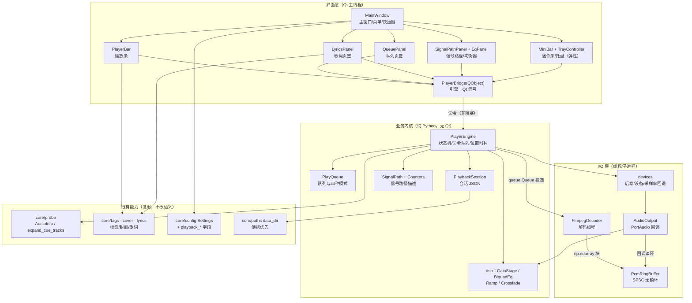
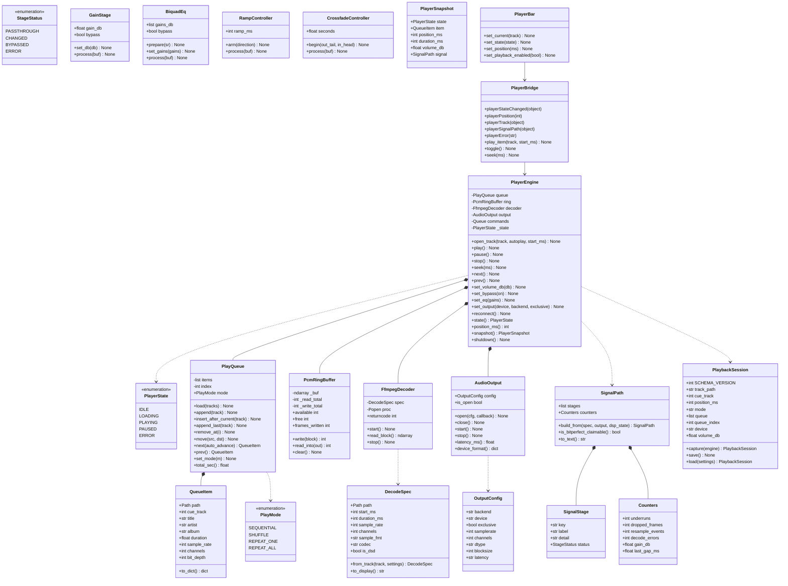
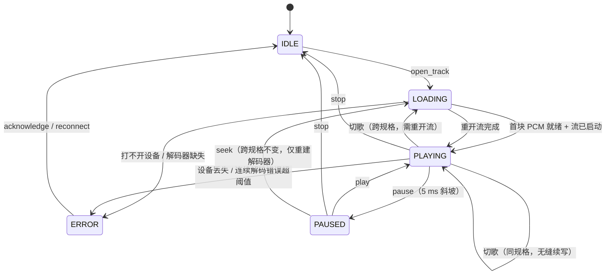
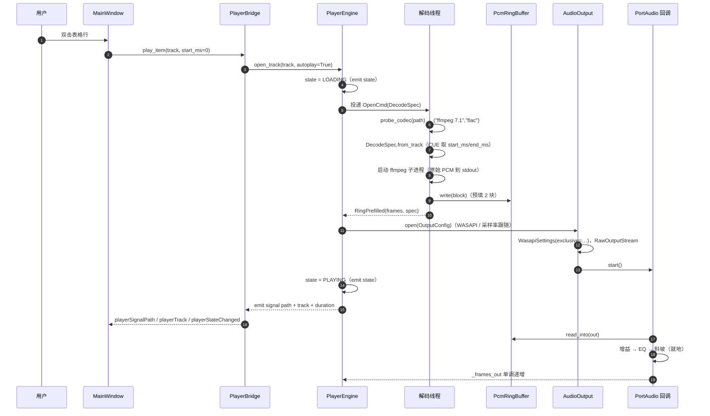
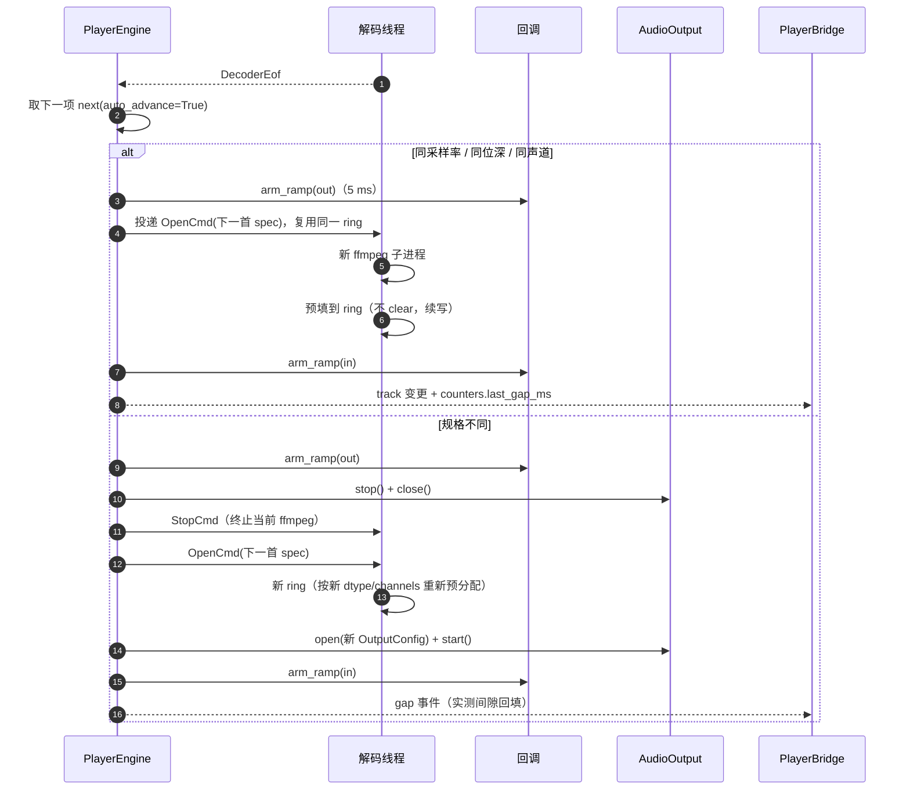
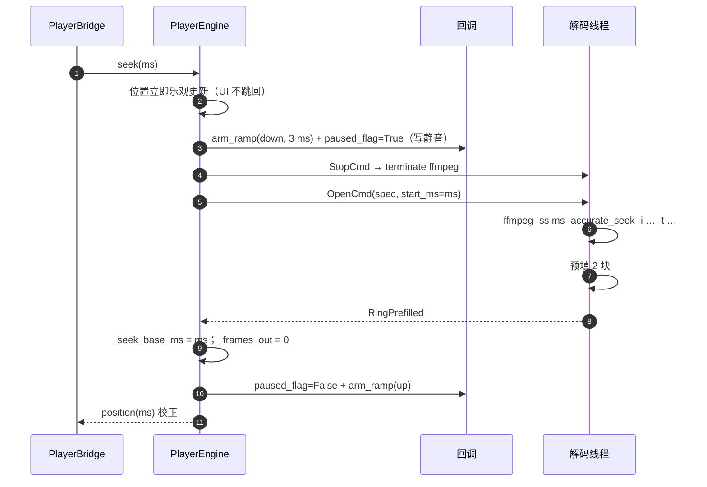
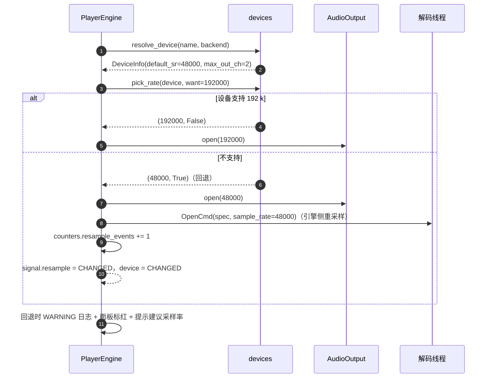
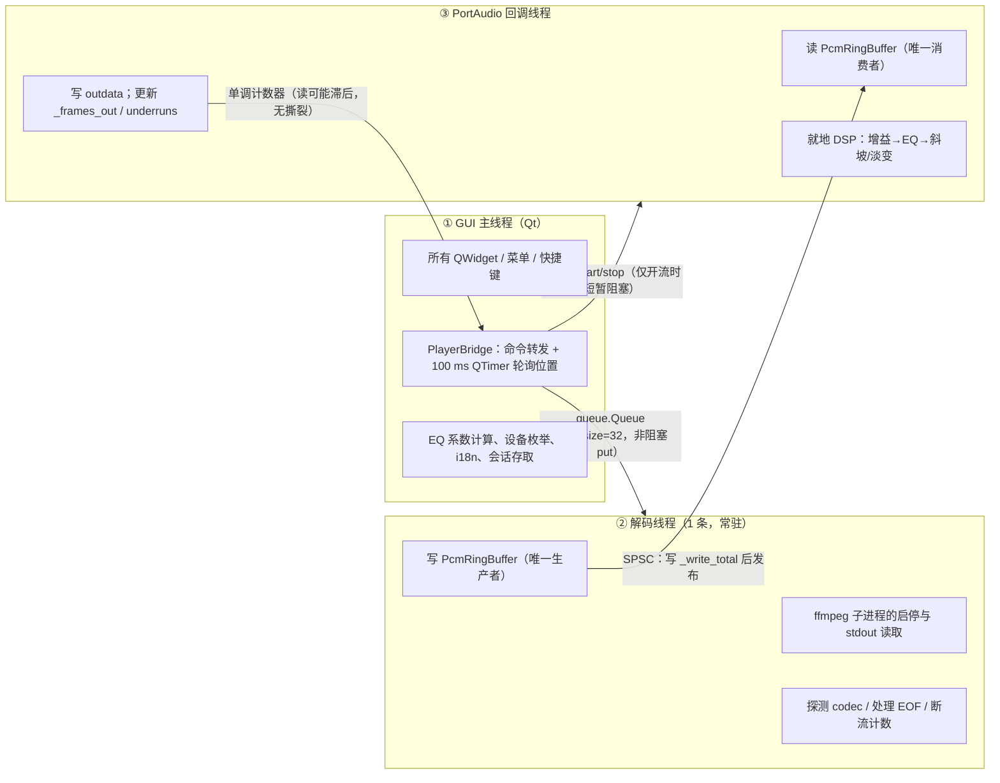

# v1.6 架构设计（播放能力）

> 上游依据：`docs/1.6-需求范围.md`（唯一范围依据）、`spec.md` 的「v1.6（播放能力）」章节。
> 基线代码：v1.5.8（Python 3.13 + PySide6 6.12，`src/seqaudio/`，约 21k 行）。
> 本文只做设计与任务拆分，不含业务实现代码；出现的代码块均为**签名/伪代码/常量定义**。
>
> 三条硬约束（不推翻）：① 单一技术路径 `ffmpeg 子进程 → 原始 PCM 管道 → numpy 环形缓冲 → sounddevice/PortAudio`；② 不引入 SQLite，曲库仍是内存列表 + 记住根目录；③ DSP 固定链 `解码 → 整数/浮点 → 音量 → 10 段 EQ → 输出`，唯一可插拔模块是 EQ。

---

## 一、总体架构

### 1.1 分层

播放内核与现有元数据工具**同进程、同 Settings、同一份曲目列表**，通过一层薄桥接（`PlayerBridge`）接入 Qt 事件循环。`player/` 包**不允许 import PySide6**，这是可测性与线程纪律的硬边界。



### 1.2 共存原则

| 关注点 | 结论 |
|---|---|
| 进程 | 同一个 EXE、同一个 `QApplication`。播放不另起进程（除 ffmpeg 解码子进程） |
| 配置 | 同一个 `Settings` 单文件 JSON，新增 `playback_*` / `library_*` 键段；旧配置读新版本自动兼容（`from_dict` 白名单过滤） |
| 曲目列表 | 播放队列是 `Track` 的**引用**，不复制、不改 `working` 标签；队列面板展示用轻量 `QueueItem` 快照，避免大库内存翻倍 |
| 主题/字体 | 播放条、队列、歌词、迷你条全部用 `ui/theme.py` 的常量与 QSS objectName，不写死颜色 |
| i18n | 新增词条并入 `ui/i18n.py` 的 `_TRANSLATIONS`，键前缀 `play_* / sig_* / eq_* / pl_* / lyr_*`；缺译回退简体中文 |
| 现有 worker | 播放线程与 `ScanWorker/ProcessorWorker/…` 完全无共享状态；批处理期间播放**暂停且禁止起播**（R8） |
| 打包 | 只多一个 `_sounddevice_data` 二进制目录与 `sounddevice` 隐式导入（见第八节） |

---

## 二、模块划分与文件清单

### 2.1 新增文件

| # | 相对路径 | 职责 | 关键类/函数（对外接口） |
|---|---|---|---|
| 1 | `src/seqaudio/player/__init__.py` | 包出口，只导出稳定接口 | `PlayerEngine, PlayerState, PlayQueue, PlayMode, SignalPath, PlaybackSession` |
| 2 | `src/seqaudio/player/constants.py` | 跨文件共享常量（采样率、块大小、EQ 频点、后端键、事件名） | 见第十节；模块级常量为主，枚举用 `enum.StrEnum`（≥3.11，本机 3.13 可用） |
| 3 | `src/seqaudio/player/ringbuffer.py` | 单生产者/单消费者 PCM 环形缓冲，预分配 | `PcmRingBuffer(capacity_frames, channels, dtype)`；`write(block)->int`、`read_into(out)->int`、`clear()`、`available`、`free`、`frames_written` |
| 4 | `src/seqaudio/player/decoder.py` | ffmpeg 子进程封装：参数构造、块读取、EOF/断流、codec 探测、DSD 分支 | `DecodeSpec.from_track(track, settings)`；`FfmpegDecoder(spec)`：`start()/read_block()->np.ndarray|None/stop()/returncode`；`probe_codec(path)->tuple[str,str]`（返回 `("ffmpeg 7.1","flac")`） |
| 5 | `src/seqaudio/player/devices.py` | 设备枚举、后端解析、采样率回退链、设备指纹 | `list_devices()->list[DeviceInfo]`；`resolve_device(name, backend)->DeviceInfo`；`resolve_backend(key)->int`；`pick_rate(device, want)->tuple[int,bool]`（bool=是否发生回退） |
| 6 | `src/seqaudio/player/output.py` | PortAudio 流生命周期，回调注册，错误→异常映射 | `OutputConfig`；`AudioOutput.open(cfg, callback)/close()/start()/stop()/latency_ms()/device_format()`；异常 `DeviceBusyError`、`DeviceLostError`、`RateUnsupportedError` |
| 7 | `src/seqaudio/player/dsp.py` | 固定链处理：增益、10 段 biquad EQ、斜坡、交叉淡变、整数通路判定 | `GainStage`、`BiquadEq(settings)`（`prepare(sr)`、`process(buf)`、`set_gains(list)`）、`RampController`、`CrossfadeController`、`int_pipeline_allowed(dsp_state)->bool` |
| 8 | `src/seqaudio/player/queue.py` | 队列模型与四种播放模式、插入接口 | `QueueItem`；`PlayMode`（`SEQUENTIAL/SHUFFLE/REPEAT_ONE/REPEAT_ALL`）；`PlayQueue`：`load(list)/append/insert_after_current/append_last/remove_at/move/clear/next(auto_advance)->QueueItem|None/prev()/set_mode(m)/total_sec()` |
| 9 | `src/seqaudio/player/signal_path.py` | 信号路径 9 级描述 + 计数器，供面板与日志 | `StageStatus`（`PASSTHROUGH/CHANGED/BYPASSED/ERROR`）；`SignalStage`；`Counters`；`SignalPath(stages, counters)`；`build_from(...)` |
| 10 | `src/seqaudio/player/session.py` | 会话 JSON 读写与版本迁移 | `PlaybackSession`：`capture(engine)`、`save()`、`load(settings)->PlaybackSession|None`、`to_dict/from_dict`、`SCHEMA_VERSION=1` |
| 11 | `src/seqaudio/player/engine.py` | 门面：状态机、命令队列、位置时钟、seek/切歌/开流、事件回调 | `PlayerState`；`PlayerSnapshot`；`PlayerError`；`PlayerEngine(settings, on_event)`：`open_track/play/pause/stop/seek/next/prev/set_volume_db/set_bypass/set_eq/set_output/reconnect/shutdown`、`state()/position_ms()/snapshot()` |
| 12 | `src/seqaudio/player/playlist_io.py`（弹性） | m3u/m3u8 导入导出、编码探测、绝对/相对互转 | `read_m3u(path)->list[Path]`；`write_m3u8(queue, path, base)->int` |
| 13 | `src/seqaudio/core/search_key.py`（弹性） | 首字母/拼音降级检索键（无第三方库） | `initials(text)->str`；`match_key(text)->str` |
| 14 | `src/seqaudio/ui/player_bridge.py` | 引擎↔Qt 的唯一通道：命令转发 + 信号发射 + 100 ms 位置轮询 | `PlayerBridge(QObject)`：信号 `playerStateChanged(object) / playerPosition(int) / playerTrack(object) / playerSignalPath(object) / playerQueueChanged(int) / playerGap(float) / playerError(str)`；槽/方法 `play_item(track, start_ms)`、`toggle()`、`seek(ms)`、`set_volume_db(db)`、`set_enabled(bool)` |
| 15 | `src/seqaudio/ui/player_bar.py` | 底部播放条：封面/曲目/进度/音量/模式/信号路径开关/设备标识 | `PlayerBar(QWidget)`：`set_current(track)`、`set_state(state)`、`set_position(ms)`、`set_duration(ms)`、`set_signal_badge(path)`、`set_playback_enabled(bool)` |
| 16 | `src/seqaudio/ui/player_queue.py` | 队列页签：QTableView + 自定义 model，支持拖拽排序/删除/清空/总时长 | `QueueTableModel(QAbstractTableModel)`；`QueuePanel(QWidget)`：`set_queue(queue)`、`refresh()`、信号 `playRequested(int)` |
| 17 | `src/seqaudio/ui/player_lyrics.py` | 歌词页签：LRC 解析、逐行高亮、±10 s 偏移、纯文本降级 | `LyricsPanel(QWidget)`：`load_for(track)`、`set_position(ms)`、`set_offset_ms(ms)`；内部 `parse_lrc(text)->list[tuple[int,str]]` |
| 18 | `src/seqaudio/ui/player_signals.py` | 信号路径面板：9 级 + 计数器，不可拖拽，回退标红 | `SignalPathPanel(QWidget)`：`set_path(path)` |
| 19 | `src/seqaudio/ui/player_eq.py`（弹性） | 10 段 EQ 滑块 + A/B 快照 + 预设 | `EqPanel(QWidget)`：`set_gains(list)`、`gains()`、信号 `gainsChanged(list)`、`abSwitched(str)` |
| 20 | `src/seqaudio/ui/player_mini.py`（弹性） | 迷你条（无边框置顶小窗）+ 托盘菜单 | `MiniBar(QWidget)`；`TrayController(QObject)`：`attach(main_window)`、菜单四项 |
| 21 | `tests/test_player_pipeline.py` | 环形缓冲/DSP/解码参数的单测（无需设备） | — |
| 22 | `tests/test_player_engine.py` | 队列/状态机/会话/信号路径的单测（Fake Output） | — |
| 23 | `tests/e2e_audio_smoke.py` | 打包冒烟：列设备 + 播静音 1 s + 退码 0 | — |
| 24 | `docs/1.6-发版检查清单.md` | 便携版/安装版冒烟项（R1 前置检查） | — |

### 2.2 修改文件（仅列改动点，不与新文件职责重叠）

| 相对路径 | 改动点 |
|---|---|
| `src/seqaudio/core/config.py` | `Settings` 追加 `playback_*`（31 个）与 `library_*`（3 个）字段，默认值见第七节 |
| `src/seqaudio/core/paths.py` | 新增 `session_path()` → `data_dir()/"playback_session.json"` |
| `src/seqaudio/ui/i18n.py` | `_TRANSLATIONS` 追加播放词条；`tr_*` 体系不变 |
| `src/seqaudio/ui/main_window.py` | 布局插入播放条；右侧页签加「队列/歌词」；双击播放；快捷键；批处理互斥；`_attach_player_extras()` 空钩子；退出保存会话；`apply_language` 增加播放区刷新 |
| `src/seqaudio/ui/settings_panel.py` | 新增「播放」页（4 张卡：输出/DSP/播放行为/曲库），`load_from`/`apply_to` 双向补齐 |
| `src/seqaudio/ui/track_model.py`（弹性） | `TrackFilterProxy` 增加首字母匹配；`COLUMNS` 增加「最近播放」排序键 |
| `src/seqaudio/ui/spectrum.py`（弹性） | FFT 长度（2048/8192/32768）与窗函数（汉宁/汉明/布莱克曼）下拉 + 导出 PNG |
| `src/seqaudio/app.py` | 引擎随 `MainWindow` 创建/销毁；`--audio-smoke` 隐藏 CLI 开关（打包冒烟用） |
| `src/seqaudio/__init__.py` | `__version__ = "1.6.0"` |
| `build.py` | `_pyinstaller_common` 收集 `sounddevice` / `_sounddevice_data`；排除 32 位与 ASIO DLL |
| `requirements.txt` / `pyproject.toml` | 加 `sounddevice>=0.5.6` |
| `README.md` | 回填逐格式实测结果（WP1 验收副产物） |

### 2.3 依赖方向（禁止反向）

```
ui/player_*.py  →  player/*        （允许）
player/engine.py →  core/probe, core/config, core/model, core/paths （允许）
player/*        →  ui/*            （禁止）
player/*        →  PySide6          （禁止）
core/*          →  player/*        （禁止；config 只加字段，不认识引擎）
```

---

## 三、核心数据结构

### 3.1 类图



### 3.2 播放状态机（本期裁剪）

PRD 表 7-1 的 6 态裁到 5 态 + 1 异常态，砍掉 `Draining`（本期停止是「斜坡→关流→IDLE」，无独立排空态）与 `Ready`（并入 `PAUSED`：已开流未出声即暂停语义相同）。



| 状态 | 语义 | UI 表现 |
|---|---|---|
| `IDLE` | 无当前曲目 | 播放条灰显，进度 0 |
| `LOADING` | 正在开流/预填缓冲，未出声 | 按钮显示「载入中」，禁用 seek |
| `PLAYING` | 回调在持续消费 | 进度走，位置 100 ms 刷新 |
| `PAUSED` | 流未关，回调写静音 | 按钮显示「播放」，进度停 |
| `ERROR` | 设备/解码不可恢复 | 播放条红条 + 提示 + 「重新连接」按钮 |

> 状态只由 `PlayerEngine` 单点写入（含解码线程与回调线程上报的两个布尔量），UI 只读 `snapshot()`。

### 3.3 信号路径各级

固定 9 级，顺序不可变（FR-DSP-001 的"顺序显式且不可拖拽"由此天然满足）：

| key | 级别 | detail 示例 | status 判定 |
|---|---|---|---|
| `source` | 源文件 | `FLAC · 24bit/96kHz · 2ch · 03:41` | 恒 `PASSTHROUGH` |
| `decode` | 解码器 | `ffmpeg 7.1 · flac`；DSD：`ffmpeg 7.1 · dsd_lsbf → 176400 Hz` | 恒 `PASSTHROUGH` |
| `format` | 样本格式 | `s24le · 2ch · 96000 Hz` / `f32le` | 整数通路 `PASSTHROUGH`；进浮点 `CHANGED` |
| `gain` | 音量 | `0 dB 旁路（无软件增益）` / `-6.0 dB 浮点` | `BYPASSED` / `CHANGED` |
| `eq` | 均衡器 | `旁路` / `10 段 · 峰值 ±12 dB` | `BYPASSED` / `CHANGED` |
| `fade` | 淡变/无缝 | `无` / `交叉淡变 3.0 s（非位完美）` / `切歌斜坡 5 ms` | `BYPASSED` / `CHANGED` |
| `resample` | 重采样/声道 | `未重采样 · 声道直通` / `重采样 44100→48000` / `下混 5.1→2.0` | `PASSTHROUGH` / `CHANGED` |
| `output` | 输出后端 | `WASAPI 独占 · 扬声器 (Realtek(R) Audio)` | 打不开时 `ERROR` |
| `device` | 设备上报格式 | `44100 Hz · 2 ch · 24 bit · 延迟 40 ms` | 采样率回退时 `CHANGED` |

计数器（`Counters`）：`underruns`、`dropped_frames`、`resample_events`、`decode_errors`、`gain_db`、`last_gap_ms`。

> **措辞铁律（R2）**：全 `PASSTHROUGH` 时界面文案是「**未做软件改动**」，绝不出现"bit-perfect 已验证 / 逐样本一致"。`SignalPath.is_bitperfect_claimable()` 只用于决定是否显示「未做软件改动」标签。

### 3.4 EQ 预设

- 频点：ISO 倍频程 `31/62/125/250/500/1k/2k/4k/8k/16k` Hz，`Q = 1.41`，范围 ±12 dB，步进 0.5 dB。
- 预设（`playback_eq_preset`）：`flat`（全 0）、`custom`（用户手调）、`A`/`B`（两套快照，FR-DSP-002 的 A/B 即时切换）。
- 系数在 **GUI 线程**算好、以不可变 tuple 形式整体替换引用；回调只读取当前引用，绝不计算系数、绝不做三角函数。

### 3.5 队列项

`QueueItem` 是 `Track` 的**轻量投影**（path / cue_track / 标题 / 歌手 / 专辑 / 时长 / 规格），用于：
1. 队列面板 500+ 行渲染与滚动（不碰 `Track` 的几十个字段）；
2. 会话恢复时秒级重建队列（不需要逐首 `probe`）；
3. 真播放时才按 `path + cue_track` 从 `TrackTableModel` 反查完整 `Track`，查不到再 `probe`。

---

## 四、关键时序

### 4.1 起播（冷启动 → 出声）



关键量化约束：`RING_SECONDS = 2.0`、`PREFILL_BLOCKS = 2`、`BLOCK_FRAMES = 1024`。实测基线（主理人已验）：44.1 k 立体声、块 1024，**起播 104 ms、欠载 0**。

### 4.2 切歌（同规格无缝 / 跨规格重开流）



`last_gap_ms` 是**如实记录**的实测值，不做承诺（FR-PL-003 明确"≤20 ms 属需实测指标"）。

### 4.3 seek



CUE 分轨的 `start_ms` 来自 `CueTrack.start_ms`（已由 `core/cue.py` 提供），`duration_ms = end_ms - start_ms`；精度按 R5 放宽到 **≤50 ms** 验收。

### 4.4 采样率跟随与回退



回退链：**源采样率 → 设备默认率 → 48000 → 44100 → 放弃并报错**（FR-OUT-002）。DSD 例外：固定请求 `playback_dsd_pcm_rate`（默认 176400），同样走回退链。

---

## 五、线程模型

### 5.1 三条执行边界



### 5.2 跨线程数据与同步方式

| 数据 | 生产者 → 消费者 | 同步手段 | 理由 |
|---|---|---|---|
| 命令（open/pause/seek/…） | GUI → 解码线程 | `queue.Queue(maxsize=32)`，`put_nowait` 失败即丢弃并记 WARNING | 阻塞 GUI 是绝对禁止项 |
| PCM 数据 | 解码线程 → 回调 | **无锁 SPSC**：预分配 `np.ndarray` + `_read_total` / `_write_total` 两个单调计数；写者先写数据再更新 `_write_total`，读者先读 `_write_total` 再拷数据 | 回调内不得加锁（R4）；单生产者单消费者天然安全 |
| `paused_flag` / `stream_alive` | GUI → 回调 | 普通 `bool` 属性赋值（CPython 单字节码写，引用替换原子） | 只有读/写，无复合操作 |
| DSP 系数（EQ） | GUI → 回调 | 整体替换不可变 `tuple` 引用 | 回调只读引用，不做计算 |
| 状态/位置/信号路径 | 引擎 → GUI | `snapshot()` 只读快照 + `PlayerBridge` 100 ms 轮询 + 事件回调转 Qt 信号 | Qt 信号跨线程发射自动排队，UI 不在音频线程被调用 |
| 队列 | GUI 独占修改，解码线程只收「下一项」快照 | 引擎把 `QueueItem` 深拷贝后投递 | 避免两边同时改同一列表 |

### 5.3 回调里绝对不能做的事（写进代码注释与 review checklist）

1. **不分配内存**：唯一允许的是 `np.frombuffer(outdata)` 产生的一个**视图对象**（不复制数据）；不得 `np.zeros` / `np.empty` / 列表推导 / 字符串拼接。
2. **不加锁**：不 `with lock:`、不 `queue.Queue.get()`、不 `Event.wait()`。
3. **不做 I/O**：不 `logging.*`（严重时也是把字符串预先格式化好再置标志位），不 `print`，不读写文件/网络。
4. **不调 Qt**：不 `emit`（信号发射本身会分配，交回 GUI 线程轮询）。
5. **不抛异常**：整个回调体包在 `try/except BaseException`，异常只置 `self._cb_error` 标志并写静音，由解码线程/GUI 线程读取后转成 `playerError`。
6. **不做数学重活**：系数、增益线性值、斜坡步进全部预先算好。
7. **不改状态机**：状态迁移只由引擎写；回调最多上报"欠载/EOF/设备错误"三个标志。

### 5.4 欠载与过载

- 回调取到的帧数 `n < frames` → 余下写 0，`counters.underruns += 1`，记录 `last_underrun_ms`。
- 连续欠载 > 20 次且间隔 < 2 s → 引擎自动把 `playback_buffer_ms` 临时抬到 120 ms（下次开流生效）并 WARNING 提示（R4 的兜底，不静默）。
- 解码侧 `ring.free < block_frames` 时短暂自旋等待（`time.sleep(0.002)`），超 500 ms 视为解码停滞 → 记 `decode_errors` 并跳过。

---

## 六、与现有界面的整合点

### 6.1 主窗口布局变更（最小侵入）

```
BackdropWidget
└─ QVBoxLayout root
   ├─ BrandBar                          （不动）
   └─ body (QVBoxLayout)
      ├─ _build_action_bar()            （不动）
      ├─ _build_stat_row()              （不动）
      ├─ QSplitter (Horizontal)
      │   ├─ _build_table_area()        （不动，仅换 doubleClicked 槽）
      │   └─ right_tabs                 ← 新增 2 个页签
      │       ├─ [0] InspectorPanel 「详情」   （不动）
      │       ├─ [1] QueuePanel      「队列」   ← 新增
      │       ├─ [2] LyricsPanel     「歌词」   ← 新增
      │       └─ [3] SettingsPanel   「参数」   ← 原 index 1，后移
      ├─ SignalPathPanel（可折叠）       ← 新增，默认折叠
      ├─ PlayerBar                       ← 新增，位于日志区之上
      ├─ _build_log_area()               （不动）
      ├─ progress                        （不动）
      └─ QStatusBar                      ← 追加「独占」常驻标识（R9）
```

> `right_tabs` 的 index 变化会影响 `_show_settings_tab(1)` 一处调用，必须同步改为按 widget 定位（`self.right_tabs.setCurrentWidget(self.settings_panel)`），避免写死索引。

### 6.2 交互接入点

| 接入点 | 现状 | 变更 |
|---|---|---|
| 表格双击 | `doubleClicked → edit_selected` | 改为 `_play_current_row()`（FR-UI-001 要求双击播放）；编辑标签保留 Ctrl+E 与右键菜单 |
| 表格右键菜单 | 已有 12 项 | 追加「播放」「下一首播」「稍后播放」「加入队列」，置顶分组 |
| 工具栏 | 无播放按钮 | **不新增**（R8：不改动现有工具栏顺序）；播放入口只在播放条与右键菜单 |
| 播放条 | 无 | 单行 56 px：封面 32×32 · 曲目/歌手 · 进度 · 时间 · 播放/暂停 · 上/下 · 音量 · 模式 · 信号路径开关。默认**折叠为 56 px 单行**，可整条关闭（R8） |
| 快捷键 | 空格未占用 | 空格=播放/暂停，`Ctrl+←/→`=上/下一首，`Ctrl+↑/↓`=音量 ±1 dB，`Ctrl+L`=歌词页签（FR-UI-006） |
| 命令面板 | `show_command_palette` | 追加 5 条播放命令 |
| 批处理互斥 | `_set_running(bool)` | `running=True` 时：若在播则 `pause()` + 日志「批处理进行中，已暂停播放」；`player_bar.set_playback_enabled(False)` |
| 退出 | `closeEvent` → `_save_view_state()` | 追加 `session.capture(engine).save()` 与 `engine.shutdown()`（先关流再退，避免 PortAudio 卸载噪音） |
| 语言切换 | `apply_language` 刷新整棵树 | `localize_tree` 已覆盖新控件；额外调用 `_apply_playback_i18n()` 更新动态文案（播放中/独占/回退） |
| 设置面板 | 4 页 | 新增第 5 页「播放」，4 张 Card：输出 / DSP / 播放行为 / 曲库 |
| 曲库根记忆 | 无 | `settings.library_roots` 保存；启动时 `library_autoload=True` 则后台 `ScanWorker` 静默载入，状态栏说明来源（R10） |

### 6.3 与既有 worker 不打架的三条规则

1. **不共享可变对象**：引擎只持有 `QueueItem` 快照；`ProcessorWorker` 改 `Track.working` 时，引擎正在播的曲目不受影响（它只认 `path + start_ms`）。
2. **不抢 Qt 事件循环**：引擎的所有跨线程通信都走 `queue.Queue` 与只读快照；`PlayerBridge` 只在 GUI 线程被调用。
3. **磁盘与 CPU 让路**（R11）：播放中把 `CoverWorker`/`SplitCueWorker`/`AuthenticityWorker` 的 `max_workers` 降为 `max(1, settings.concurrency - 2)`；实现点在各 worker 的构造参数，不改其内部逻辑。

### 6.4 弹性接口契约（防两个任务改同一文件打架）

`MainWindow` 预留给弹性项的三个空壳方法，**由 T04 建立、T05 填充**，签名一旦定下不得改：

```python
def _attach_player_extras(self) -> None:      # T05：挂 MiniBar / TrayController
def _apply_playback_i18n(self) -> None:       # T05/T04：刷新播放区动态文案
def _on_player_gap(self, gap_ms: float) -> None:  # T05：无缝/淡变间隙回填与提示
```

---

## 七、配置扩展（`Settings` 新增字段）

遵守 PRD 表 5-13 的关键默认值：**输出模式 WASAPI 共享**、**采样率跟随开**、**DSP 全旁路**、**软件音量固定 0 dB 旁路**、**标签写回关**。

### 7.1 播放段（`playback_*`，31 个）

| 字段 | 类型 | 默认值 | 含义 |
|---|---|---|---|
| `playback_enabled` | `bool` | `True` | 播放功能总开关；关闭后播放条与播放入口全部隐藏 |
| `playback_bar_visible` | `bool` | `True` | 播放条显示（折叠态 = 56 px 单行） |
| `playback_signal_panel_visible` | `bool` | `False` | 信号路径面板展开态 |
| `playback_output_backend` | `str` | `"wasapi"` | `wasapi` / `directsound` / `mme` / `wdmks` |
| `playback_exclusive` | `bool` | `False` | WASAPI 独占（R3：可选而非默认） |
| `playback_device` | `str` | `""` | 设备名，空 = 系统默认 |
| `playback_follow_source_rate` | `bool` | `True` | 采样率跟随（FR-OUT-002） |
| `playback_dsd_pcm_rate` | `int` | `176400` | DSD→PCM 目标率，可选 88200/176400/352800 |
| `playback_bit_perfect` | `bool` | `False` | 位完美模式（强制率/位深=源 + 音量 1.0 + 空 DSP） |
| `playback_volume_mode` | `str` | `"bypass"` | `bypass`（固定 0 dB）/ `software`（浮点音量） |
| `playback_volume_db` | `float` | `0.0` | 软件音量 dB，`-60.0` 视为静音 |
| `playback_block_frames` | `int` | `1024` | 回调块帧数 |
| `playback_buffer_ms` | `int` | `80` | 目标缓冲深度（40 为下限，R4） |
| `playback_dsp_bypass` | `bool` | `True` | 全局直通（FR-DSP-002） |
| `playback_eq_enabled` | `bool` | `False` | EQ 模块启用（与 bypass 互斥） |
| `playback_eq_gains` | `list[float]` | `[0.0]*10` | 10 段增益 dB |
| `playback_eq_preset` | `str` | `"flat"` | `flat` / `custom` / `A` / `B` |
| `playback_eq_snapshot_a` | `list[float]` | `[0.0]*10` | A/B 快照 A |
| `playback_eq_snapshot_b` | `list[float]` | `[0.0]*10` | A/B 快照 B |
| `playback_gapless` | `bool` | `True` | 同规格无缝续写 |
| `playback_crossfade_sec` | `float` | `0.0` | 交叉淡变秒数（0=关；1–10 s，与无缝互斥） |
| `playback_ramp_ms` | `int` | `5` | 切歌/暂停/seek 斜坡（1–5 ms） |
| `playback_mode` | `str` | `"sequential"` | `sequential` / `shuffle` / `repeat_one` / `repeat_all` |
| `playback_downmix_stereo` | `bool` | `False` | 多声道下混为 2.0（ffmpeg `-ac 2`） |
| `playback_int_pipeline` | `bool` | `False` | 整数通路优先（音量旁路且无 DSP 时生效） |
| `playback_restore_session` | `bool` | `True` | 启动恢复队列/位置/模式/设备/音量 |
| `playback_restore_position` | `bool` | `True` | 恢复时是否回到上次毫秒位置 |
| `playback_lyrics_offset_ms` | `int` | `0` | 歌词偏移（会话内也会存一份，会话优先） |
| `playback_writeback_tags` | `bool` | `False` | 播放相关写回标签（**默认关**，共用既有 `write_tags` 三层保护） |
| `playback_exclusive_notice_shown` | `bool` | `False` | 独占首次说明是否已弹（R9） |
| `playback_mini_bar` | `bool` | `False` | 迷你条开关（弹性） |

### 7.2 曲库段（`library_*`，3 个）

| 字段 | 类型 | 默认值 | 含义 |
|---|---|---|---|
| `library_roots` | `list[str]` | `[]` | 曲库根目录（取代"零散 last_folder"，FR-LIB-001） |
| `library_autoload` | `bool` | `True` | 启动自动载入上次曲库（R10） |
| `library_recent_sort` | `bool` | `True` | 启用「最近播放」排序键（弹性 FR-LIB-010） |

> 字段追加后 `Settings.from_dict` 的键白名单机制自动生效：旧 `config.json` 读到新版本时缺键取默认值，多余键被丢弃，无需迁移脚本（FR-SYS-002 现状即如此）。

---

## 八、打包影响

### 8.1 `build.py` 改动

```python
# _pyinstaller_common() 内追加
"--collect-binaries", "sounddevice",          # _sounddevice.pyd / 依赖
"--collect-data", "_sounddevice_data",        # portaudio-binaries 目录
"--hidden-import", "sounddevice",
"--hidden-import", "_sounddevice",
"--hidden-import", "cffi",                    # sounddevice 的 cffi 后端（若走 CFFI 路径）
"--exclude-module", "sounddevice_asio",       # 不存在，但防未来版本误收
```

**显式兜底**（因为 `_sounddevice_data` 不在 `sounddevice` 包内，`--collect-data sounddevice` 抓不到）：

```python
def _portaudio_binaries() -> list[tuple[Path, str]]:
    """返回 [(DLL 绝对路径, 包内目标目录)]。

    只收 64 位非 ASIO 版本：libportaudio64bit.dll。
    排除：libportaudio32bit*.dll（32 位）、*-asio.dll（无 SDK 授权）、libportaudioarm64*.dll、*.dylib。
    """
```

调用点：`_pyinstaller_common` 里 `for src, dest in _portaudio_binaries(): args += ["--add-binary", f"{src}{os.pathsep}{dest}"]`，`dest` 固定为 `_sounddevice_data/portaudio-binaries`（与 sounddevice 运行时查找路径一致）。

排除项同时加：`--exclude-module PySide6.QtMultimedia`（不引入 Qt 多媒体，避免与 PortAudio 抢设备）、`--exclude-module soundfile`。

### 8.2 冒烟检查项（发版前置，R1）

| # | 场景 | 检查 | 通过标准 |
|---|---|---|---|
| S1 | 源码运行 | `python -m seqaudio --audio-smoke` | 打印设备数 ≥1，播 1 s 静音，退码 0 |
| S2 | 便携版（onedir，解压后） | `音序管家.exe --audio-smoke` | S1 同标准 |
| S3 | 安装版（安装到含空格的路径） | 同上 | S1 同标准 |
| S4 | 便携版真实播放 | 拖入 44.1 k FLAC，双击 | 有声、进度走、信号路径显示 `ffmpeg 7.1 · flac` |
| S5 | 便携版 192 k 切换 | 播 44.1 k 后播 192 k/24 bit | 设备率读数变化，无爆音，不崩溃 |
| S6 | 便携版 WASAPI 独占被占用 | 浏览器放音乐时切独占 | 弹「设备忙」，不崩溃、不静默 |
| S7 | 便携版会话恢复 | 播到 1:23 退出再启动 | 队列/位置/模式/设备/音量全部还原 |
| S8 | 便携版无声环境（无输出设备） | 禁用所有声卡后启动 | 播放条显示「无可用输出设备」，其余功能正常 |
| S9 | 卸载重装 | 安装→卸载（保留数据）→重装 | 会话与曲库根仍在（`paths._restore_kept_data` 链路） |
| S10 | 环境变量 `PATH` 清空 | 便携版启动 | 仍能找到内置 ffmpeg（走 `imageio_ffmpeg.get_ffmpeg_exe()`） |

`--audio-smoke` 的实现位置：`app.py` 在创建 `QApplication` **之前**判断该参数，直接走无 GUI 分支（`sd.query_devices()` + 1 s 静音流），避免打包版弹窗导致 CI/脚本挂住。

### 8.3 体积与依赖

- 新增 `.pyd` + `libportaudio64bit.dll` 约 **1.2 MB**；`--collect-binaries sounddevice` 若把 `_sounddevice_data` 也带进来，注意排除 32 位/ASIO/arm64 四类 DLL（约省 3 MB）。
- `requirements.txt` / `pyproject.toml` 增加 `sounddevice>=0.5.6`（**不加** `PyAudio`，不加 `soundfile`，不加 `resampy`——重采样交给 ffmpeg，见第十一节待确认项）。

---

## 九、任务分解表

**共 5 个任务**，按依赖顺序排列。每个任务的文件范围互不重叠；唯一例外是 `ui/main_window.py`（T04 独占，T05 只能通过 6.4 的三个空壳方法扩展）。

| 任务ID | 标题 | 涉及文件 | 依赖 | 规模 | 档位 | 验收标准 |
|---|---|---|---|---|---|---|
| **T01** | 项目基础设施与共享约定 | `src/seqaudio/player/__init__.py`<br/>`src/seqaudio/player/constants.py`<br/>`src/seqaudio/core/config.py`<br/>`src/seqaudio/core/paths.py`<br/>`src/seqaudio/ui/i18n.py`<br/>`src/seqaudio/__init__.py`<br/>`requirements.txt`<br/>`pyproject.toml` | — | M | 保底 | ① `Settings()` 含全部 34 个新字段（`playback_*` 31 + `library_*` 3）且默认值与第七节逐项一致；② 旧 `config.json` 加载后新字段为默认值、不抛异常；③ `paths.session_path()` 在便携与 AppData 两种形态都指向可写目录；④ `i18n.tr("play_play")` 在 8 语言下均非空；⑤ `import seqaudio.player` 不导入 PySide6（`python -c` 断言 `sys.modules` 无 PySide6）；⑥ `python -m compileall src` 通过 |
| **T02** | 播放内核：解码 → 环形缓冲 → 输出 | `src/seqaudio/player/ringbuffer.py`<br/>`src/seqaudio/player/decoder.py`<br/>`src/seqaudio/player/devices.py`<br/>`src/seqaudio/player/output.py`<br/>`tests/test_player_pipeline.py` | T01 | L | 保底 | ① 脚本级 smoke：44.1 k/16 bit FLAC 连播 10 s，`underruns == 0`，输出字节数与时长一致（3 s = 529 200 B 为已知基线）；② APE/WavPack/TTA/ALAC/AIFF/CAF/AU/MP3/AAC/OGG/Opus/WMA/MPC/AC-3/MKA/M4A 各抽 1 个样本能连续出 PCM 5 s 不中断；③ 含视频的 MKV/MP4 只出音频（`-map 0:a:0`）；④ 采样率回退链实测：设备不支持 192 k 时落到 48000 并返回 `fallback=True`；⑤ 环形缓冲单测覆盖：满/空/跨界回绕/短写/`frames_written` 单调；⑥ 关闭流 100 次无 PortAudio 句柄泄漏（`sd.query_devices()` 前后一致） |
| **T03** | 引擎：状态机 + 队列 + DSP + 信号路径 + 会话 | `src/seqaudio/player/engine.py`<br/>`src/seqaudio/player/queue.py`<br/>`src/seqaudio/player/dsp.py`<br/>`src/seqaudio/player/signal_path.py`<br/>`src/seqaudio/player/session.py`<br/>`tests/test_player_engine.py` | T02 | L | 保底（内含 5 项弹性） | ① 四种模式行为正确：顺序到底停、随机一轮不重复、单曲循环、列表循环；`insert_after_current` / `append_last` 落位正确；② 状态机 5 态迁移与第三节状态图一致（用 Fake Output 跑全部边）；③ 切歌/暂停/恢复/seek 的斜坡生效（Fake Output 检查首尾帧为渐变而非阶跃）；④ 信号路径 9 级在「位完美/普通/重采样/下混/回退」5 种组合下 status 正确；⑤ 会话 JSON 往返一致（含 500 项队列），坏 JSON 不崩溃；⑥ DSD 请求 `-ar 176400`，`signal.decode` 显示 `dsd_lsbf → 176400` |
| **T04** | 界面整合：播放条 + 队列 + 歌词 + 信号路径 + 主窗口接线 | `src/seqaudio/ui/player_bridge.py`<br/>`src/seqaudio/ui/player_bar.py`<br/>`src/seqaudio/ui/player_queue.py`<br/>`src/seqaudio/ui/player_lyrics.py`<br/>`src/seqaudio/ui/player_signals.py`<br/>`src/seqaudio/ui/player_eq.py`<br/>`src/seqaudio/ui/main_window.py`<br/>`src/seqaudio/ui/settings_panel.py`<br/>`src/seqaudio/app.py` | T03 | L | 保底（EQ UI/歌词偏移保留） | ① 主表格 + 底部播放条 + 右侧「队列/歌词」页签；双击表格行起播，`Ctrl+E` 仍能编辑标签；② 队列 500 项滚动 ≥30 fps，拖拽排序/删除/清空/总时长可用；③ LRC 逐行高亮跟随、内嵌 USLT 可显示、纯文本可读、偏移 ±10 s 且重启保留；④ 批处理运行中起播被禁止且已播曲目自动暂停并提示；⑤ 参数面板「播放」页 4 张卡双向 `load_from`/`apply_to` 往返一致（保存后 `Settings` 值等于面板值）；⑥ `_attach_player_extras` / `_apply_playback_i18n` / `_on_player_gap` 三个空壳方法存在且为空实现 |
| **T05** | 弹性项 + 打包与发版冒烟 | `src/seqaudio/player/playlist_io.py`<br/>`src/seqaudio/core/search_key.py`<br/>`src/seqaudio/ui/player_mini.py`<br/>`src/seqaudio/ui/spectrum.py`<br/>`src/seqaudio/ui/track_model.py`<br/>`src/seqaudio/app.py`<br/>`build.py`<br/>`tests/e2e_audio_smoke.py`<br/>`docs/1.6-发版检查清单.md` | T04 | M | 弹性 | ① 便携版与安装版各过 S1–S10 十项冒烟（R1 发版前置）；② m3u8 导出在记事本可见 UTF-8 中文路径，含相对路径的 m3u 能正确解析，GBK 的 m3u 不产生乱码；③ 迷你条可置顶/拖动/关闭，托盘四项可用且提示为「曲名 - 歌手」；④ 频谱窗口可切 FFT 长度与窗函数，可导出 PNG；⑤ 首字母过滤：`zhoujielun` / `周杰伦` / `zj` 三种输入命中同批结果 |

### 9.1 需求覆盖矩阵（33 项 → 任务）

| 工作包 | 需求编号 | 档位 | 任务 |
|---|---|---|---|
| WP1 播放内核与解码 | FR-DEC-001/005/006 | 保底 | T02 |
| | FR-DEC-004 | 保底 | T02（`DecodeSpec.from_track` 读 `start_ms/end_ms`） |
| | FR-DEC-011 | 保底 | T02（`probe_codec`）+ T03（`signal.decode`） |
| | 基础播放控制 | 保底 | T03（引擎命令）+ T04（按钮接线） |
| WP2 输出与位完美 | FR-OUT-001 / 002 / 003 / 004 / 005 | 保底 | T02（001/002/004 的 `-ac 2`）+ T03（003/005 的旁路与信号级）+ T04（UI 呈现） |
| WP3 DSP 与可观测 | FR-DSP-002 / 009 | 保底 | T03 + T04（`SignalPathPanel`） |
| | FR-DSP-001 | 弹性 | T03（固定链常量）+ T04（不可拖拽呈现） |
| | FR-DSP-003 | 弹性 | T03（`BiquadEq`）+ T04（`EqPanel`） |
| WP4 队列与模式 | FR-PL-002 / 005 / 006 + 队列面板 | 保底 | T03（队列/斜坡/会话）+ T04（面板） |
| WP5 播放界面 | FR-UI-001 / FR-LYR-001 | 保底 | T04 |
| WP6 曲库衔接 | FR-LIB-001 | 保底 | T01（`library_*`）+ T04（自动载入） |
| | FR-LIB-009 / 010 | 弹性 | T05（`search_key` / 排序键） |
| WP7 DSD 与容错 | FR-DEC-002 / FR-OUT-006 | 弹性 | T02（DSD 分支）+ T03（信号级标注） |
| | FR-DEC-008 / FR-DEC-009 | 弹性 | T02（`-err_detect ignore_err` / 整数 dtype）+ T03（阈值停播 / 通路判定） |
| | FR-OUT-010 | 弹性 | T02（异常映射）+ T03（`reconnect`）+ T04（按钮） |
| WP8 其余弹性 | FR-PL-001 | 弹性 | T05（`playlist_io`） |
| | FR-PL-003 / 004 | 弹性 | T03（无缝预取 / 淡变） |
| | FR-UI-002 / FR-UI-006 / FR-TOOL-001 | 弹性 | T05 / T04 / T05 |

### 9.2 保底/弹性计数

- **保底 18 项**：WP1(4) + WP2(5) + WP3(2) + WP4(4) + WP5(2) + WP6(1) = 18。
- **弹性 15 项**：WP3(2) + WP6(2) + WP7(5) + WP8(6) = 15。
- 任务档位：T01–T04 承载保底（T03 内含 5 项弹性子步骤），T05 承载剩余弹性。**砍项顺序照抄范围文档**：EQ → 淡变 → 频谱补齐 → 迷你条/托盘 → DSD。

### 9.3 工程师执行顺序建议

1. **T01 半小时内可完成**，完成即可让 T03/T04 并行（T04 用 `FakeEngine` 按第三节的公开接口先搭 UI，不必等真引擎）。
2. **T02 是唯一有"设备不确定性"的任务**，先做 `ringbuffer` 单测再做 `output`，不要把时间耗在驱动兼容上；遇到独占失败的设备立刻记入 `docs/1.6-发版检查清单.md` 的"实测设备"表，不在本版硬修。
3. **T03 的弹性子步骤（EQ/淡变/无缝/整数通路/容错）不要写在主路径里**，做成 `if settings.playback_eq_enabled:` 的独立分支，保证砍掉时不牵连保底逻辑。
4. **T04 一次只接一个面板**（信号路径 → 播放条 → 队列 → 歌词），每接一个跑一次 `test_ui_flow.py` 防回归。
5. **T05 先做打包冒烟（S1–S3），再做功能弹性项**——打包不过等于整个版本不可发布，顺序不能反。

---

## 十、共享约定（跨文件必须一致）

### 10.1 常量（全部落在 `player/constants.py`，其他文件只许 import）

```python
# 采样率
SR_44K, SR_48K, SR_88K2, SR_96K, SR_176K4, SR_192K, SR_352K8 = (
    44100, 48000, 88200, 96000, 176400, 192000, 352800)
SUPPORTED_RATES = (SR_44K, SR_48K, SR_88K2, SR_96K, SR_176K4, SR_192K, SR_352K8)
RATE_FALLBACK_CHAIN = ("device_default", SR_48K, SR_44K)   # FR-OUT-002 回退顺序

# 缓冲
BLOCK_FRAMES_DEFAULT = 1024
BUFFER_MS_DEFAULT, BUFFER_MS_MIN, BUFFER_MS_MAX = 80, 40, 500
PREFILL_BLOCKS = 2
RING_SECONDS = 2.0

# DSP
EQ_BANDS_HZ = (31, 62, 125, 250, 500, 1000, 2000, 4000, 8000, 16000)
EQ_Q, EQ_MAX_DB, EQ_MIN_DB = 1.41, 12.0, -12.0
RAMP_MS_MIN, RAMP_MS_MAX, RAMP_MS_DEFAULT = 1, 5, 5
CROSSFADE_MIN_SEC, CROSSFADE_MAX_SEC = 1.0, 10.0
DB_FLOOR_MUTE = -60.0            # 低于此值视为静音；线性换算 10**(db/20)

# 后端键（存进 Settings，勿用中文/枚举名）
BACKEND_WASAPI, BACKEND_DIRECTSOUND = "wasapi", "directsound"
BACKEND_MME, BACKEND_WDMKS = "mme", "wdmks"

# 样本格式串（ffmpeg 侧与 numpy 侧的唯一对照表）
PCM_FMT_TO_NUMPY = {"s16": "int16", "s24": "int32", "s32": "int32", "f32": "float32"}
PCM_FMT_TO_FFMPEG = {"s16": "pcm_s16le", "s24": "pcm_s24le",
                     "s32": "pcm_s32le", "f32": "f32le"}
```

### 10.2 命名与信号

| 类别 | 约定 |
|---|---|
| 状态枚举 | `PlayerState.IDLE / LOADING / PLAYING / PAUSED / ERROR`（值是英文大写，展示文案走 i18n） |
| 模式枚举 | `PlayMode.SEQUENTIAL / SHUFFLE / REPEAT_ONE / REPEAT_ALL` |
| 信号级 key | `source / decode / format / gain / eq / fade / resample / output / device`（顺序即固定链顺序） |
| Qt 信号名 | 统一 `player` 前缀：`playerStateChanged(object)`、`playerPosition(int)`、`playerTrack(object)`、`playerSignalPath(object)`、`playerQueueChanged(int)`、`playerGap(float)`、`playerError(str)` |
| 引擎事件名（`on_event(kind, payload)`） | `"state" / "track" / "position" / "signal" / "error" / "queue" / "gap"`（与 Qt 信号一一对应，命名保持同源） |
| 日志 logger | `logging.getLogger(__name__)`，即 `seqaudio.player.engine` / `seqaudio.player.decoder` / `seqaudio.ui.player_bar` |
| i18n key 前缀 | `play_*`（控制）、`pl_*`（队列）、`lyr_*`（歌词）、`sig_*`（信号路径）、`eq_*`（均衡器）、`dev_*`（设备/后端） |
| QSS objectName | 新控件复用现有：`card` / `sectionTitle` / `hint` / `chip` / `primary` / `ghost` / `smallGhost`；新增仅 `playerBar`、`playerQueue`、`signalRow`、`signalChanged` 四个 |

### 10.3 日志级别用法

| 级别 | 用途 | 例子 |
|---|---|---|
| `DEBUG` | 回调计数、块统计、EQ 系数重算 | `"块 #%d 读取 %d 帧，环内剩余 %d"` |
| `INFO` | 起播/切歌/停止/设备变更/会话恢复/信号路径摘要 | `"起播：03 - 七里香.flac（flac 24/96，WASAPI 独占）"` |
| `WARNING` | 采样率回退、设备丢失、解码丢帧、连续欠载、独占被占 | `"设备不支持 192000 Hz，已回退 48000 Hz（重采样 1 次）"` |
| `ERROR` | 打不开流、ffmpeg 不可用、连续错误超阈值停播 | `"无法打开输出设备：设备忙（WASAPI 独占被占用）"` |

### 10.4 跨模块一致性硬约束

1. **单一 PCM 格式真源**：`DecodeSpec.sample_fmt` 是唯一真源，ffmpeg 参数、numpy dtype、`OutputConfig.dtype` 全部由它派生，禁止各处自行判断位深。
2. **单一 DSD 判定**：DSD 一律用 `AudioInfo.dsd_rate`（`core/probe.py` 已填）或 `codec.startswith("dsd_")`，不得用采样率数值猜。
3. **单一 CUE 边界真源**：`CueTrack.start_ms/end_ms`，不重新解析 CUE。
4. **单一状态写入者**：只有 `PlayerEngine` 能改 `_state`；其他地方最多上报"请求"。
5. **单一位置真源**：`_scope_base_ms + _frames_out * 1000 // sr`，UI 不得自行累加计时器（否则必漂移）。
6. **措辞统一**：`PASSTHROUGH` 的展示文案是「原样通过 / 未做软件改动」，`CHANGED` 是「已重采样 / 已衰减 -X dB / 已做淡变处理」，`ERROR` 是「已回退」。
7. **失败不留半成品**：任何开流失败都要 `close()` 已开的句柄并把状态退回 `IDLE` 或 `ERROR`，不允许"开了一半"。

---

## 十一、待明确事项

| # | 事项 | 现状/我的判断 | 需要谁定 |
|---|---|---|---|
| Q1 | **表格双击行为**：现在是「编辑标签」，FR-UI-001 要求「双击播放」 | 建议改为双击播放，编辑标签移到 `Ctrl+E` + 右键首项，并在首次启动的日志里提示一次。属于**用户习惯破坏**，需产品确认 | 产品经理 |
| Q2 | **播放条默认展开还是折叠**（R8 主张折叠，FR-UI-001 主张常在） | 折中：默认显示但压成 56 px 单行、可整条关闭、批处理时禁用起播。若产品要"默认隐藏"则改 `playback_bar_visible=False` | 产品经理 |
| Q3 | **WASAPI 独占是否默认开**（R3 主张不默认，PRD 把独占当一等公民） | 建议默认关（共享），首次切独占弹一次说明。理由：独占会踢掉会议软件，投诉成本远高于收益 | 产品经理 |
| Q4 | **批处理期间是否允许播放**（R8 主张禁止，R11 主张降并发共存） | 建议禁止**起播**、允许**继续播**（暂停已播曲目属于过度打断）；若产品要严格禁止，T04 改为 `engine.stop()` | 产品经理 |
| Q5 | **CUE 分轨行导出 m3u**：同一路径多行如何编号 | 建议按 `path#track=N` 的扩展写法（VLC/foobar 可识别的常见变体），并在导出时提示兼容性 | 产品经理 |
| Q6 | **会话恢复时曲库根盘符未挂载** | 建议：队列保留但灰显标「不可用」，起播时跳过并提示；不自动删队列 | 产品经理 |
| Q7 | **DSD 默认 PCM 率 176.4 还是 88.2** | 范围文档写 176.4；实测 DSD256 在 176.4 下 CPU 偏高（R6）。建议 DSD64/128 默认 176.4、DSD256+ 默认 88.2，自动降档并提示 | 主理人（需一次 CPU 实测） |
| Q8 | **5.1 直通遇设备只支持 2 ch**：报错还是自动下混 | 建议自动下混 + 面板标 `CHANGED`（"下混 5.1→2.0"），比静音报错友好 | 产品经理 |
| Q9 | **重采样实现位置**：ffmpeg `-ar` 还是 Python 侧 | 建议一律交给 ffmpeg（唯一路径，不引 `resampy`/`soxr`）。代价：重采样无法做"仅输出级"重采样，`signal.resample` 只能标注不能旁路 | 主理人 |
| Q10 | **`--audio-smoke` 是否算公开 CLI** | 建议作为隐藏参数（不进 `--help`），仅供 `build.py` 与 `tests/e2e_audio_smoke.py` 使用，避免成为需维护的对外接口 | 主理人 |
| Q11 | **歌词逐字增强型 LRC** | 范围文档已明确不做；但现有 `core/lyrics.is_synced` 能识别逐字行，需确认遇到逐字 LRC 时**降级为逐行**而不是不显示 | 产品经理 |
| Q12 | **播放中是否允许「清理假无损」删掉正在播的文件** | 未定义。建议：正在播的曲目禁止移入回收站，提示"当前播放中"，规避播放中断 | 产品经理 |

---

## 附：与范围文档的对应关系

范围文档的 WP1–WP8 与本设计的 5 个任务是**多对多**关系（一个 WP 常横跨内核与界面），逐条映射见 `docs/1.6-需求范围.md` 末尾追加的「## 架构落地映射」一节。
