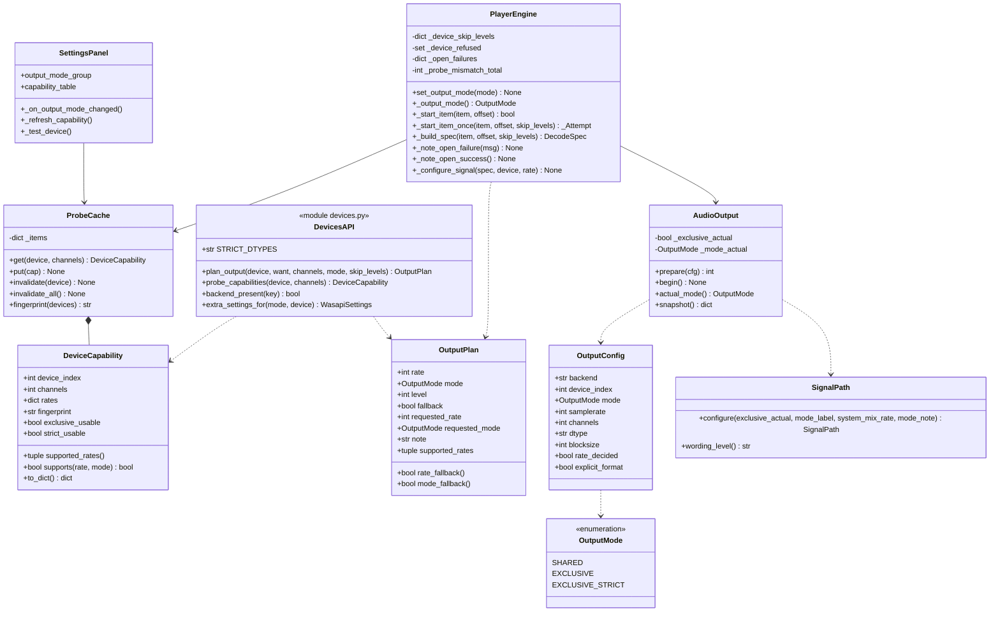
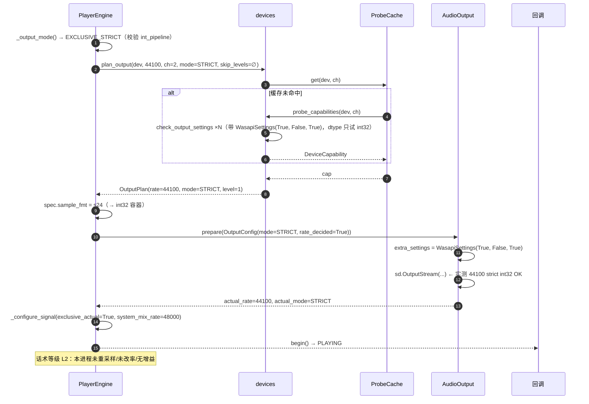
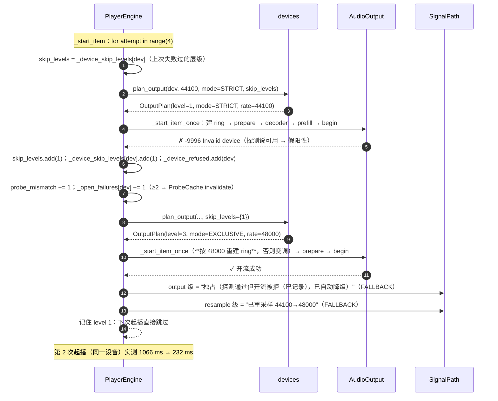
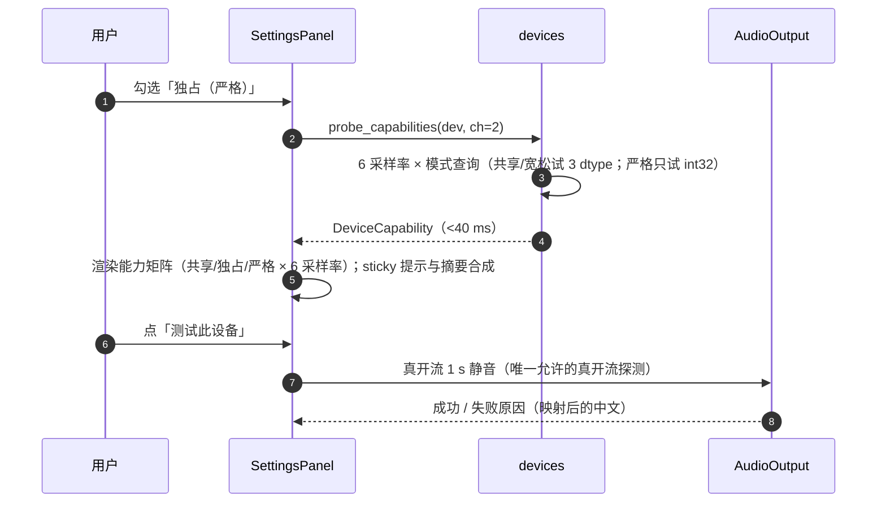

# v1.7 独占输出与位完美（增量设计）

> 上游：用户提出的三条路径（WASAPI Exclusive / ASIO / Kernel Streaming）。
> 基线：v1.6.1 已发布代码（`src/seqaudio/player/` 11 个模块 + `ui/player_*.py`）。
> 本文只做设计与任务分解，**不改任何 `src/` 下文件**。
> 继承约束不变：单一 PCM 路径（ffmpeg → 环形缓冲 → PortAudio）、无 SQLite、DSP 固定链、`player/` 不 import PySide6。

---

## 一、结论摘要

| 项 | 结论 |
|---|---|
| 本期纳入 | **WASAPI 独占（两级：严格 / 宽松）** 为 P0；**WDM-KS 只做可见性与明确不可用提示**，不承诺 |
| 本期不纳入 | **ASIO 的实际启用**（DLL 替换）。只做「能力探测 + 明确告知」，DLL 替换方案完整给出但排到 v1.7.1 |
| 根因 | v1.6 的独占**已接好一半**：`output.py` 确实传了 `WasapiSettings(exclusive=True)`，但**采样率探测走的是共享模式**，于是「源 44.1k」在探测阶段就被判失败并重采样到 48k —— 用户在界面上看到的仍是「已重采样」，独占等于白开 |
| 本次最关键的一组实测 | `check_output_settings(extra_settings=WasapiSettings(exclusive=True))` **能区分独占能力，但不是 100% 准**：QA 用 `--verify-open` 逐格真开流校验 **29/30 一致**，唯一失配是 dev18 44.1k 独占的**稳定假阳性**（探测 ✓ / 开流 `-9996`）。所以探测只用于**排序候选**，`开流成功`才是唯一裁决 |
| 用户价值最大的发现 | dev21「扬声器 (Realtek(R) Audio)」在**共享模式只有 48k，独占模式解锁 44.1/88.2/96/176.4/192 共 5 档**（dev22 解锁 4 档但偏偏没有 176.4k）。独占不只是「44.1k 不被重采样」，而是**解锁高采样率**——比 44.1k 更硬的卖点，且必须逐档实测、不能按高低推断 |
| 默认档 | **独占（宽松）**。严格模式本机支持率仅 **1/5**（dev21），只能作进阶开关，绝不默认 |
| 措辞 | **不放宽** R2 铁律。新增两条「可验证事实」话术（绕开混音器 / 本进程未重采样），`FORBIDDEN_CLAIMS` 原样保留，`bit-perfect` 永久禁用 |
| 任务数 | **6 个**（T01–T06），保底 4 个（T01–T04），弹性 2 个（T05 ASIO 探测、T06 打包冒烟中的 ASIO 部分） |

---

## 二、实测基线

### 2.1 主理人已给的事实（采信，不重复验证）

- `sd.WasapiSettings(exclusive=False, auto_convert=False, explicit_sample_format=False)` 三参数齐备（本次已核对签名，一致）。
- dev20 44.1k：共享 `Invalid sample rate` / 独占成功；48k 两模式皆可；96k/192k 设备本身不支持。
- dev18 44.1k 独占报 `Invalid device`，48k 独占成功。→ **这是真开流的结论**；而探测查询对同一格答「可用」，即**探测假阳性**。这条是 §2.2 的引子，也是"探测不能当唯一闸门"的实证。
- dev19「Strix 7.1」两模式皆失败。→ **该结论已被修正**：失败原因是按 2ch 探测/开流，8ch 下两模式都能开（见 §2.2 补测 B 与 QA 矩阵）。
- ASIO DLL 已在 `_sounddevice_data/portaudio-binaries/libportaudio64bit-asio.dll`（335 KB，与 300 KB 的主 DLL 并列）。
- WDM-KS 本机驱动拒绝（`-9996`）。

### 2.2 本次补测（五组，全部可复现；**其中三组修正了既有结论**）

**补测 A：探测查询与真实开流的一致性 —— 29/30，而不是初稿写的 12/12（QA 逐格校验，已推翻本设计初稿的结论）**

> **权威数据源**：`tools/probe_exclusive.py`（`--verify-open` 逐格真开 30 ms 静音流）→
> `docs/1.7-独占能力矩阵.md` / `.json`。**本文不再自行维护矩阵**，避免文档与 QA 产物两处数字打架；
> 本节只保留结论与反例。

| 设备 | 声道 | 44.1k 共享/独占 | 48k 共享/独占 | 88.2k 共享/独占 | 96k 共享/独占 | 176.4k 共享/独占 | 192k 共享/独占 | 严格（int32） |
|---|---|---|---|---|---|---|---|---|
| dev18 Nahimic | 2 | ✗ / **探测✓ 开流✗** | ✓ / ✓ | ✗ / ✗ | ✗ / ✗ | ✗ / ✗ | ✗ / ✗ | ✗ |
| dev19 Strix 7.1 | **8** | ✗ / ✓ | ✓ / ✓ | ✗ / ✗ | ✗ / ✗ | ✗ / ✗ | ✗ / ✗ | ✗ |
| dev20 C27HG7x（HDMI） | 2 | ✗ / ✓ | ✓ / ✓ | ✗ / ✗ | ✗ / ✗ | ✗ / ✗ | ✗ / ✗ | ✗ |
| dev21 扬声器 Realtek | 2 | ✗ / ✓ | ✓ / ✓ | ✗ / ✓ | ✗ / ✓ | ✗ / ✓ | ✗ / ✓ | **✓（6 档全通）** |
| dev22 Realtek 数字输出（SPDIF） | 2 | ✗ / ✓ | ✓ / ✓ | ✗ / ✓ | ✗ / ✓ | **✗ / ✗** | ✗ / ✓ | ✗ |

结论三条，逐条写清：

1. **探测不能当唯一闸门（29/30）**。唯一失配是 **dev18 44.1k 独占**：探测答「可用」，真开流 `-9996 Invalid device`。本次独立复现 **3/3 稳定失败** —— 一个稳定反例就足以否掉「探测=铁律」。因此 §4.3 的**每一级回退都必须覆盖"探测通过但开流失败"**，不能只在探测阶段判死。
2. **严格模式是"单设备特性"，不是普遍能力**。本机 5 台设备里只有 dev21 六档全通，其余 4 台全 ✗。这直接决定默认值：**默认宽松独占，严格只能由用户显式开启且必须先通过能力矩阵**（§9 / §14 Q1）。
3. **"独占解锁高采样率"是 5 档，不止 2 档**（dev21：44.1/88.2/96/176.4/192 全部共享✗独占✓；dev22 解锁 4 档）。初稿只写 96k/192k 属漏测。同时 **dev22 是反例样本**：192k 独占可、**176.4k 连独占都不行** —— 说明"高率能否解锁"不能按"越高越难"推断，只能逐档实测。

**补测 A-2：探测结果可能抖动，单次结果不能持久化当事实**

QA 观察到同一设备两次探测结果会变（dev18 44.1k 首次只有 float32 通、重跑三种 dtype 全通）。本次以 3 种 dtype 顺序 × 3 轮复测**未复现抖动**（9/9 一致），但既有报告必须进设计，且两条实现约束本来就要成立：

- 探测结果只能作为**"本次尝试的提示"**，不能作为"该设备永久能力"落库；
- 纠偏靠**「缓存 + 连续失败重探」**（§4.2）：任何一级开流连续失败 2 次 → 该设备缓存立即失效并重探，而不是继续按旧缓存死循环降级。

**补测 B：dev19 是「声道数」问题，不是「设备被占用」**

| 配置 | 结果 |
|---|---|
| dev19 2ch 48k 共享 | ✗ |
| dev19 2ch 48k 独占 | ✗ |
| **dev19 8ch 48k 共享** | **✓** |
| **dev19 8ch 44.1k 独占** | **✓** |

结论：dev19 是 8 声道设备，**2ch 探测必然是假阴性**。而现有 `devices.supports_rate()` 的探测声道恒为 `min(2, max_out)`，对 8 声道设备的判定一律错。这解释了主理人「dev19 两模式都失败」的观察，也说明**探测必须用「将要用到的声道数」，不能用固定 2**。（QA 的 `--verify-open` 已用 8ch 口径独立印证：dev19 8ch 44.1k 独占真开流 OK。）

**补测 C：`explicit_sample_format=True` 会拒绝 float32**

| dev21 | excl(expl=False) | excl(expl=True) | shared(expl=True) |
|---|---|---|---|
| 44100 int16 | ✓ | ✓ | ✗ |
| 44100 int32 | ✓ | ✓ | ✗ |
| **44100 float32** | ✓ | **✗** | ✗ |

结论：严格模式（`explicit_sample_format=True`）下 **float32 直接开不了流**（真实开流复现：`-9997 Invalid sample rate`）。所以「严格独占」与「整数通路」是**强绑定**，不是两个独立开关：v1.6 默认 `DEFAULT_SAMPLE_FMT = "f32"`，若不先强制整数，打开严格模式就是 100% 起播失败。

> **口径铁律：探测口径必须与实现口径完全一致，否则探测自己就变成新的假阳性源。**
> QA 矩阵的「严格」列统一只试 int32；实现也据此定为 `STRICT_DTYPES = ("int32",)` —— **只探 int32**。
> 反例（实测踩到过）：若探测用 `(int16, int32)` 两档，一台"只有 int16 能过 explicit"的设备会被判为"支持严格"，而引擎强制 int32 开流 → 失败，于是又冒出一类假阳性。只探 int32 后，本机矩阵与 QA 完全一致（仅 dev21 六档全 ✓，dev18/19/20/22 全 ✗）。
> 本表 §2.2 补测 C 单独验了 int16 在 dev21 也能过，那是**事实记录**，不构成实现口径——实现一律 int32 容器（24 位样本左移 8 位），不引入 int16 分支。

**补测 D：真实开流交叉验证（dev21，另加 dev18 反例）**

| 请求 | 结果 |
|---|---|
| 44100 独占 + explicit + int32 | **OK**，`stream.samplerate = 44100` |
| 96000 独占 + explicit + int32 | **OK**，`96000` |
| 192000 独占 + explicit + int32 | **OK**，`192000` |
| 44100 独占 + explicit + **float32** | **FAIL `-9997`** |
| 44100 独占（无 explicit）+ int32 | OK |
| 44100 **共享** + int32 | **FAIL `-9997`** |
| **dev18 44100 独占**：探测 OK → 真开流 | **FAIL `-9996 Invalid device`（3/3 稳定）= 探测假阳性** |

结论：① `-9997 Invalid sample rate` **是双义的**——既可能是「采样率真不支持」（共享 44.1k），也可能是「格式被 explicit 拒绝」（float32+strict）。现有 `map_portaudio_error()` 一律映射成「设备不支持该采样率」，在严格模式下会**误导用户去改采样率**。必须在 T01 修掉。② `-9996` 在 dev18 上是「该设备/该格式组合被驱动拒绝」，与"设备被拔出"无关，现有映射给的"换后端"建议在这里是唯一正确出路，但仍需补一句"该设备不支持此模式下的该采样率"。

### 2.3 与主理人简报的三处校正（避免工程师按错前提动手）

| 简报说法 | 代码实际 | 影响 |
|---|---|---|
| 「输出通过 `sd.OutputStream(...)`，目前**没有传** `extra_settings`」 | **已经传了**：`output.py` 在 `cfg.exclusive and 设备后端==wasapi` 时构造 `sd.WasapiSettings(exclusive=True)` | 独占不是"从零做"，而是"补三个缺陷"：探测模式、explicit 参数、实际值上报 |
| 「`devices.py` 有 `backend_available()`（真开流探测）」 | **不存在**（全仓 grep 无此符号）。现有只有 `backend_key_for_hostapi` / `resolve_backend` | T02 需**新建**该函数，并明确它给谁用（设置面板「测试此设备」按钮） |
| 「`supports_rate()` 对独占不可信」 | 结构问题是**它没有模式概念**（无 `mode` 参数、不传 `extra_settings`），永远在问"共享模式支持吗"。"不可信"这部分**方向正确但需精确化**：带 `extra_settings` 修好之后仍有 1/30 假阳性（§2.2 补测 A） | 两步修：① 加 `mode` 参数（回答正确的问题）；② **探测只排序、开流才裁决**（应对残余假阳性）。不是简单弃用 |

---

## 三、三条路径的取舍

### 3.1 对比

| 维度 | WASAPI 共享（现状） | **WASAPI 独占（本期 P0）** | ASIO（本期只做探测） | WDM-KS（本期只做可见） |
|---|---|---|---|---|
| 绕开系统混音器 | 否（强制混到混音格式） | **是** | 是 | 是 |
| 跟随源采样率 | 仅当源率==混音率 | **是（实测最多解锁 5 档：44.1/88.2/96/176.4/192）** | 是（驱动支持为准） | 驱动相关，本机拒绝 |
| 额外依赖 | 无 | 无（系统自带） | 需 DAC 驱动或 ASIO4ALL | 无 |
| 分发成本 | 0 | 0 | **需替换 DLL（含 ASIO SDK 的 PortAudio 构建）** | 0 |
| 风险面 | 无 | 抢其他程序声音（产品级提示可解） | **影响全部后端**（同一份 DLL） | 半废弃后端，行为不可预测 |
| 本机可验收 | 是 | **是（5 台设备 × 6 档率 × 3 模式，已逐格真开流校验）** | **否（本机无 ASIO 驱动）** | 否（驱动拒绝） |
| 本期定位 | 默认 | **P0 一等公民**（默认档 = 宽松独占） | v1.7.1 候选 | 可见即止，不给承诺 |

### 3.2 推荐优先级

```
默认：WASAPI 独占（宽松）  →  失败回退 WASAPI 共享  →  MME/DirectSound
进阶：WASAPI 独占（严格）—— 仅当能力矩阵显示本设备支持时才允许选（本机 1/5 设备支持）
不推荐：ASIO（本期不可用，只在下拉里显示原因）/ WDM-KS（半废弃，驱动拒绝）
```

理由：
1. **独占是唯一「零依赖 + 已实测可行 + 用户可感知」的路径**。用户在意的事（44.1k 不被重采样、能上 88.2/96/176.4/192k）它全解决了。
2. **默认档必须是宽松，不能是严格**。本机 5 台设备只有 dev21 一台能过严格模式；把严格做成默认 = 80% 用户开箱即失败（且失败形态是 `-9997`，看起来像"采样率不支持"，极难自查）。这是"默认宽松独占"这条产品决策的**硬依据**。
3. **ASIO 的收益/风险比在本期不划算**：要替换全包唯一的 PortAudio DLL，一旦 ASIO 构建在有/无驱动两类机器上行为不同，**WASAPI 也会一起遭殃**；而本机没有 ASIO 驱动，等于发一个自己无法验收的功能。叠加 ASIO SDK 再分发许可未确认（v1.6 的结论未变），建议推迟。
4. **WDM-KS 半废弃**：PortAudio 里长期实验状态、采样率处理有已知问题，本机驱动直接拒绝。放进下拉只为让高级用户看得见「有这条路但不可用」，绝不写进验收。

### 3.3 设备能力矩阵（权威口径，来自 QA 实测）

| 设备 | 声道 | 共享可用 | 独占可用 | **独占解锁** | 严格（int32） |
|---|---|---|---|---|---|
| dev18 扬声器 (Nahimic mirroring) | 2 | 48k | 44.1k, 48k | 44.1k（**但真开流 44.1k 失败，见 §2.2**） | ✗ |
| dev19 扬声器 (Strix 7.1) | **8** | 48k | 44.1k, 48k | 44.1k | ✗ |
| dev20 3 - C27HG7x (AMD HDMI) | 2 | 48k | 44.1k, 48k | 44.1k | ✗ |
| dev21 扬声器 (Realtek(R) Audio) | 2 | 48k | 44.1k, 48k, 88.2k, 96k, 176.4k, 192k | **5 档** | **✓ 6 档全通** |
| dev22 Realtek Digital Output (SPDIF) | 2 | 48k | 44.1k, 48k, 88.2k, 96k, 192k | 4 档（**176.4k 连独占都不支持**） | ✗ |

> 数据来源：`docs/1.7-独占能力矩阵.md`（含逐格原始错误串与 `--verify-open` 校验结果）。
> 三条必须记住的推论：① **严格支持率 1/5**，是单设备特性；② **解锁档数不能按"越高越难"推断**（dev22 有 192k 但没 176.4k）；③ **探测与开流会不一致**（dev18 44.1k），UI 与回退都要容错。

---

## 四、WASAPI 独占实现方案

### 4.1 三个参数的语义与组合矩阵

```python
sd.WasapiSettings(exclusive=False, auto_convert=False, explicit_sample_format=False)
```

| 参数 | PortAudio 语义 | 本项目用法 |
|---|---|---|
| `exclusive` | 走 `IAudioClient::Initialize` 的独占模式，独占设备、绕开混音器 | 用户显式开启；仅 WASAPI 设备生效 |
| `auto_convert` | 共享模式下允许 WASAPI 内部做格式转换 | **恒为 False**（本项目不借助系统转换；共享模式的重采样由 ffmpeg 做，路径可查） |
| `explicit_sample_format` | 要求 PortAudio 用**请求的样本格式原样**开流，不做格式协商 | 严格模式 `True`，宽松模式 `False` |

| 组合 | 名称 | dtype 约束 | 实测（本机 5 台） | 用途 |
|---|---|---|---|---|
| `exclusive=True, explicit=True, auto_convert=False` | **严格独占** | **只能整数**（float32 实测开不了流）；实现固定 int32 容器 | **仅 dev21 六档全通，其余 4 台全 ✗** | 位完美诉求的正解；因支持率 1/5，只能作为进阶开关 |
| `exclusive=True, explicit=False` | **宽松独占** | 任意（含 float32） | 5 台设备 × 44.1/48 均可，dev21/dev22 还可解锁 88.2–192k | **默认档**；只要"绕开混音器"、允许 DSP 的场景 |
| `exclusive=False, explicit=True` | （无意义） | — | 共享+explicit 全部失败 | **禁止**：配置校验里要挡掉 |
| `exclusive=False` | 共享 | 任意 | 取决于混音格式 | 默认回退档 |

### 4.2 核心修复：模式感知探测（本次设计的中心）

**现状缺陷**：`engine._build_spec()` → `devices.pick_rate()` → `devices.supports_rate()` → `sd.check_output_settings(...)`（**无 `extra_settings`**）。于是即使用户开了独占，探测仍在问"共享模式支持 44.1k 吗"，dev20/dev21 答"不支持"→ 引擎把解码器改成 48k → `output.prepare()` 用独占打开 48k → **成功但已重采样**。用户看到「已重采样」，独占设置形同虚设。

**修法（三层）**：

```python
# devices.py
class OutputMode(str, enum.Enum):
    SHARED = "shared"
    EXCLUSIVE = "exclusive"          # 宽松
    EXCLUSIVE_STRICT = "exclusive_strict"

def extra_settings_for(mode: OutputMode):
    """模式 → sd.WasapiSettings（非 WASAPI 设备返回 None）。唯一构造点。"""

def supports_rate(device, rate, channels=0, *, mode=OutputMode.SHARED) -> bool:
    """带 extra_settings 的探测。channels=0 时必须用设备最大输出声道，
    不能用固定 2（补测 B：dev19 是 8 声道设备，2ch 探测必假阴性）。"""

def probe_capabilities(device, *, channels, rates=RATE_FALLBACK_FULL) -> DeviceCapability:
    """一次性产出一台设备的完整能力矩阵（共享/宽松/严格 × 采样率 × dtype）。"""
```

```python
# engine.py（实际实现）
def _build_spec(item, offset_ms, *, skip_levels=frozenset()):
    mode = self._output_mode()                     # 由 settings 决定，含 strict 校验
    plan = devices_mod.plan_output(                # 候选生成器：只回答"这次试哪级"
        device, want, channels=spec.channels, mode=mode, skip_levels=skip_levels)
    ...
    spec = replace(spec, sample_rate=int(plan.rate))
    return self._apply_strict_constraints(spec)     # strict → 强制 int32 容器
```

> 参数名以 `devices.py` 中 `plan_output(..., skip_levels=...)` 的现有签名为准；早期草案里的 `pick_rate_for_mode()` **未实现，已被 `plan_output()` 取代**（一次产出 `rate + mode + level + note`，比"只返回 rate"信息更全）。

**「探测一次」原则**：v1.6 里 `_build_spec` 与 `output.prepare()` **各调一次 `pick_rate`**（两次探测之间设备可能变化，也是 44.1k→48k 抖动的来源）。v1.7 改为：`_build_spec` 定案后把 `rate` + `mode_used` 写进 `OutputConfig`，`prepare()` **不再自行探测**（`OutputConfig.rate_decided=True`），只按给定参数开流；开流失败才允许一次「降级重试」。

**缓存 + 连续失败重探**（不是"缓存 + 单次探测当铁律"）。记忆分**两层**，职责不同：

**第一层：`ProbeCache`（探测结果缓存，设备级）** — 键 `(device_index, channels)`，值 `DeviceCapability{rate -> dtype 可用性}`。**它不是持久真相，只是"上次问到的答案"**：

| 事件 | 动作 |
|---|---|
| 设备列表指纹变化（`(index,name,hostapi)` 集合哈希不同） | 全量失效 |
| 用户点「重新探测」 | 该设备失效并重探 |
| **某级开流连续失败 2 次**（`engine._open_failures[idx] >= 2`） | `probe_cache().invalidate(device)`，下次起播重探；日志 WARNING |
| 探测结果抖动（同设备两次不同） | 以**最近一次成功开流**的结论为准；探测只作提示 |

**第二层：引擎侧跨起播记忆（层级级）** — 实测证明这一层不可省：

| 字段 | 语义 | 清空时机 | 不做的后果 |
|---|---|---|---|
| `_device_skip_levels: dict[(dev_index, want_rate, mode), set[level]]` | 这组**三元键**参数（设备 + **请求采样率** + **请求模式**）上**开流失败过的层级**，后续起播直接跳过 | `set_output()` / `set_output_mode()` / `reconnect()`；**参数（率或模式）变化时自然不命中** | dev18 每次切歌都白试一次 level 1，**实测 1066 ms → 232 ms** 的可见差异 |
| `_device_refused: dict[(dev_index, want_rate, mode), bool]` | 这组参数上**进过"探测说行、开流被拒"**；用来让 `output` 级 detail **常驻如实说明归因** | 同上（三元键，同参数同设备才命中） | 第二次起播会退化成「独占下不支持 44100 Hz」——**这句话对 dev18 是错的**（它是"能探测不能开"，不是"不支持"） |
| `_open_failures: dict[dev_index, int]` | 连续开流失败次数（成功清零），阈值 2 触发第一层失效 | 成功后置 0 | 假阳性设备永远不重探，缓存里的错答案永久生效 |
| `playback_device_probe_cache`（Settings） | 跨会话复用第一层结果，减少首次探测 | 用户清缓存 | 每次启动都要重扫 18 格（约 40 ms，可接受但没必要） |

> **⚠ 键必须含「请求采样率 + 请求模式」，不能只用设备索引。**
> 理由：`level 1 在 44.1k 失败` **不蕴含** `level 1 在 96k 也失败`。只按设备记，会带来两个后果：
> ① **静默降质**：dev21 这类"独占 6 档全通"的设备，若某次 44.1k 失败，之后播 192k 也会跳过 level 1，白白丢掉独占/严格；
> ② **文案说谎**：dev18 上 44.1k 失败后播 48k，若跳过 level 1 落到 level 3（"独占 + 回退采样率"分支），面板会把一个**原生 48k 成功**的播放标成 `FALLBACK`——用户看到"已重采样"而实际没有重采样，正好违反 §7 的措辞纪律。
> 所以学习粒度必须到 `(设备, 请求率, 请求模式)` 这一级：dev18 的 44.1k 收益保留，48k/96k 不受污染。

> **⚠ 缓存不能只存结论，还要存原因。**
> `_device_skip_levels` 存的是**结论**（"这组参数别试 level 1"），`_device_refused` 单独存的是**原因**（"它是探测假阳性 + 开流被拒，不是不支持这个采样率"）。两者必须分开存：
> - 只存结论 → 第二次起播时引擎知道"跳过 level 1"，但**不知道该说什么**，于是退回通用文案「独占下不支持 44100 Hz」——把假阳性错误归因成"设备能力不足"，用户去换设备或改采样率，永远解决不了；
> - 结论会因为设备/驱动变化而失效（要能被 `_open_failures` 阈值作废），而"这台设备在这一档上探测不可信"这个**性质**值得保留更久。
>
> 一句话：**跳过是优化，归因是事实；优化可以忘，事实不能被覆盖成另一个事实。** 这条对任何"学习型缓存"都成立，不只本例。

> **为什么"学会的层级"要跨起播保留、而"探测缓存"要失败后作废**：前者是设备的**稳定行为**（dev18 44.1k 是 3/3 稳定失败），记住它纯赚；后者是**可能过期的快照**（换驱动、插拔、其他进程占用都会变），必须能自我纠正。两者混为一谈就会要么反复白试、要么永久记错。

依据：`check_output_settings` 与真实开流 **29/30 一致但非 30/30**（§2.2），dev18 44.1k 是稳定的假阳性。既然存在假阳性与可能的抖动，就不能把单次探测结果当持久事实。

探测本身零出声（`Pa_IsFormatSupported`），单设备 6 采样率 × dtype 查询，实测 < 40 ms，可在 GUI 线程做（但只在设置页展开时做；起播路径只做单点探测）。

### 4.3 回退阶梯（四级 + 两条硬规则，每级都必须留痕）

**实现形状（与 `player/devices.py` / `player/engine.py` 现有代码一致）**：

`plan_output()` 是**候选生成器**，不是最终裁决——一次调用只回答"这次该试哪一级"，**不真开流**：

```python
plan_output(device, want, *, channels=0, mode=SHARED, extended=True,
            probe=None, skip_levels=frozenset()) -> OutputPlan
# 返回第一个未被 skip_levels 跳过的层级；OutputPlan 字段：
#   rate / mode / level(1–4) / fallback / requested_rate / requested_mode / note / supported_rates
```

引擎侧用**两次函数**把"试一级"与"降级重试"分开，避免递归：

```
_start_item(item, offset)          # 外层：最多 4 次
  └─ for attempt in range(4):
        _start_item_once(item, offset, skip_levels)   # 内层：只试一级
            ├─ _build_spec(..., skip_levels)  → plan_output 取下一级
            ├─ 建 ring（按该级 rate/dtype）→ prepare → decoder → prefill → begin
            └─ 失败返回 _Attempt(ok=False, retryable=True, level=N)
        失败 → skip_levels.add(N)；_device_skip_levels[dev].add(N)；_device_refused.add(dev)
             → _note_open_failure()（probe_mismatch += 1；连续 2 次作废 ProbeCache）
        4 级全失败 → _fail("独占各级开流均失败：…")
```

| level | 含义 | 何时产生 | 信号路径 `output` 级 status |
|---|---|---|---|
| **1** | 按**请求模式** + 源采样率 | 请求严格且严格探测 ✓（mode=strict）；或请求宽松且宽松探测 ✓ | `PASSTHROUGH` |
| **2** | 严格 → 宽松，仍源采样率 | **仅在请求严格时存在**：严格探测 ✗、宽松探测 ✓（note：严格独占不可用，已降为宽松独占） | `FALLBACK` |
| **3** | 独占 + 回退采样率 | 独占在源率不可用（探测 ✗ 或上一级开流失败）→ 候选里第一个可用的率 | `FALLBACK` + `TEXT_FALLBACK_RATE` |
| **4** | 共享（系统混音） | 独占各级均不可用/失败；note 明确「独占各级开流均失败，已退回共享」或「该设备不支持独占，已退回共享」 | `FALLBACK` + detail 写「共享（系统混音器）」 |

> **注意**：`level 2` 只在"请求严格"时存在。请求宽松时失败**直接跳 level 3**（不存在"另一档独占"）。写测试用例时别假设宽松请求会有 4 次尝试。

**硬规则 1：每一级的成败判据是「开流成功」，不是「探测通过」。**
探测只用来**排序候选**（少试几次），绝不用来做最终裁决。dev18 44.1k 独占就是活证据：探测 ✓ → 开流 `-9996` → 必须降到下一级继续试，而不是在探测阶段判死、更不是直接进 ERROR。

**硬规则 2：每一级只允许降级一次，不允许原地重试同一参数。**
同一 (设备, 模式, 率, dtype) 组合在一次起播里最多尝试 1 次（`skip_levels` 保证）；上限 4 次开流；每次失败计一次 `probe_mismatch`，并参与 §4.2 的「连续 2 次 → 作废探测缓存」判定。

**硬规则 3（实现陷阱，容易漏）：降级改率时必须重建环形缓冲。**
`ring = PcmRingBuffer.from_seconds(..., spec.sample_rate, ...)` 依赖采样率；level 2→3 会改率，若沿用旧 ring，回调按新率读旧缓冲会**变调**。当前实现的做法是「每次 `_start_item_once` 都重新 `_build_spec` 并重建 ring」，等于把重建的成本付在重试上（正常路径只付一次）。这样既不变调，也不会像"递归回 `_start_item`"那样把 `_teardown` 与状态迁移搅在一起。

其他规则：
- **每一级都写 `SignalStage.status`**：见上表；③④ 面板标红。
- **回退策略可选**：`playback_exclusive_fallback = "auto" | "ask" | "never"`。默认 `auto`（R9：首次启用独占弹一次说明，之后静默自动回退但**必然**在信号路径与日志留痕）。
- **不允许跨后端静默回退**：从 WASAPI 掉到 MME 必须用户点确认（延迟与设备名都会变），只在 ERROR 状态给按钮建议。
- **`ask` 模式**下拉一个非模态提示条：「该设备不支持独占 44.1 kHz，已按 48 kHz 独占播放（会重采样 1 次）。［改用共享 / 保持独占］」。
- **失败文案必须区分"探测说不行"与"开流才失败"**：后者固定用「**探测通过但开流被拒（已记录），已自动降级**」——这句由 `_device_refused` 常驻保留，跨起播不丢（见 §4.2 第二层）。

### 4.4 失败归因（四类陷阱 + 一条通用规则）

> **通用规则（先记这条，它覆盖下面所有具体 case）**
> **失败文案必须覆盖所有被尝试的维度：采样率 × 声道 × 模式（× dtype）。**
> 只报其中一个维度，等于把用户引向错误方向——他会一直去改那个维度，而问题在另一个维度上，永远改不好。
> 判据：把文案里的每个数字/名词遮住，用户是否还能判断"我该改哪个设置"。判不了就是没写全。

| # | 陷阱 | 表现 | 规则 |
|---|---|---|---|
| 1 | **`-9997` 双义** | 同一句「设备不支持该采样率」既可能是率不支持，也可能是格式被 `explicit` 拒绝 | 按 `(mode, dtype, rate)` 上下文分岔，见下表 |
| 2 | **探测通过但开流被拒** | 探测 ✓ / 开流 `-9996`（dev18 44.1k） | 文案「探测通过但开流被拒（已记录），已自动降级」+ `_device_refused` 常驻，跨起播不丢 |
| 3 | **多维度只报一个维度**（QA TC-EX-13） | 请求 **6ch** 失败，却只报「…都不支持候选采样率 (48000, 88200, 96000, 44100)」，**一个"声道"字都没有** | 失败分支必须把**本次试过的全部维度**列出来：`设备 X（6 ch，独占）在 48000/88200/96000/44100 Hz 下均不可用；该设备最多 2 ch` |
| 4 | **原始错误码裸露** | 尾部 `[PaErrorCode -9997]` | **保留**（排障有用，且正常路径已被前置拦截、用户看不到），但必须**附在中文原因之后**，不得作为唯一说明 |

**陷阱 1 的上下文分岔表**（改 `map_portaudio_error(exc, *, mode, dtype, rate)`）：

| 条件 | 现在的文案 | 改为 |
|---|---|---|
| `-9997` + 共享模式 | 设备不支持该采样率 | 不变（正确） |
| `-9997` + 独占 + `explicit=True` + **浮点** dtype | 设备不支持该采样率 ❌ | **「严格独占要求整数样本格式，float32 不被接受」** + 提示切换 `playback_int_pipeline` |
| `-9997` + 独占 + `explicit=True` + 整数 dtype | 设备不支持该采样率 | 「该设备在独占模式下不接受 44100 Hz」+ 列出实测支持的率 |
| `-9997` + 独占 + `explicit=False`（如 dev22 176.4k） | 设备不支持该采样率 | 「该设备在独占模式下不支持 176400 Hz」+ 提示"本设备支持 192k 但不支持 176.4k"（逐档实测，不按高低推断） |
| `-9996` + 独占 | 后端/驱动拒绝该设备 | **「该设备不支持独占模式（驱动或系统保留）」** + 建议换共享 |
| **`-9996` + 独占 + 探测曾报可用**（dev18 44.1k） | 同上 ❌（会让人以为设备坏了） | **`output` 级固定写「探测通过但开流被拒（已记录），已自动降级」**（`_device_refused` 常驻，跨起播不丢）；实际率与模式由 `device` 级显示（如 `48000 Hz（源 44100 Hz）· 2 ch · int32`）；计 `probe_mismatch`。**不写"不支持 44100 Hz"**——对 dev18 那是错的 |
| `-9985` + 独占 | 设备忙 | 「该设备已被其它程序独占，请关闭后重试」（这句现有文案可用） |

**陷阱 3 的落地要求（`devices.py` 的失败分支）**：
1. `RateUnsupportedError` 的文案必须带上**声道**与**模式**：「设备 X 在 {模式} 下、{ch} ch 时，{rates} 均不可用」；
2. 若 `ch > device.channels`，直接给出**可行动的结论**：「该设备最多 2 ch，6 ch 无法直通；请改用共享模式（会自动下混）或 2 ch 输出」——这条比列一串采样率有用得多；
3. `plan_output()` 里其它多维度失败分支（严格→宽松、独占→共享）同样要列全维度，`:note` 字段是用户可见文案的一部分；
4. 单测：构造"声道超限"的假设备，断言异常文本里**同时**含 `ch` 与模式词，且不含裸的采样率列表。

### 4.5 独占的用户体验配套

| 问题 | 处置 | 落点 |
|---|---|---|
| 抢走浏览器/会议软件的声音 | 首次开启弹说明（`playback_exclusive_notice_shown` 已有字段）；播放条常驻「独占」徽标；停止/切歌即释放流（现有 `stop(abort)`） | T04 |
| 独占时其他程序「没声了」但用户不知道原因 | 状态栏 + 播放条双处常驻标识；日志 INFO 记「已取得设备独占」 | T04 |
| 暂停时仍占着设备（最烦人的一点） | `playback_release_on_pause`（**默认 True，Q3 定稿**）：暂停即释放流，恢复时重开（代价 +~100 ms 起播）；**仅真独占时生效**，共享模式无此行为 | T01/T04 |
| 独占失败但用户以为开了 | 信号路径 `output` 级显示实际模式（**不是**请求值），并给 `FALLBACK` 状态 | T03 |
| 换设备后能力变化 | 缓存按设备指纹失效；设置页每次展开重探 | T02 |

---

## 五、ASIO 可行性方案（本期只做探测，替换方案留 v1.7.1）

### 5.1 三种 DLL 策略对比

| 策略 | 做法 | 优点 | 致命问题 | 结论 |
|---|---|---|---|---|
| **A. 构建期替换** | `build.py` 直接把 `libportaudio64bit-asio.dll` 改名成 `libportaudio64bit.dll` 打进包 | 最简单；体积 **-300 KB**（只留一份） | ① ASIO 构建成为**唯一** PortAudio，所有后端的风险面 100%；② 本机无 ASIO 驱动，无法验收它对 WASAPI 有无副作用；③ ASIO SDK 再分发许可未确认 | **不采用** |
| **B. 双 DLL + 运行时复制 + 提示重启** | 两个 DLL 都进包，`app.py` 在 **import sounddevice 之前**按设置把选中那份复制成 `libportaudio64bit.dll` | 用户可切；切换只影响自己；体积 +335 KB | ① 需写安装目录（Program Files 下可能无权限）；② 切换后必须重启进程（PortAudio/DLL 无法在同进程内可靠卸载）；③ 首次运行前就要决定，逻辑与「设置改完即时生效」的习惯冲突 | **v1.7.1 候选**（本期不做） |
| **C. 双 DLL + 同进程切换** | 运行时 `ctypes` 换 DLL 后重载 sounddevice | 无重启 | **不可行**：Windows 上已映射的 DLL 无法真正卸载；`sounddevice` 的 `_lib` 是模块级单例，同名 DLL 二次 `LoadLibrary` 会拿到旧模块；`reimport_sounddevice()` 只清 Python 缓存变量，DLL 仍在 | **明确不做** |

### 5.2 本期实际做什么

1. `constants.BACKEND_ASIO = "asio"` + `BACKEND_HOSTAPI_HINTS["asio"] = ("asio",)`，让 `backend_key_for_hostapi()` 能识别（如果用户手上是带 ASIO 的第三方 PortAudio 构建，代码也能用）。
2. `devices.backend_present("asio")` → 查 hostapi 列表里有没有 ASIO。**没有时设置面板显示灰色项 + 原因文案**（`dev_hint_asio_missing`：「当前 PortAudio 构建不含 ASIO；需替换 DLL，见说明」）。
3. 打包侧**现状已经是"只有一份 x64 非 ASIO DLL"**：`build.py` 的 `build_onedir()` 在装包后遍历 `_internal/_sounddevice_data/portaudio-binaries`，把除 `libportaudio64bit.dll` 以外的 `.dll/.dylib/.so` 全删掉（ASIO 变体因此进不了包）。这解释了为什么当前构建里 ASIO 一定不可用。本期**不改这段逻辑**，只在 T06 加一条断言把它锁住（防止将来有人"顺手取消清理"就把 ASIO 变体带进包而无人验证）。
4. 在 `docs/1.6-发版检查清单.md` 增补 ASIO 决策记录，注明「未纳入 v1.7 及原因」，避免下版重开讨论。

### 5.3 若 v1.7.1 要上，前置条件（写清，别下版再考古）

- [ ] 法务确认 ASIO SDK 再分发边界（或明确"仅随 sounddevice 官方 wheel 分发，本项目不二次打包"）。
- [ ] 在**有 ASIO 驱动**（DAC 或 ASIO4ALL）的机器上跑完：真开流、48k/96k、与其他后端回归、拔插恢复。
- [ ] 解决音量：ASIO 下设备音量由驱动控制，我们的 `playback_volume_mode="software"` 仍有效但用户会以为在调硬件音量 → 需明确文案。
- [ ] 解决与 WASAPI 独占的**互斥**：二者都要求独占设备，同时开必冲突 → 同一时刻只允许一个后端持有设备。

---

## 六、WDM-KS 定位

| 项 | 结论 |
|---|---|
| 是否在本期出现 | 出现在后端下拉（已存在），但**标注"实验性，本机不可用"** |
| 是否验收 | **否**。本机驱动 `-9996` 拒绝，无法验证 |
| 代码改动 | 仅 `map_portaudio_error` 的 `-9996` 分支增加「WDM-KS 属实验后端，建议改用 WASAPI」提示（T01） |
| 风险 | 若用户强选且能开流，采样率行为不可预测 → 信号路径必须显示实际率，且**不参与位完美话术**（L1/L2 话术要求后端==WASAPI 独占） |

---

## 七、位完美的措辞边界

### 7.1 四级话术（只能说前三级）

| 级别 | 文案（中文原文，进 i18n） | 成立条件（代码可判定） | 依据强度 |
|---|---|---|---|
| **L0** | 未做软件改动 | 9 级里无 `CHANGED`（现有 `is_bitperfect_claimable()`） | 事实：本进程没改样本 |
| **L1（新增）** | 已绕开系统混音器（系统混音 48000 Hz · 本流 44100 Hz） | `exclusive_actual=True` **且** `stream.samplerate == 源采样率` **且** `设备默认率 != 本流率` | **强**：两个独立读数（`query_devices().default_samplerate` 与 `stream.samplerate`）互相印证 |
| **L2（新增）** | 本进程未重采样、未改采样率、未加软件增益（整数通路 32 位容器 / 有效位深 24） | 严格独占 + 整数 dtype + `dsp` 全旁路 + `rate_want==rate_actual` + 无 EQ/淡变 | 强（本进程内可枚举），但**不含"设备侧未转换"** |
| **L3（永久禁止）** | bit-perfect / 位完美 / 逐样本一致 / 比特完美 / 「24bit 直通 DAC」 | —— | **永远不能说**，`FORBIDDEN_CLAIMS` 原样保留 |

### 7.2 为什么不能升级到"位完美已验证"

1. **没有回环录音比对**。唯一能证明「输出比特 == 源比特」的手段是数字回环（SPDIF/虚拟声卡）逐样本比对，依赖外部硬件，进不了自动化验收（v1.6 R2 结论未变，本期不推翻）。
2. **24 位不是原生 24 位容器**。本项目 `s24 → pcm_s32le`，样本**左移 8 位**放在 int32 里传输（`constants.PCM_FMT_TO_FFMPEG` 已注明）。所以设备拿到的是「32 位容器 + 24 位有效数据」，我们**无法断言** DAC 是按 24 位还是 32 位接收的。
3. **WASAPI 独占不保证驱动不改**。`explicit_sample_format=True` 只约束 PortAudio 不做格式协商，操作系统与驱动仍可能做音效处理（Realtek/Nahimic 类 APO 在独占下通常被绕过，但不是所有驱动都如此）。**本进程不可知**。
4. **DSD 路径必然不是位完美**：DSD→PCM 转换是我们的主动处理，`format` 级本来就是 `CHANGED`。

### 7.3 措辞守卫要改的地方（保持"只收不放"）

| 改动 | 说明 |
|---|---|
| `FORBIDDEN_CLAIMS` | **不删任何一条**。新增 `"已验证"`+`"bit"` 组合的启发式拦截（如同时出现「位」与「完美」直接降级） |
| `assert_wording()` | 增加对 L1/L2 的**前置条件校验**：若调用方声称 L1 但 `exclusive_actual=False`，自动降级为 L0 并 WARNING |
| 单测 | 新增反向用例：`assert_wording("位完美已验证")`、`assert_wording("24bit 直通 DAC")` 必须返回 L0 文案 |

---

## 八、信号路径标注

### 8.1 `output` 级（第 8 级）

| 场景 | detail | status |
|---|---|---|
| 严格独占成功 | `WASAPI · 独占（严格）· 扬声器 (Realtek(R) Audio)` | `PASSTHROUGH` |
| 宽松独占成功 | `WASAPI · 独占 · <设备>` | `PASSTHROUGH` |
| 严格请求但降为宽松（level 2） | `WASAPI · 独占 · <设备>（严格独占不可用，已降为宽松独占）` | **`FALLBACK`** |
| 请求独占但降级共享（level 4） | `WASAPI · 共享（系统混音器）· <设备>` | **`FALLBACK`** |
| 设备拒绝独占（`-9996`） | `WASAPI · 共享（该设备不支持独占）· <设备>` | **`FALLBACK`** |
| **探测通过但开流被拒**（`_device_refused` 常驻） | `WASAPI · 独占 · <设备>（探测通过但开流被拒（已记录），已自动降级）` | **`FALLBACK`** |
| 非 WASAPI 后端 | `MME · 共享 · <设备>` | `PASSTHROUGH` |
| 后端缺失（ASIO 未编译进 DLL） | `ASIO · 不可用（当前 PortAudio 构建不含 ASIO）` | `ERROR` |

### 8.2 `device` 级（第 9 级）

| 场景 | detail | status |
|---|---|---|
| 率一致 | `44100 Hz · 2 ch · int32 · 延迟 40 ms` | `PASSTHROUGH` |
| 率一致 + 绕开混音器 | `44100 Hz（系统混音 48000 Hz，已绕开）· 2 ch · int32 · 延迟 40 ms` | `PASSTHROUGH` |
| 回退 | `48000 Hz（源 44100 Hz）· 2 ch · int32 · 延迟 40 ms` | `FALLBACK` |
| 独占争用 | `设备已被其它程序独占` | `ERROR` |

新增 `SignalPath.configure()` 参数（**只加不改**，保持向后兼容）：
`exclusive_actual: bool`、`mode_label: str`（`strict`/`loose`/`shared`）、`system_mix_rate: int`、`mode_note: str`。
**关键**：`exclusive` 参数从此只允许传**实际值**，`engine._configure_signal()` 现在传的是 `settings.playback_exclusive`（请求值），这是"面板说谎"的根源，T03 修掉。

---

## 九、设置面板交互

### 9.1 控件树（在现有「输出设备」卡内扩展，不新增页）

```
输出设备 卡
├─ 输出后端     [WASAPI | DirectSound | MME | WDM-KS | ASIO(灰,附原因)]
├─ 输出设备     [下拉：标签形如 "WASAPI · 扬声器 (Realtek(R) Audio)"]
├─ 输出模式     ( ) 共享  (•) 独占  ( ) 独占（严格：不转换样本格式）
│               └─ 严格项：先看能力矩阵「严格」列，全部 ✗ 时该单选置灰 + 「本设备不支持严格模式」
│                  悬停提示：要求整数通路（int32），开启后 DSP 与软件音量不可用
├─ 独占失败时   [自动回退共享 | 每次询问 | 只报错]
├─ 设备能力（可折叠，选中独占/严格时展开）
│   ├─            共享   独占   严格
│   ├─ 44100 Hz    ✗     ✓     ✓
│   ├─ 48000 Hz    ✓     ✓     ✓
│   ├─ 88200 Hz    ✗     ✓     ✓     ← dev21 解锁的是 5 档，别只列 96k/192k
│   ├─ 96000 Hz    ✗     ✓     ✓
│   ├─ 176400 Hz   ✗     ✓     ✓
│   ├─ 192000 Hz   ✗     ✓     ✓
│   └─ 注：本机 5 台设备中仅 1 台支持严格；探测与实际开流可能不一致（已自动处理）
├─ [重新探测此设备]  [测试此设备（播 1 s 静音，真开流）]
├─ ☑ 采样率跟随源文件
└─ 提示条：独占会抢占其他应用的声音…（现有）
```

### 9.1.1 依据实测的三条 UI 规则（本次新增）

| 规则 | 依据 | 落点 |
|---|---|---|
| **默认 `独占（宽松）`，不默认严格** | 严格本机支持率 **1/5**；若默认严格，80% 用户开箱即 `-9997`，且错误看起来像"采样率不支持"，极难自查 | T04 默认值 |
| **严格项按「能力矩阵的严格列」动态可用**：全部 ✗ 则置灰并写原因；若用户硬选（如配置迁移带过来的），起播前拦下并提示，**不要**让它走到开流失败 | QA 矩阵「严格」列 4/5 台全 ✗ | T04 联动 |
| **能力矩阵必须列 6 档采样率**（含 88.2k / 176.4k），且允许出现"192k ✓ 但 176.4k ✗"这种非单调结果 | dev22 实例：独占支持 192k 但不支持 176.4k | T04 表格 |

### 9.1.2 矩阵旁边必须有一句"免责"

> 「本表是上次探测结果，可能与实际开流不一致（已验证存在此情况）。起播失败会自动降级并记录，不影响播放。」

理由：dev18 44.1k 是**稳定假阳性**（探测 ✓ / 开流 `-9996`）。如果 UI 把矩阵画成"权威事实"，用户遇到降级就会认为软件有 bug；提前说明并自动处理，才是一致的体验。

### 9.1.3 提示文案的所有权规则（QA 观察项，本轮修）

**问题**：`capability_hint` 是一个 QLabel，却有 **7 个写入点**（`dev_cap_unlocked` / `dev_cap_none_unlocked` / `dev_strict_auto_downgraded` / `dev_testing` / `dev_hint_exclusive_wasapi_only` / `dev_no_output_device` / 探测异常文本）。**后写的会静默盖掉先写的**，于是「严格模式为何被自动降级」这条最需要被看到的信息，会被"本设备独占解锁了 5 档"之类的摘要覆盖掉。用户只会发现"我明明选了严格，怎么变宽松了"。

**判定：本轮修，成本小（纯 UI 层，约 20 行，不动引擎与信号路径结构）。** 理由：降级是**已经发生的事实**，用户必须知道；而它被覆盖只是"单槽多人写"的渲染问题，不是数据流问题。

**修法（组合式，不新增控件、不改布局）**：

```python
# settings_panel.py
self._sticky_notice: str = ""          # 需要用户知道、且必须留存的一条
def _compose_hint(self, summary: str) -> None:
    parts = [p for p in (self._sticky_notice, summary) if p]
    self.capability_hint.setText("；".join(parts))
```

| 文案种类 | 是否 sticky | 何时清除 |
|---|---|---|
| 严格自动降级（`dev_strict_auto_downgraded`） | **是** | 用户改了输出模式，或换了设备 |
| 探测/实际不一致（`dev_probe_mismatch`） | **是** | 换设备 / 重新探测成功 |
| 测试设备失败原因 | **是**（下次测试成功时清） | 测试成功 |
| 能力摘要（解锁 N 档 / 无解锁 / 未探测） | 否（每次都重算） | —— |
| 瞬时状态（`dev_testing`） | 否 | 结果返回即替换 |

> 判据：**凡是"已经发生且用户无法从别处得知"的信息，必须 sticky**；凡是"当前状态描述"，可以随时被重算覆盖。

### 9.2 交互规则

| 规则 | 说明 |
|---|---|
| 后端非 WASAPI 时 | 「独占」与「严格」置灰 + 提示「仅 WASAPI 支持独占」 |
| 选「严格」时 | 自动勾上「优先整数通路」，并把「软件音量」「EQ」置灰（附原因：严格模式要求 DSP 全旁路）；若用户取消勾选 → 严格模式自动退回「独占」并提示 |
| 能力矩阵 | 只在「独占」或「严格」被选中时展开并触发探测（避免每次开设置页都扫全设备）；探测在 GUI 线程，结果缓存在 `DeviceCapability` |
| 严格项的可用性 | 按能力矩阵「严格」列动态置灰：全 ✗ → 置灰 +「本设备不支持严格模式（int32 + 不转换格式）」。若配置里已是严格且本设备不支持 → 打开面板时降级为「独占」并提示一次，**不允许**保存一个必然失败的模式 | 
| 「测试此设备」 | 调 `devices.backend_available()`（**本期新建**）：真开一条 1 s 静音流再关，返回成功/失败与真实率与**实际模式**。这是唯一允许"真开流探测"的入口（用户显式点击），也是纠正假阳性的手动手段（dev18 44.1k 会在这里暴露） |
| 设备切换 | 清该设备的缓存能力；不自动弹窗 |
| 保存后 | 若正在播放且输出参数变化 → 走 `engine.set_output()`（现有），失败进 ERROR 并给「改用共享重试」按钮 |
| i18n | 新增 `dev_mode_*`（shared/exclusive/strict）、`dev_cap_*`（矩阵表头含 6 档率）、`dev_cap_disclaimer`（探测免责一句）、`dev_strict_unsupported`（本设备不支持严格）、`dev_strict_auto_downgraded`（配置里是严格但换了不支持的设备，已自动退回「独占」）、`dev_probe_mismatch`（探测与实际不一致已降级）、`dev_hint_asio_missing`、`dev_test_device`、`dev_probe_again`；`dev_hint_wasapi` 现文案「共享模式会被系统混音到 48k 并重采样」需改成「共享模式会被系统混音到混音格式并重采样；独占可跟随源采样率，部分设备还能解锁更高采样率」 |
| 严格项的 dtype 说明 | 矩阵与提示里写明「严格 = 不转换样本格式（int32 容器）」。**不要**写"位深可任意跟随源"——实测 strict 只接受整数，且实现固定 int32（§2.2 口径铁律） |
| **提示文案不得互相覆盖** | 见 §9.1.3：`capability_hint` 有 7 个写入点，降级原因必须 **sticky** 合成，不能被能力摘要盖掉（QA 观察项 ①，本轮修） |
| **原始错误码保留但必须后置** | `[PaErrorCode -9997]` 保留（排障有用，正常路径已被前置拦截看不到），但**只能附在中文原因之后**，不得作为唯一说明（QA 观察项 ②，保留不修） |
| **多维度失败必须列全** | 声道超限时不得只报采样率列表，须直接给可行动结论（「该设备最多 2 ch…」），见 §4.4 陷阱 3（QA TC-EX-13） |

> 严格项为什么不做成「默认推荐」：本机 5 台设备只有 1 台支持（§3.3）。做成默认 = 80% 用户首次起播就失败，而失败串是 `-9997`，与"采样率不支持"同码不可区分。默认必须是**宽松独占**。

---

## 十、配置扩展

| 字段 | 类型 | 默认 | 含义 | 兼容 |
|---|---|---|---|---|
| `playback_output_mode` | `str` | **`"exclusive"`** | `shared` / `exclusive`（宽松，默认）/ `exclusive_strict` | 新字段；读取时若 `playback_exclusive=True` 且本字段为默认 → 视为 `exclusive`（**不会**升级为 strict） |
| `playback_exclusive` | `bool` | `False` | **保留**（面板旧值/会话兼容），`apply_to` 时与 `output_mode` 双向同步，`output_mode` 为准 | 不改语义，只做镜像 |
| `playback_exclusive_fallback` | `str` | `"auto"` | `auto` / `ask` / `never` | 新字段 |
| `playback_release_on_pause` | `bool` | **`True`** | 暂停即释放设备（**Q3 定稿：默认释放**）。仅真独占生效；共享模式忽略此值 | 新字段，已定稿 |
| `playback_strict_require_int` | `bool` | `True` | 严格模式强制整数通路（实测必需；留开关仅供排障） | 新字段 |
| `playback_device_probe_cache` | `dict` | `{}` | 能力矩阵缓存（键含设备指纹）。**只是"上次问到的答案"，不是持久真相**：开流连续失败 2 次即失效重探（§4.2） | 新字段，可清空 |
| `playback_exclusive_notice_shown` | `bool` | `False` | 已有，复用 | — |

> **Q3 定稿：`playback_release_on_pause = True`（暂停即释放设备）**。三条理由：
> ① **独占的定义就是抢占设备**，暂停仍占着 = 用户开会/看视频时莫名没声，这是本版最容易被投诉的形态（R1 的具体发作点）；
> ② 代价是恢复播放要重开流，约 **100 ms** 起播延迟——这是可感知但不恼人的量级，且设置里可关（「暂停时保持独占」），发烧友自行权衡；
> ③ **只在真独占时生效**（`exclusive_actual=True`），共享模式无此行为，所以对绝大多数用户零影响。
>
> **落地约束（防退化）**：释放后必须保留 `position_ms` 与队列位置，恢复时按原位置重开；释放与恢复都不得改变 `PlayerState`（仍是 `PAUSED`），否则界面会把"暂停"显示成"停止"。
> **新增风险点（因默认值改 True 而来）**：暂停期间设备被别的程序抢走 → 恢复时开流失败。此时必须 `ERROR` + 提示「设备已被其它程序占用，位置已保留」+ 给「重新连接」按钮（`engine.reconnect()` 已有），**不得**静默跳到下一首，也不得静默改成共享模式（用户选的是独占）。

> **默认值从 `shared` 改为 `exclusive`（宽松）的三个前提**：① 宽松独占在本机 5 台设备上 44.1k/48k 全部可用（含 dev18 的 44.1k 会退到 48k）；② 失败自动回退共享且留痕，不会"没声音"；③ 首次运行一次性说明抢占行为（`playback_exclusive_notice_shown`）。
>
> **已实现的一次性说明（Q9 落地形态）**：首次启动弹一次，弹窗内「改回共享」会**同时**写回 `settings.playback_output_mode="shared"` 并调 `engine.set_output_mode("shared")`（正在播也立即生效），随后落盘 `playback_exclusive_notice_shown=True`。这比"只弹不改"好——用户当场能拒绝，不用再进设置找。
>
> 若发布前 QA 认为抢占风险仍高，**降级方案是把默认改回 `shared` 并对已探测支持独占的设备做一次性推荐**——只改默认值，不动实现。
>
> `Settings.from_dict` 的键白名单机制照旧：旧配置读新版本自动取默认值，无需迁移脚本。**注意**：老用户配置里没有 `playback_output_mode` 键 → 会取到新默认 `exclusive`，这属于"静默改变行为"，因此上面的首次说明是**必须**的，不是锦上添花。

---

## 十一、数据结构与调用时序

### 11.1 类图（增量部分）



### 11.2 时序 A：严格独占起播（成功路径）



### 11.3 时序 B：四级回退的实际形状（含开流失败重试与跨起播记忆）



> 上面第 2 次起播的数字来自工程师的 E7 实测：`skip_levels` 生效后不再白试 level 1。这就是「学会的层级要跨起播保留」的直接收益——**不做这一层，用户每次切歌都要多等约 800 ms**。

### 11.4 时序 C：能力探测与缓存（设置页展开）



---

## 十二、任务分解

| 任务ID | 标题 | 涉及文件 | 依赖 | 规模 | 档位 | 验收标准 |
|---|---|---|---|---|---|---|
| **T01** | 输出层独占：三参数、实际值上报、错误码去歧义 | `player/output.py`<br/>`player/constants.py`<br/>`core/config.py` | — | M | 保底 | ① `OutputConfig` 增加 `mode` / `rate_decided` / `explicit_format`，`AudioOutput.open()` 按模式构造 `WasapiSettings`（严格=True,False,True；宽松=True,False,False；共享=None）；② 新增 `actual_mode()`，`snapshot()["exclusive"]` 返回**实际**值而非请求值；③ `map_portaudio_error(exc, mode=, dtype=)` 覆盖 §4.4 **陷阱 1** 的 6 个上下文分支，单测逐条断言中文文案；④ `playback_output_mode/strict_require_int/exclusive_fallback/release_on_pause` 四个字段进 `Settings`，旧 config.json 加载不报错；⑤ 非 WASAPI 设备请求独占时日志说明「仅 WASAPI 支持独占」且不抛错 |
| **T02** | 设备能力探测（模式感知 + 双层记忆）与四级回退 | `player/devices.py`<br/>`player/engine.py`<br/>`tests/test_player_devices.py`<br/>`tests/test_player_exclusive.py` | T01 | L | 保底 | ① `supports_rate(..., mode=)` 带 `extra_settings`，探测声道用**实际声道数**（dev19 8ch 用例必须通过）；② **`STRICT_DTYPES = ("int32",)`，严格探测只试 int32**（探测口径=实现口径，否则"只过 int16"的设备会变成新假阳性）；③ `plan_output(..., skip_levels=)` 是候选生成器（不真开流），`DeviceCapability` 与 QA `docs/1.7-独占能力矩阵.json` 逐格对齐：dev21 六档独占全 ✓ 且严格全 ✓、dev22 192k ✓ **但 176.4k ✗**；④ 四级回退由 `_start_item`（≤4 次）＋`_start_item_once`（单级）实现，**每级判据是开流成功**，失败层级进 `skip_levels`，同组参数不重试；⑤ **假阳性用例**（dev18 44.1k 原型）：探测 ✓ / 开流 `-9996` → 自动降到下一级、`probe_mismatch += 1`、**不进 ERROR**；⑥ **降级改率时必须按新 rate 重建 ring**（断言回调读到的 sr == `spec.sample_rate`，防变调）；⑦ `_device_skip_levels` 生效：同一组 `(设备, 请求率, 请求模式)` 第二次起播不再尝试已失败层级（参照实测 1066 ms → 232 ms），清空时机为 `set_output()` / `reconnect()`；**键不含率/模式的实现判为不通过**（会静默降质并让面板误标 FALLBACK，见 §4.2 警示框）；⑧ `_device_refused` 使 `output` 级第二次起播仍显示「探测通过但开流被拒（已记录）」，**不得退化成"不支持 44100 Hz"**；⑨ `_open_failures >= 2` 时调用 `ProbeCache.invalidate()`；⑩ `_build_spec` 与 `prepare` 不再各自探测（`rate_decided=True`）；⑪ **失败文案列全维度**（QA TC-EX-13）：`RateUnsupportedError` 与 `plan_output` 的 `note` 必须同时含**采样率 × 声道 × 模式**，声道超限时给可行动结论；单测断言"只含裸采样率列表"的实现判为不通过（§4.4 陷阱 3） |
| **T03** | 信号路径与话术分级 | `player/signal_path.py`<br/>`player/engine.py`（`_configure_signal`）<br/>`tests/test_player_wording.py` | T02 | M | 保底 | ① `configure()` 新增 4 参数且旧调用不破（默认值兼容）；② `output` 级按第八节 6 种场景逐条断言 detail 与 status；③ `device` 级能显示「系统混音 48000 Hz，已绕开」；④ `wording_level()` 三级判定：L2 需 strict+整数+无 DSP+率一致，L1 需 exclusive_actual+率一致+混音率不同，其余 L0；⑤ `FORBIDDEN_CLAIMS` 一条不删，反向用例（「位完美已验证」「24bit 直通 DAC」）必须降级为 L0 文案；⑥ 引擎不再把 `settings.playback_exclusive` 当实际值传下去 |
| **T04** | 设置面板：三值模式 + 能力矩阵 + 测试按钮 | `ui/settings_panel.py`<br/>`ui/i18n.py`<br/>`ui/player_signals.py`（徽标） | T03 | M | 保底 | ① 输出模式三选一；选严格自动勾整数通路并置灰音量/EQ（附原因），取消勾选自动退回「独占」；② 后端非 WASAPI 时独占/严格置灰并提示；③ 能力矩阵在选中独占/严格时展开，dev21 实测结果与界面一致；④ 「测试此设备」播 1 s 静音并回报真实采样率与模式，失败显示映射后的中文原因；⑤ 「独占失败时」三选一落到 `playback_exclusive_fallback`；⑥ `load_from`/`apply_to` 往返一致，`playback_exclusive` 与 `output_mode` 双向同步不打架；⑦ 新增 i18n 键在 8 语言下非空；`dev_hint_wasapi` 文案更新；⑧ **提示文案 sticky 合成**（§9.1.3）：严格自动降级 / 探测不一致 / 测试失败三类不得被能力摘要覆盖，切模式或换设备才清除（QA 观察 ①，验收 E11） |
| **T05** | ASIO：能力可见与不可用说明（**不做 DLL 替换**） | `player/constants.py`<br/>`player/devices.py`<br/>`ui/settings_panel.py`（下拉项状态）<br/>`docs/1.6-发版检查清单.md` | T04 | S | 弹性 | ① `BACKEND_ASIO` 与 hostapi hint 就位，`backend_key_for_hostapi("ASIO")=="asio"`；② `backend_present("asio")` 在当前构建下返回 False；③ 下拉里 ASIO 项置灰 + `dev_hint_asio_missing` 文案；④ 用户手工把 `playback_output_backend` 写成 `asio` 时不崩溃，进 ERROR 并提示「当前 PortAudio 构建不含 ASIO」；⑤ 决策记录写进发版清单（含 v1.7.1 前置条件四条） |
| **T06** | 打包与独占冒烟 | `build.py`<br/>`tests/e2e_audio_smoke.py`<br/>`docs/1.7-独占验收清单.md` | T02 | S | 弹性 | ① 打包后 `_internal/_sounddevice_data/portaudio-binaries` 里**只有** `libportaudio64bit.dll`（ASIO/32bit/arm64/dylib 全被清掉），并把实际清单打进构建日志；② 在 `build_onedir()` 的清理段后加断言：若目录里出现 `*-asio.dll` 直接 `raise SystemExit`（防止将来"顺手取消清理"把未验证的 ASIO 变体带进包）；③ `--audio-smoke --mode=exclusive` 在支持独占的设备上开流成功、在不支持的设备上给出预期中文原因；④ 便携版/安装版各过一遍新冒烟表（E1–E6） |

### 12.1 新增冒烟项（T06）

| # | 场景 | 通过标准 |
|---|---|---|
| E1 | 44.1k FLAC + WASAPI 独占（dev21） | 有声、`stream.samplerate=44100`、信号路径 `output` 级显示「独占」 |
| E2 | 双击 96k 文件（dev21） | 共享模式回退 48k 并被标注；独占模式直接 96k（同机对比，证明独占解锁） |
| E3 | 独占时打开浏览器播视频 | 浏览器无声（预期），状态栏有「独占」标识；关掉播放后浏览器恢复有声 |
| E4 | 独占被占用（先让别的程序独占） | 提示「设备忙」+ 不崩溃 + 按 `fallback` 设置回退共享 |
| E5 | 严格模式 + 浮点 | 起播前就被拦下并提示「严格要求整数通路」（**不允许**出现 `-9997` 原始报错） |
| E6 | 5.1 文件 + 8 声道设备（dev19） | 探测按 6ch 进行（不是 2ch 假阴性），开流成功或明确说明不支持 |
| **E7** | **假阳性降级（dev18 + 44.1k FLAC + 独占）** | 探测可能报 ✓，开流 `-9996` → 自动降到 48k 并播放，面板 `output` 级标 `FALLBACK` + 「探测通过但开流被拒（已记录），已自动降级」，**不进 ERROR、不静默**。工程师实测：首次起播 **1066 ms**、第二次 **232 ms**（`skip_levels` 生效）；`probe_mismatch=1`、`resample_events=1`、`state=PLAYING`、`exclusive=True`、`rate=48000` |
| **E8** | **非单调例（dev22 + 176.4k + 独占）** | 176.4k 被拒（`-9997`）后回退到 96k 或 192k 之一并标注；文案**不得**暗示"越高越容易" |
| **E9** | 老配置升级 | 删掉 `playback_output_mode` 键后启动 → 取默认 `exclusive`，首次弹「已默认启用独占」说明（可用 `playback_exclusive_notice_shown` 关闭） |
| **E10** | **多维度归因（QA TC-EX-13）** | 在只支持 2ch 的设备上请求 6ch → 报错文案必须**含声道**并给可行动结论（「该设备最多 2 ch…请改用共享模式（会自动下混）或 2 ch 输出」），**不允许**只列一串采样率 |
| **E11** | **降级提示不被覆盖（QA 观察 ①）** | 设备不支持严格、配置里是严格 → 面板显示「已自动退回独占」这条**不被**能力摘要（"解锁 N 档"）盖掉；再点「重新探测」后仍可见 |
| **E12** | **暂停释放设备（Q3 定稿）** | 独占下暂停 → 浏览器立刻恢复有声；恢复播放从头位置继续（`position_ms` 不丢），状态仍显示「暂停」而非「停止」 |

### 12.2 任务间契约（防两个任务改同一函数）

- `devices.supports_rate()` 的 `mode` 参数由 T02 加，**T01 不得先行改动**（T01 只管 output 层）。
- `signal_path.configure()` 的新参数由 T03 加；T04 只消费 `SignalPath.to_dict()` 的既有键 + 新增键，**不改 configure 签名**。
- `engine._configure_signal()` 全程 T03 独占（它是"实际值 vs 请求值"的修正点）。
- `constants.py`：T01 加 `BACKEND_ASIO` 会与 T05 撞车 → **改由 T05 独占** `constants.py` 的 ASIO 相关行，T01 只加 `OutputMode` 枚举。

---

## 十三、风险清单

| # | 风险 | 影响 | 缓解 |
|---|---|---|---|
| **R1** | **用户投诉「独占把我会议/浏览器静音了」** | 差评与卸载，产品级事故 | 首次开启弹说明；播放条+状态栏双处常驻「独占」徽标；停止即释放流；**暂停即释放**（`release_on_pause` 默认开，可关）；文档明写"开会前先停播" |
| **R2** | **ASIO DLL 替换会连带影响其他后端** | 一份 DLL 出问题 = 全部后端不可用 | **本期不做替换**；若做，只允许构建期替换 + 逐机全后端回归（5 后端 × 2 采样率） |
| **R3** | **`check_output_settings` 对独占不完全可信** | 探测假阳性 → 按探测结果直接开流会失败，用户看到"设备坏了" | **主理人最初的判断方向是对的**：本设计初稿曾据 12 格数据认为"探测可作唯一判据"，QA 用 30 格 `--verify-open` 校验后确认存在 1 例**稳定假阳性**（dev18 44.1k 独占）。最终口径：**探测只用于排序候选，开流成功才是唯一裁决**（§4.3 硬规则 1），并把该反例落成单测（T02 验收 ⑤） |
| **R4** | **设备差异大**（dev18 44.1k 独占假阳性；dev19 需 8ch；dev21 独占解锁 5 档；dev22 有 192k 却没有 176.4k） | 用户"我这儿开了独占还是重采样"或"没声音" | 逐设备能力矩阵（QA 产物为唯一真源）+ 起播前探测 + **开流失败即降级** + 面板显式展示；发版清单维护「实测设备表」 |
| **R5** | **位完美无法客观证明**，但营销/用户预期会推着我们说 | 一旦写成"已验证"就是可证伪的承诺 | 第七节四级话术 + `FORBIDDEN_CLAIMS` 只收不放 + 反向单测；文档口径统一为「未做软件改动 / 已绕开系统混音器」 |
| **R6（新增）** | **浮点 + 严格模式必然开流失败**（`-9997`） | 用户开了严格但默认浮点 → 100% 起播失败，且报错指向"采样率" | T01 前置校验 + T04 UI 联动勾整数 + 错误码去歧义；冒烟 E5 专项 |
| **R7（新增）** | **24 位走 int32 容器（左移 8 位）** | 若宣称"24bit 直通 DAC"就是错的 | L2 文案必须写「32 位容器 / 有效位深 24」；禁止 L3 类表述 |
| **R8（新增）** | **8 声道设备按 2ch 探测会假阴性**（dev19） | 多声道用户被判"不支持" | T02 探测必须用实际声道数；冒烟 E6 专项 |
| **R11（新增）** | **严格模式支持率仅 1/5，做成默认或普适宣传即翻车** | 80% 用户开箱失败 | 默认宽松独占；严格项按能力矩阵动态置灰；§9 写明支持率；对外**不宣传**"支持严格/位完美模式" |
| **R12（新增，QA TC-EX-13）** | **失败文案只报一个维度**（请求 6ch 失败却只报采样率） | 用户去改采样率，永远改不好；差评集中在"这软件连 5.1 都不支持" | §4.4 通用规则「必须列全维度」+ 声道超限直接给可行动结论；单测断言文案同时含 `ch` 与模式词、不含裸率列表 |
| **R13（新增，QA 观察 ①）** | **重要提示被能力摘要覆盖**（用了单槽 QLabel 的典型退化） | 用户不知严格为何被降级，认为设置无效 | §9.1.3 sticky 合成规则 + 「凡是已发生且别处不可知的信息必须 sticky」的判据；T04 验收加断言 |
| **R9** | **暂停仍占设备** | 用户以为"放着不动就没事"，实际浏览器一直无声 | **已定稿**：`release_on_pause=True`（默认释放）+ 设置里可关 + 状态标识说明（§10 Q3 三条理由） |
| **R10** | 独占与 ASIO 互斥（若未来两者都在） | 双后端同时持有设备必冲突 | §5.3 前置条件已列；本期无此风险 |

---

## 十四、待明确事项

| # | 事项 | 我的建议（**已按 QA 5 设备矩阵修订**） | 需要谁定 |
|---|---|---|---|
| Q1 | 「独占（严格）」是否作为**独立模式**对外露出 | **露出但降级为"进阶开关"**：不再是推荐路径。硬依据——严格支持率 **1/5**（仅 dev21），且失败形态是 `-9997`（与"采样率不支持"同码，用户无法自查）。做法：默认选「独占（宽松）」；严格项按能力矩阵动态置灰，不支持时给出原因。**如果你要求更保守，可把严格收进「高级」折叠区**，我倾向仍然露出（否则 dev21 这类用户拿不到全部能力） | 产品经理 |
| Q2 | 把"独占解锁高采样率"作为卖点提示 | 建议做，但**按设备实测逐档展示**，不要写"支持最高 192k"这种普适句。硬依据：dev21 解锁 **5 档**（44.1/88.2/96/176.4/192），dev22 解锁 4 档且**没有 176.4k**。文案模板：「本设备独占实测支持 44.1/48/88.2/96/176.4/192 kHz；共享模式仅 48 kHz」——数字来自能力矩阵，换设备自动变 | 产品经理 |
| Q3 | `playback_release_on_pause` 默认值（释放独占 vs 保延迟） | **已定稿 `True`（暂停即释放）**。理由见 §10 的三条：抢占定义本身、100 ms 代价可接受且可关、仅真独占生效。**已实现**（`engine._should_release_on_pause()`），本文档已同步 | 已关闭 |
| Q4 | 回退策略默认 `auto` 还是 `ask` | 建议 `auto` + 必留痕（面板标红 + 日志），避免每首歌都弹窗。**新增依据**：dev18 44.1k 这类假阳性会触发"探测说行、开流不行"，若默认 ask 会每天弹窗 | 产品经理 |
| Q5 | ASIO 是否 v1.7.1 上、以及 ASIO SDK 再分发许可 | 建议 v1.7.1 且先出法务结论；本版只做可见性 | 主理人 |
| Q6 | 严格模式是否强制禁用 EQ（当前设计：是，硬约束） | 建议强制。否则"未加软件增益"就不成立 | 产品经理 |
| Q7 | 位完美话术 L1/L2 的**中文定稿**（要进 i18n × 8 语言） | 建议按第七节表格原文，避免再出现"bit-perfect"变体 | 主理人 + 产品 |
| Q8 | 是否需要在信号路径面板加一行「系统混音采样率」常驻显示（非仅回退时） | 建议加：这是"独占生效"的最直观证据，成本一行文字 | 产品经理 |
| **Q9（新）** | 默认档从 `shared` 改成 `exclusive`（宽松）属于**静默改变既有用户行为** | **已实现，形式认可**：首次启动弹一次，弹窗内「改回共享」同时写回 settings 并调 `engine.set_output_mode("shared")`（正在播也立即生效），落盘 `notice_shown`。仍需产品确认**文案与时机**（首次启动 vs 首次播放） | 产品经理 + QA |
| **Q10（新）** | 是否把"探测与实际不一致"（dev18 型）在 UI 上显式暴露 | **已按轻量方案实现**：`_device_refused` 让 `output` 级常驻「探测通过但开流被拒（已记录），已自动降级」+ 矩阵旁免责句。**不做弹窗**（用户不可行动）。若产品要求更强提示，只需把该 note 提到状态栏 | 产品经理 |
| **Q11（新）** | 严格模式下 int16 源怎么处理 | **已定并实现**：`STRICT_DTYPES = ("int32",)` —— 探测与开流都只走 int32 容器，int16 源进 int32 不损失。**不要**再引入 int16 分支：探测两档会把"只过 int16"的设备误报为支持严格，开流强制 int32 又失败，等于自造假阳性 | 已关闭 |
| **Q12（新，QA 观察 ①）** | 严格自动降级的提示会被能力摘要覆盖 | **本轮修，成本小**。判定依据：这是"单槽多人写"的渲染问题（`capability_hint` 7 个写入点），不是数据流问题 → 组合式 `_compose_hint()` + sticky 三类文案，纯 UI 约 20 行，不动引擎/信号路径。**不排 v1.7.1**（用户看不到"为何从严格变宽松"，等于功能白做） | 已定（§9.1.3） |
| **Q13（新，QA 观察 ②）** | 错误文案尾部 `[PaErrorCode -9997]` 是否保留 | **保留不修**。理由：正常路径已被前置拦截（严格+浮点、声道超限都在开流前拦），用户看不到裸码；排障时它是最快的定位线索。仅要求"必须后置在中文原因之后" | 已定（§4.4 陷阱 4） |

---

## 附：一页速查

```
能说的三句：
  · 未做软件改动                        （任何模式）
  · 已绕开系统混音器（混音 48000 / 本流 44100）
  · 本进程未重采样、未改采样率、未加软件增益（32 位容器 / 有效 24 位）

永远不能说的：
  · bit-perfect / 位完美 / 逐样本一致 / 24bit 直通 DAC

八个必踩的坑（全部已被实测 / 实测+实现 / QA 验收钉死）：
  · float32 + explicit_sample_format=True → -9997，严格模式必须 int32
  · 探测说 ✓ 但开流 -9996（dev18 44.1k 稳定假阳性）→ 开流才是裁决，探测只排序
  · 假阳性设备要学会"跳过"（_device_skip_levels），否则每次切歌多等 ~800 ms
  · 2ch 探测 8 声道设备（dev19）→ 假阴性，必须用实际声道数
  · 严格模式本机支持率 1/5 → 只能作进阶开关，绝不默认
  · 高采样率解锁不是单调的（dev22 有 192k 却没有 176.4k）→ 逐档实测，别推断
  · 探测口径必须等于实现口径（STRICT_DTYPES 只探 int32，探两档就自造假阳性）
  · 失败文案只报一个维度（6ch 失败却只报采样率）→ 用户永远改不好
```
