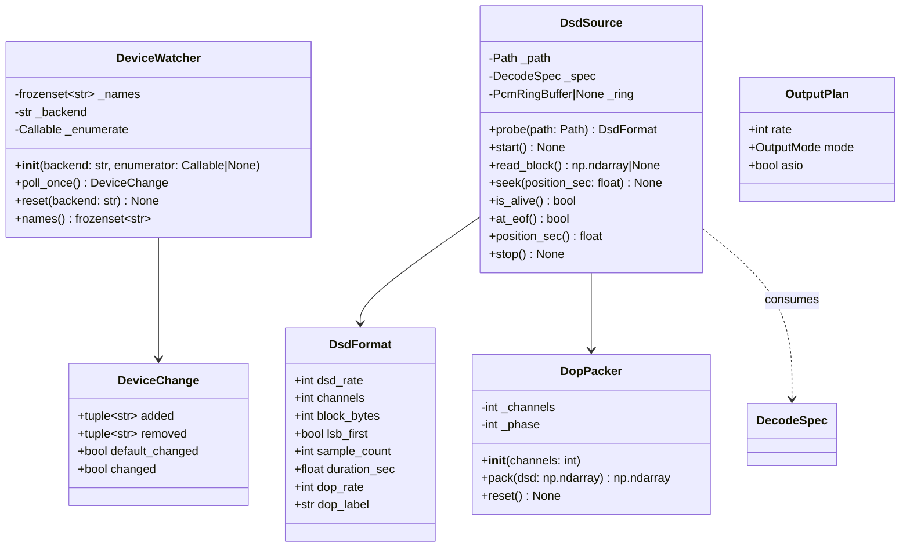
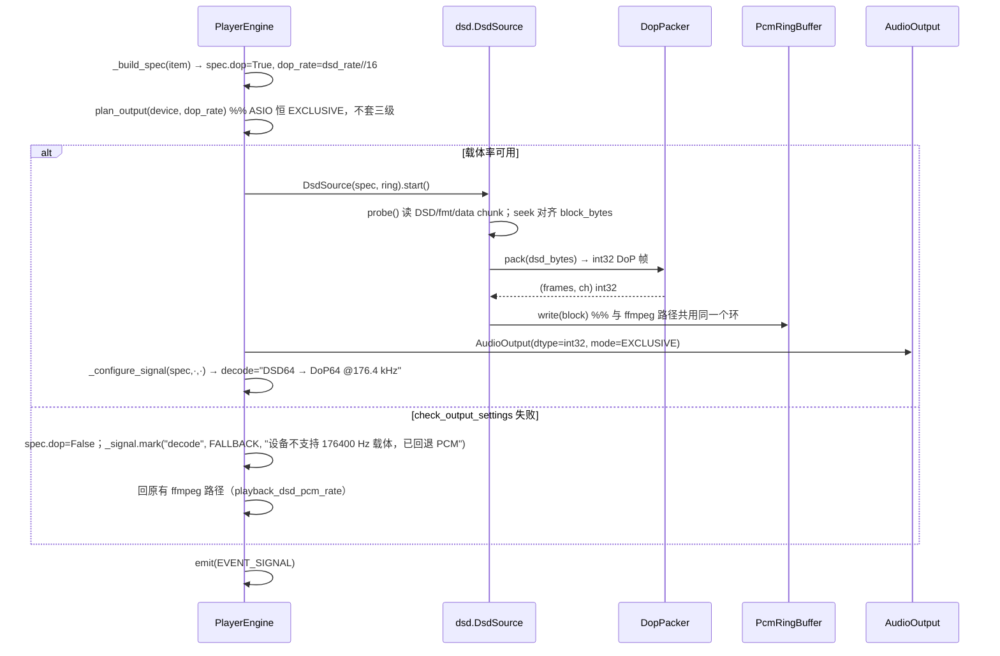
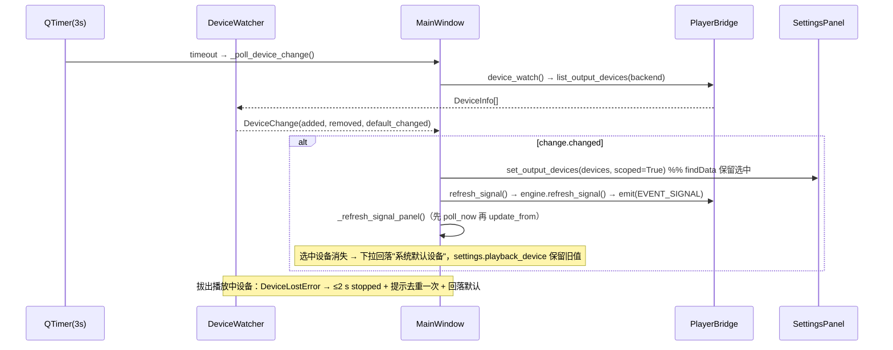

# 音序管家 v1.8.1 增量设计（承接 1.8.0 基线）

> 输入：`docs/v1.8.1-增量PRD.md`。本文只写**增量**：不变的模块不重述。已核对签名：`devices.py`（`list_output_devices/resolve_device/plan_output/backend_present`）、`output.AudioOutput.__init__`、`engine._configure_signal/_refresh_signal/_make_decoder`、`player_bridge.last_snapshot/poll_now/list_output_devices`、`player_signals.update_from`（吃 `signal_path`/`stages`/`counters`/`rate`/`output`）、`settings_panel.set_output_devices(scoped=)`、`constants.BACKEND_ASIO`（**已存在**，`BACKEND_HOSTAPI_HINTS["asio"]=("asio",)` 也已存在）。

## 1. 实现方案与关键取舍

### 1.1 P0-2 信号路径不刷新 —— 采纳 (a)：`_refresh_signal_panel()` 先 `poll_now()` 再 `update_from()`

理由（四条，按权重）：

1. **单点覆盖 11 个触发点**。当前 `_refresh_signal_panel()` 被 `_on_player_state/_on_player_track/_on_player_signal` 与 6 处设置回调调用，全部读 `last_snapshot()`。改 (a) 是 1 行改动、11 处同时修好；(b) 只修 `_on_player_signal`，切歌（`_on_player_track` 也读旧快照）与停止仍残留上一曲。
2. **(b) 会制造新的"面板说谎"**。`_on_player_signal(payload)` 拿到的是 `SignalPath.to_dict()`，没有 `rate` / `output` 键，`PlayerSignalsPanel._update_counters` 的 `device_rate` 会退化成 `—`；一个计数器说谎与整条链路说谎同样违反 R2「所见为真」。
3. **成本可忽略**。`poll_now()` 就是 `engine.poll()`，GUI 线程 100 ms 定时器已在跑同一条路径，纯内存操作（`_sync_counters` + `to_dict`），额外一次 <1 ms。
4. **防闪烁天然成立**。`QLabel.setText` 同文本不触发重绘；真正的"同文本不重复推"落在引擎侧 `_emit_signal_if_changed()`（§1.4）。

配套：`_on_player_track` 里现有的 `poll_now()` 移到 `_refresh_signal_panel()` 内部，避免重复调用。

### 1.2 引擎侧钩子（轨 A 不得改 engine.py → 由轨 B 提供）

`_refresh_signal()` 只重算 eq/gain；source/decode/format 只在 `_configure_signal()` 算一次。因此 `playback_bit_perfect` / `playback_int_pipeline` / `playback_volume_mode` / `playback_dsd_pcm_rate` 改动而**不重开流**时，format/decode 级不会变。修法不是重写逻辑，而是**复用**：`_configure_signal(self._spec, device, self._rate)` 无副作用（只重建 `SignalPath` 对象），可直接重跑。

- 轨 B 在 `engine.py` 新增（**仅此一处供轨 A 调用**）：
  `def refresh_signal(self) -> None:  # 按当前 spec/plan/output 重跑 _configure_signal 并推 EVENT_SIGNAL`
- 轨 A 只调 `player_bridge.refresh_signal()`（bridge 归轨 A），内部 `getattr(self._engine, "refresh_signal", None)`，无钩子时退回 `poll_now()` —— **T02 不阻塞于 T04**。

### 1.3 P0-1 设备热插拔

`DeviceWatcher` 放 `player/devices.py`，**不 import Qt**（player 层既有约束）；QTimer 由 `main_window` 持有。探测只调 `list_output_devices()`（纯 `sd.query_devices()` 枚举，不开流），与 `check` 类探测完全分离。

- 比对键 = **设备名集合**（`frozenset(d.name)`），不比对索引：`SD_ENABLE_ASIO=1` 后 5 个 hostapi 并存、索引整体后移，按索引比会"每次都变了"。
- 拔出播放中设备：沿用 `DeviceLostError` 兜底（output 层已抛），`main_window._on_device_lost()` 只做三件事：提示去重（`self._device_lost_notified: set[str]`）、`settings.playback_device = ""`（回落系统默认）、状态栏文案。**不新增**自动恢复播放。

### 1.4 P0-3 ASIO

- **开关来源 = 命令行 `--no-asio` / 环境变量 `SEQAUDIO_NO_ASIO`**，**不来自 settings**。理由：`Settings.load()` 需要 import 与磁盘 IO，晚于 "import sounddevice 之前"这个硬时限；且 settings 里的开关只能"下次启动生效"，用户会以为当场就关了（半生效＝说谎）。冷启动 `playback_output_backend="asio"` 直接生效的要求由"环境变量恒默认开"满足。
- 设置位置：`run.py` 在 `from seqaudio.app import main` **之前**；`app.py` 在所有 `from .` **之前**。两处都调 `_bootstrap_asio()`（幂等）。`devices.sounddevice()` 内在 `import sounddevice` 前再 `os.environ.setdefault("SD_ENABLE_ASIO","1")` 兜底（幂等、无害），并在 `_SD` 已加载且环境为 0 时打一条 DEBUG（说明"改环境已无效，需重启"）。
- 降级路径：DLL 缺失 / 无驱动 → `backend_present("asio") is False` → 下拉项置灰 + `dev_asio_unavailable`；配置存 asio 却解析不到 → `resolve_backend` 既有行为返回 `-1`（出声优先）+ WARNING，面板同时置灰。
- **不改既有四后端行为**：`resolve_backend`/`backend_key_for_hostapi` 已是名字包含匹配，索引后移不影响；`playback_device` 现状即存名字，**明令禁止**写入数字索引（`main_window` 只写 `device.name`）。
- `plan_output` 对 ASIO **不套三级降级**（ASIO 驱动天然独占，`WasapiSettings` 对它无意义——`extra_settings_for` 已对非 WASAPI 返回 `None`，正确）：新增提前返回分支，只按候选率降级、模式恒 `EXCLUSIVE`，全失败抛 `RateUnsupportedError` 且 `note` 写明"ASIO 只支持驱动声明的采样率"。

### 1.5 P1 DSD DoP

绕开 ffmpeg 直读位流：新增 `player/dsd.py`，`DsdSource` 与 `FfmpegDecoder` **同构**（`start/stop/is_alive/read_block/at_eof/position_sec/returncode`），因此 `engine._make_decoder` 只需一个分支，`_teardown_playback/_wait_prefill` 零改动。

- DoP 打包（以 DoP 1.1 规范原文为准，dsd-guide.com 白皮书 / ESS ES9020 datasheet / XMOS lib_xua 三处一致）：24-bit 帧 = `[标记(8, 最高字节) | DSD(16, 低位)]`，标记**逐样本**在 `0x05`/`0xFA` 之间交替（不是 8+8 分组）；int32 容器**左对齐** = `(marker << 24) | (payload16 << 8)`，低 8 位恒为 0（32bit 字宽时接收端丢弃的正是这 8 位）。`dop_rate = dsd_rate // 16` → 64:176400 / 128:352800 / 256:705600（本机不可用）。
- 载体率探测用 `sd.check_output_settings`（零出声）；不可用 → 回退 ffmpeg PCM，`decode` 级 `FALLBACK` + 写明回退率。
- DoP 与交叉淡变/无缝续写/音量/EQ 冲突：显式关闭并在信号路径注明，音量滑块禁用 + tooltip（采纳 PRD §6-2）。

## 2. 文件清单

**新增**
```
src/seqaudio/player/dsd.py             # DsdFormat / DsdSource / DopPacker / DsdDecodeError
tests/test_dsd_dop.py                  # DoP 打包 + DSF/DFF 解析 + 回退
tests/test_device_watch.py             # 两次伪造枚举做差
tests/test_signal_refresh.py           # ≥8 场景 stage detail 断言
docs/v1.8.1-sequence-diagram.mermaid   # 增量时序（v1.6 全量序列图保留不动）
docs/v1.8.1-class-diagram.mermaid      # 增量类图
```
**修改**
```
run.py                                 # _bootstrap_asio（首个可执行段）
src/seqaudio/app.py                    # _bootstrap_asio（早于所有 from . import）
src/seqaudio/player/constants.py       # DOP_RATES/DOP_MARKERS/DSD_RATES/DEVICE_WATCH_MS
src/seqaudio/player/devices.py         # DeviceWatcher/DeviceChange；plan_output ASIO 分支
src/seqaudio/player/output.py          # ASIO 下不构造 WasapiSettings、mode 上报 EXCLUSIVE
src/seqaudio/player/decoder.py         # DecodeSpec.dop/dop_rate；_pick_* DoP 分支
src/seqaudio/player/signal_path.py     # configure(dop=,dop_rate=,dsd_rate=) 与 DoP/FALLBACK 文案
src/seqaudio/player/engine.py          # refresh_signal()；_make_decoder DoP 分支；_apply_dop_constraints  ← 轨 B 独占
src/seqaudio/ui/player_bridge.py       # refresh_signal()/device_watch()/asio_present()
src/seqaudio/ui/settings_panel.py      # set_asio_state()/DoP 开关/首台 ASIO 提示
src/seqaudio/ui/main_window.py         # _device_watch_timer/_poll_device_change/_on_device_lost
src/seqaudio/ui/player_signals.py      # DSD/DoP 徽标（不改接口）
src/seqaudio/core/config.py            # playback_dsd_dop/playback_asio_note_seen
src/seqaudio/ui/i18n.py                # 新词条
pyproject.toml, src/seqaudio/__init__.py, installer/_meta.py   # 1.8.1
installer/check_audio_bundle.py, THIRD-PARTY.md
```

> **已拍板，不再讨论（team-lead 裁决）**
> 1. 首次检测到 ASIO 设备**不自动切换**后端；`settings_panel` 仅在 ASIO 项首次可用时给一次性提示（`settings.playback_asio_note_seen` 去重），切换权留给用户。
> 2. DoP 下播放条音量滑块**禁用 + ToolTip**（`dev_dop_volume_note`＝"音量由驱动控制"，采纳 PRD §6-2），**不隐藏**，避免布局跳动。
> 3. 热插拔轮询固定 **3 s**（`DEVICE_WATCH_MS = 3000`），并与 `DeviceLostError` 即时兜底**双保险**——轮询负责"列表与面板一致"，异常负责"正在播放时被拔"的 ≤2 s 响应。

## 3. 数据结构与接口（增量）



关键签名（伪代码只留决策行）：

```python
# devices.py
@dataclass(frozen=True)
class DeviceChange: added: tuple[str, ...]; removed: tuple[str, ...]; default_changed: bool
    @property
    def changed(self) -> bool: return bool(self.added or self.removed or self.default_changed)

class DeviceWatcher:
    def __init__(self, backend: str = "", *, enumerator: Callable[[str], list[DeviceInfo]] | None = None) -> None
    def poll_once(self) -> DeviceChange:      # 只比名字集合；不 start()、不 check_output_settings()
    def reset(self, backend: str) -> None:    # 后端切换重建基线，首次不报 change

# dsd.py
DSD_RATE_64, DSD_RATE_128, DSD_RATE_256, DOP_MARKER_FIRST=0x05, DOP_MARKER_SECOND=0xFA
class DsdFormat: ... ; def dop_rate(self) -> int: return self.dsd_rate // 16
class DsdSource:                          # 与 FfmpegDecoder 同构，可被 _make_decoder 直接返回
    @classmethod
    def probe(cls, path: Path | str) -> DsdFormat: ...   # 只读 chunk 头，无子进程
class DopPacker:
    def pack(self, dsd: np.ndarray) -> np.ndarray:        # (n,ch) uint8 -> (n,ch) int32
        out = dsd.astype(np.int32) << 16                 # 8bit 数据 → 24bit 高位
        out[..., 1] = 0
        out[self._phase % 16 == 0] |= 0x05 << 8
        out[self._phase % 16 == 8] |= 0xFA << 8
        self._phase += len(dsd)

# engine.py（轨 B）
def refresh_signal(self) -> None: ...      # 供轨 A 调；重跑 _configure_signal 并 emit(EVENT_SIGNAL)
def _apply_dop_constraints(self, spec: DecodeSpec) -> DecodeSpec: ...  # 禁 EQ/gain/fade/crossfade/gapless
def _make_decoder(...): return DsdSource(...) if spec.dop else FfmpegDecoder(...)

# player_bridge.py（轨 A）
def refresh_signal(self) -> None: ...      # getattr(engine,"refresh_signal",None) or poll_now()
def asio_present(self) -> bool: ...        # 缓存一次 backend_present("asio")
def device_watch(self) -> list[dict]: ...  # 供 watcher 注入 enumerator

# settings_panel.py
def set_asio_state(self, enabled: bool) -> None: ...   # 置灰/隐藏三档/换说明行
def set_dop_available(self, available: bool, reason: str = "") -> None: ...
```

## 4. 调用时序

**起播 DoP 路径**


**热插拔刷新路径**


## 5. 任务列表（5 个，≤ 上限）

| ID | 任务 | 轨 | 文件 | 依赖 | 优先级 | 验收命令 |
| --- | --- | --- | --- | --- | --- | --- |
| T01 | 基础设施：ASIO 环境引导 + 版本三件套 + 配置/词条/常量 | 公共 | `run.py`,`app.py`,`constants.py`,`core/config.py`,`ui/i18n.py`,`pyproject.toml`,`src/seqaudio/__init__.py`,`installer/_meta.py` | — | P0 | `python -m compileall -q src run.py && python -c "import os,run" && pytest -q tests/test_core.py` + 肉眼核对三处版本号 |
| T02 | 轨A-1：信号路径全场景刷新 + 设备热插拔 | A | `player/devices.py`,`ui/player_bridge.py`,`ui/main_window.py`,`ui/player_signals.py`,`tests/test_device_watch.py`,`tests/test_signal_refresh.py` | T01 | P0 | `pytest -q tests/test_device_watch.py tests/test_signal_refresh.py tests/test_player_devices.py` |
| T03 | 轨A-2：ASIO 后端可选可播 | A | `player/devices.py`(`plan_output` ASIO 分支),`player/output.py`,`ui/settings_panel.py`,`ui/main_window.py`,`installer/check_audio_bundle.py`,`THIRD-PARTY.md` | T02（同文件需顺序） | P0 | `pytest -q tests/test_output_backend_filter.py tests/test_player_exclusive_ui.py` + 手工：`python run.py --no-asio` 下拉置灰 |
| T04 | 轨B：DSD DoP64/128 直出与可视 | B | `player/dsd.py`(新),`player/decoder.py`,`player/engine.py`,`player/signal_path.py`,`tests/test_dsd_dop.py`,`tests/make_samples.py` | T01 | P1 | `pytest -q tests/test_dsd_dop.py tests/test_player_formats.py tests/test_player_wording.py` |
| T05 | 集成与验收：回归 + 文档 + 产物 | 公共 | `docs/v1.8.1-增量设计.md`,`docs/v1.8.1-*.mermaid`,`build.py`,`installer/*` | T02,T03,T04 | P1 | `pytest -q tests/ && python build.py --check` |

依赖图：`T01 → {T02 → T03, T04}; {T03,T04} → T05`。**T04 与 T02/T03 文件零重叠，可全程并行**。

## 6. 共享约定

- **错误类型**：设备侧沿用 `DeviceLostError/NoOutputDeviceError/RateUnsupportedError`；`dsd.py` 自定义 `DsdDecodeError(RuntimeError)`，**不 import devices**（避免循环，同 `decoder.DecodeError` 惯例）。
- **日志措辞**（固定，测试可断言）：`设备 %s 已断开，回落系统默认输出` / `设备表变化：+%s -%s` / `当前 PortAudio 未启用 ASIO（SD_ENABLE_ASIO 未生效）` / `DSD%d → DoP @%d Hz（%d ch）` / `载体率 %d Hz 不可用，DSD 回退 PCM`。
- **settings 新字段**：`playback_dsd_dop: bool = True`、`playback_asio_note_seen: bool = False`。**不新增** `playback_asio_enabled`（走 `--no-asio` / `SEQAUDIO_NO_ASIO`）。
- **常量**：`DEVICE_WATCH_MS = 3000`、`DSD_RATES = (2822400, 5644800, 11289600)`、`DOP_RATE_OF = {2822400:176400, 5644800:352800, 11289600:705600}`、`DOP_MARKER = (0x05, 0xFA)`、`DOP_FRAMES_PER_CYCLE = 16`。
- **i18n 词条**：`dev_asio_unavailable` / `dev_asio_mode_note` / `dev_dop_switch` / `dev_dop_volume_note` / `dev_dop_fallback` / `dev_lost_notice` / `decode_dop_detail` / `status_badge_dsd` / `status_badge_dsd_pcm`。
- **设备一律按名字存**，禁止把 PortAudio 索引写进 `playback_device`。
- **信号去重**：文本不变不 `emit(EVENT_SIGNAL)`（防闪烁），由 `engine._emit_signal_if_changed()` 统一裁决。
- 措辞铁律 R2 不变：DoP 路径文案禁 `bit-perfect`/`逐样本一致`，走 `signal_path.assert_wording`。

## 7. 待明确事项

1. `--no-asio` 是唯一关闭方式，还是同时在设置里放「下次启动生效」的开关（需附加"重启后生效"提示）？
2. DoP seek 按 DSF `blockSizePerChannel`(4096B) 对齐，最坏误差 ≈11.6 ms（DSD64）。PRD 只要求 ±5 s 不爆音，是否可以接受该量化误差？
3. 拔出设备后是否自动续播（PRD 仅要求转 stopped）？本设计取"不自动续播"，只回落默认设备。
