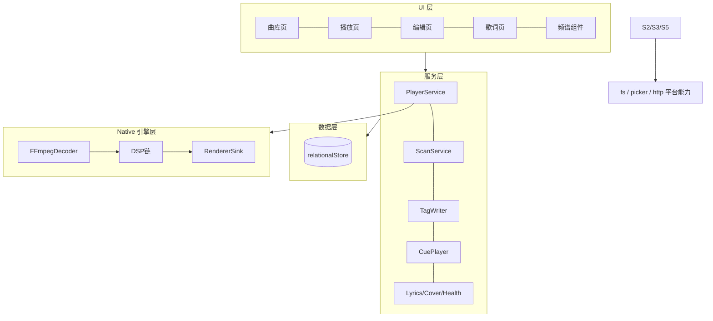
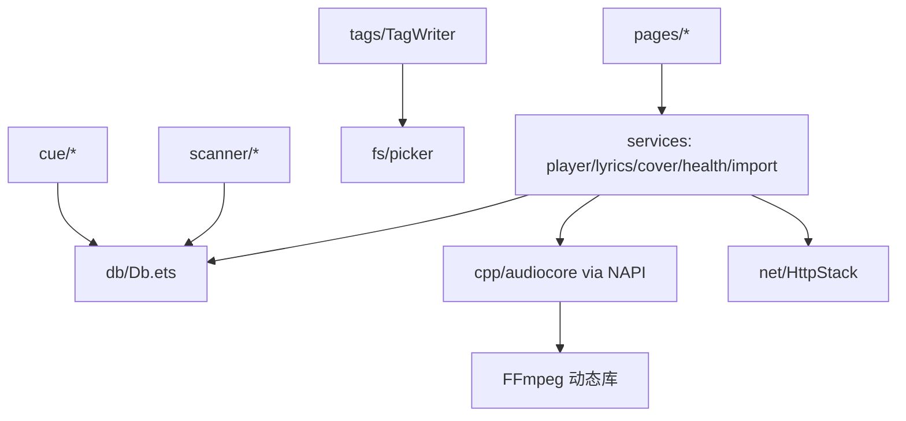
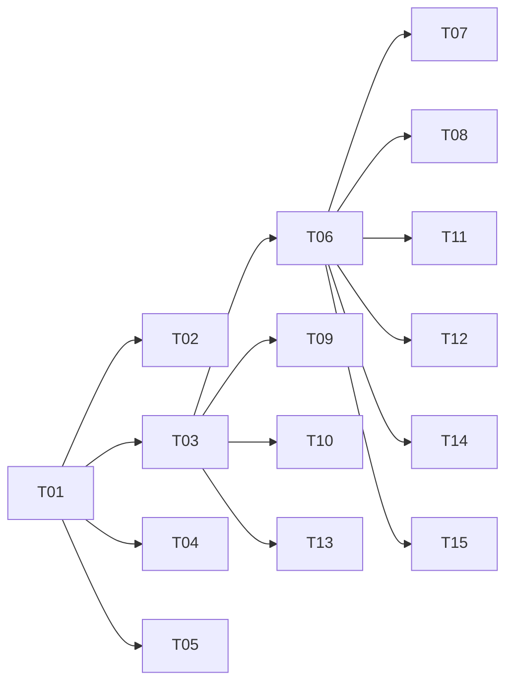

# 音序管家 · 鸿蒙 PC 版重写计划书

| 项 | 内容 |
|---|---|
| 文档版本 | v1.1 |
| 日期 | 2026-11-25 |
| 编制 | software-seqaudio-harmony 团队：许清楚（产品经理 / PRD）、高见远（架构师 / 方案与任务分解）、齐活林（交付总监 / 汇编） |
| 状态 | **M1 已交付（待出口回归）** —— T01–T05 全部完成并提交，2in1 模拟器冒烟通过；Q1 / Q3 / Q5 已拍板（见 §10），其余问题按建议默认执行 |
| 目标分支 | `harmony-pc`（当前基线 v1.0，提交 52f5c6a，已在 2in1 模拟器验证） |

---

## 0. 执行摘要

- **目标**：在鸿蒙 PC（2in1 / API 26）上，把音序管家从 v1.0 基线重写到对齐桌面版 v1.8.2 的核心能力：曲库管理、标签编辑、CUE、歌词、封面、Hi-Fi 播放内核。
- **路线**：三个里程碑 —— **M1 / v1.1 曲库管理基线**（纯 ArkTS，T01–T05）→ **M2 / v1.2 音质与体验**（引入 `cpp/audiocore`：随包 FFmpeg + OH_AudioRenderer + DSP 链，T06–T10）→ **M3 / v2.0 专业 Hi-Fi**（DSD、fake FLAC 鉴别、聚合元数据、频谱、桌面卡片，T11–T15）。
- **总量**：15 个任务，合计 **57 人日**（S/M/L=1/3/5 人日）；单人约 12 周（含 ~20% 缓冲），双人并行约 7–8 周。最大风险在 Native 播放内核与标签写回，均已给出降级与防护设计。
- **关键选型（已定）**：
  1. 解码：**随包裁剪版 FFmpeg 动态库**（LGPL-2.1+ 合规），不采用系统 OH_AVCodec 作主解码路径（格式覆盖/位深不可控，APE/DSD 等无法达成）。
  2. 标签写回：**纯 ArkTS「全量重写 + 原子替换」**（tmp → rename → 失败留 .bak），不引入 Native tag 库。
  3. 检索：`search_blob` 冗余列 + 索引，FTS5 作为可选增强（探测可用后再启用）。
  4. 输出：v1.2 起原生 PCM 直通（采样率跟随源），OH_AudioRenderer 低时延模式近似「独占」；AVPlayer 保留为降级路径。

---

## 1. 背景与现状

### 1.1 桌面版（能力来源，v1.8.2）
Windows 桌面级 Hi-Fi 音乐曲库管理 + 播放器（Python + PySide6）：
1. 元数据：多格式标签扫描/读写、批量整理、重命名、去重、真伪鉴别、完整性/健康检查、隔离区
2. CUE：整轨合并、CUE 分轨导出、多 FILE 修复
3. 歌词：lrclib 等源获取、嵌入、显示
4. 封面：多源搜索、嵌入、迷你窗旋转封面
5. 播放内核：ffmpeg 解码 → 环形缓冲 → WASAPI 共享/独占；采样率跟随；四模式；淡入淡出；防爆音；会话恢复；10 段 EQ；频谱
6. 曲库：内存列表 + 根目录；网络聚合元数据（MusicBrainz/iTunes/QQ/网易云）；便携配置、深色主题、托盘

### 1.2 鸿蒙版基线 v1.0（已完成并上机验证）
- ArkTS/Stage、API 26、bundleName `com.seqaudio.manager`
- 已有：本地扫描（FLAC/MP3/WAV/M4A 标签+规格，纯 ArkTS）、relationalStore 曲库、AVPlayer 四模式播放、曲库页（搜索/统计/导入/扫描进度）+ 全屏播放页 + 迷你播放条、内置示例曲目、深色主题
- 构建链：hvigor CLI + hdc 安装未签名 HAP 到 2in1 模拟器（26.0.0）

### 1.3 差距（本计划书要解决的）
标签编辑、CUE、会话恢复、健康检查、批量整理（v1.1）；直通输出/低时延、EQ、歌词、封面、防爆音（v1.2）；DSD、真伪鉴别、聚合元数据、频谱、卡片（v2.0）。

---

## 2. 需求范围（产品经理：许清楚）

### 2.1 产品目标
| # | 目标 | 量化指标 | 优先级 |
|---|---|---|---|
| G1 | 核心能力对齐桌面版 | 8 大能力域中 v1.2 覆盖 ≥6 类；v2.0 覆盖全部「非目标」以外能力 | P0 |
| G2 | 音质底线 bit-perfect | 44.1k/16～192k/24bit FLAC/WAV/MP3 全程直通无重采样；点击到出声 ≤1s；24h 播放零爆音零崩溃 | P0 |
| G3 | 曲库规模与性能 | ≥10 万首曲库；1 万首增量扫描 ≤5 分钟（M.2 SSD 测试机）；搜索响应 ≤200ms | P1 |
| G4 | 曲库整理效率 | 1000 首内批量改标签/重命名/去重 ≤1 分钟；批量操作支持预览与失败回滚 | P1 |

### 2.2 目标用户与场景
**目标用户**：拥有本地无损收藏（FLAC/WAV/APE/DSD 等）的鸿蒙 PC（2in1/笔记本）用户；典型画像为「在桌面版管理 1～5TB 曲库的 Hi-Fi 爱好者」。

| 场景 | 描述 | 关键诉求 |
|---|---|---|
| S1 首次建档 | 2TB 无损目录批量导入，扫描标签与规格，建立可检索曲库 | 快、全、准；能识别 fake FLAC |
| S2 日常聆听 | 打开即续播上次会话，按专辑/歌手浏览，四模式播放，看封面歌词 | 无缝、稳定、体验好 |
| S3 曲库整理 | 批量改标签、按模板重命名、去重、CUE 整轨拆分导出 | 安全（可预览/回滚）、高效 |
| S4 音质调校 | 独占/低延迟输出、采样率跟随、10 段 EQ、DSD 播放、频谱观察 | bit-perfect、可控可验证 |

### 2.3 用户故事（验收取向）
| # | 用户故事 | 验收要点 |
|---|---|---|
| U1 | 批量导入本地无损目录并自动扫描，快速建档 | 1 万首增量扫描 ≤5 分钟；进度可暂停/恢复；重复导入零重复 |
| U2 | 查看格式/采样率/位深/码率等规格，判断音源品质 | 规格字段解析准确并在详情页完整展示 |
| U3 | 直接编辑标签并支持批量应用 | 写入后第三方工具可正确回读；批量有预览与失败报告 |
| U4 | 播放 CUE 整轨专辑并按单轨切换 | 内嵌/外置 CUE 均可解析；切轨误差 ≤0.5s |
| U5 | 采样率跟随、无重采样直通播放 | 192k/24bit 输出规格与源一致；可「跟随/锁定」输出采样率 |
| U6 | 31 段 EQ 调音并保存预设 | 与桌面版 `EQ_BANDS_HZ` 一致（20Hz–20kHz 1/3 倍频程，Q=1.41），±12dB；预设保存/切换；切换 ≤200ms 生效 |
| U7 | 联网获取并显示歌词（逐行滚动） | 获取成功率 ≥90%；无网回退嵌入/本地歌词；同步误差 ≤300ms |
| U8 | 自动搜索并嵌入专辑封面 | 多源按匹配度排序；嵌入后第三方可读；无结果可手动指定 |
| U9 | 鉴别 fake FLAC 并隔离可疑文件 | 检出率 ≥90%、误报率 ≤5%；一键移入隔离区 |
| U10 | 断点续播并恢复上次会话 | 重启后恢复曲目/进度（误差 ≤3s）/模式/音量 |
| U11 | 去重、批量重命名与目录整理 | 模板可预览；去重仅标记/隔离不自动删除；抽检准确率 ≥95% |
| U12 | 实时频谱与输出规格观察 | 频谱 ≥30fps 不卡 UI；同屏显示采样率/位深/输出模式 |

### 2.4 需求池

**P0（必须 · v1.1）**
| 编号 | 名称 | 说明 | 验收要点 | 规模 |
|---|---|---|---|---|
| R01 | 增量扫描与根目录管理 | 多根目录增删；仅处理新增/变更；进度可暂停/恢复/取消 | 1 万首增量 ≤5 分钟；零重复记录；移除根目录可选保留/清除 | M |
| R02 | 标签编辑与批量整理 | FLAC(Vorbis)/MP3(ID3v2)/M4A 标题/歌手/专辑/年份/音轨号/封面读写；单首+批量（预览+回滚） | 第三方工具可正确读回；批量失败可回滚或明确报告 | L |
| R03 | CUE 解析与按轨播放 | 外置+内嵌 CUE；轨号/标题/时间轴；按轨切歌；CUE 分轨导出 | 切轨误差 ≤0.5s；多 FILE 可解析；导出标签正确 | M |
| R04 | 会话恢复 | 持久化队列、当前曲目、进度、模式、音量 | 应用/系统重启后完整恢复，进度误差 ≤3s | S |
| R05 | 完整性与健康检查（基线） | 可解码性、时长/标签一致性、截断与损坏标记 | 损坏样本 100% 被标记；健康报告页可筛选 | M |
| R06 | 批量导入链路加固 | 选择器多选/文件夹授权导入；失败重试与错误明细；重复提示 | 1000 文件失败率可统计且有重试入口；重复可选跳过/覆盖 | S |

**P1（应该 · v1.2）**
| 编号 | 名称 | 说明 | 验收要点 | 规模 |
|---|---|---|---|---|
| R07 | Native 播放内核一期 | NAPI + AudioRenderer 直通输出；采样率跟随/锁定；独占/低延迟；真实输出规格上报 | 192k/24bit 输出与源一致（无重采样）；独占被抢占明确降级；延迟不劣于 AVPlayer | L |
| R08 | 31 段 EQ 与预设 | 对齐桌面版 31 段 1/3 倍频程（20Hz–20kHz，Q=1.41），±12dB；预设保存/切换；全局开关 | 频点与桌面版 `EQ_BANDS_HZ` 一致（Q1 已定）；切换 ≤200ms；预设持久化 | L |
| R09 | 歌词获取与显示 | lrclib 等源；读取嵌入歌词；逐行滚动；无网降级 | 成功率 ≥90%；同步误差 ≤300ms | M |
| R10 | 封面多源搜索与嵌入 | 多源搜索按匹配度排序；嵌入文件+曲库缓存 | 嵌入后第三方可读；无结果支持手动选择 | M |
| R11 | 淡入淡出与防爆音 | 切歌/暂停/音量突变平滑过渡；时长可配置 | 主观无爆音；无瞬时满幅跳变 | M |
| R12 | 批量重命名与去重 | 模板重命名；标签+指纹去重建议清单；仅标记/隔离 | 模板变量齐全可预览；去重抽检准确率 ≥95%；零自动删除 | M |

**P2（可以做 · v2.0）**
| 编号 | 名称 | 说明 | 验收要点 | 规模 |
|---|---|---|---|---|
| R13 | DSD 文件播放 | Native 解码 DSF/DFF，DoP 或 Native DSD（视 R07 能力） | DSD64 完整播放不中断；输出规格正确上报 | L |
| R14 | fake FLAC 真伪鉴别 | 频谱/统计特征识别升频、转码；结果分级；一键隔离 | 检出率 ≥90%、误报率 ≤5% | L |
| R15 | 网络聚合元数据 | MusicBrainz/iTunes/QQ/网易云按优先级补全 | 源优先级可配置；单源失败降级不阻塞 | L |
| R16 | 实时频谱可视化 | 播放页频谱动画 + 输出规格同屏 | ≥30fps；不影响播放线程 | M |
| R17 | 隔离区管理 | 隔离文件查看/恢复/删除 | 操作可逆；曲库与磁盘状态一致 | S |
| R18 | 桌面卡片/迷你播放窗 | 卡片或迷你窗：旋转封面 + 快捷控制 | 卡片刷新及时；控制与主状态一致 | M |
| R19 | 扩展格式解码 | APE/WavPack/TTA/ALAC 经第三方解码库接入 Native 内核 | 样本可解码播放；性能 ≥2x 实时 | L |

### 2.5 版本切分与工作量
| 版本 | 主题 | 需求 | 预估工作量 |
|---|---|---|---|
| v1.1 | 曲库管理基线补齐 | R01–R06 | 约 14–18 人日 |
| v1.2 | 音质与体验（Native 内核一期） | R07–R12 | 约 24–30 人日 |
| v2.0 | 专业 Hi-Fi 能力 | R13–R19 | 约 35–45 人日 |

> 规模口径：本表为产品侧粗估。架构师按任务拆分后的最终口径为 S/M/L=1/3/5 人日，15 个任务合计 57 人日，明细见第 7 节任务表与第 9 节排期。

### 2.6 非目标（本期明确不做）
| 非目标 | 理由 |
|---|---|
| ASIO 独占驱动 | 鸿蒙无 ASIO 驱动模型与生态；以 AudioRenderer 独占/低延迟模式作为平台等价物 |
| SACD ISO 直放 | ISO 解析与 SACD 流提取复杂度高、版权与格式生态受限；v2.0 先支持 DSF/DFF 单文件 |
| WASAPI 细节/便携版等 Windows 专属形态 | 平台机制不同；以鸿蒙等价能力替代，不做移植级兼容 |
| 在线流媒体播放 | 桌面版亦无此能力，不扩大范围 |
| 多设备分布式播放/投播 | 非核心价值，待核心能力对齐后再评估 |
| 全格式自研解码一步到位 | APE/WavPack/TTA 等依赖第三方解码库移植，成本高风险大，放 v2.0 单独评估 |

---

## 3. 总体架构（架构师：高见远）

在 v1.0「ArkTS 单层 + AVPlayer」基础上，演进为「**UI 层 / 服务层 / 数据层 / Native 引擎层 / 平台适配层**」五层结构；Native 层仅在 v1.2 引入，v1.1 全程纯 ArkTS，保证基线可交付。

| 层 | 职责 | 主要模块 | 技术载体 |
|---|---|---|---|
| UI 层 | 曲库/播放/编辑/歌词/频谱页面与组件 | Index、PlayerPage、TrackEditPage、LyricsPage、FakeCheckPage、MiniPlayer、SpectrumView | ArkUI（现有延续） |
| 服务层 | 播放控制、扫描调度、标签/CUE/歌词/封面/健康/导入/会话等业务编排 | PlayerService、ScanService、TagWriter、CuePlayer、LyricsService、CoverService、HealthCheck、ImportManager、SessionStore | ArkTS |
| 数据层 | 曲库/设置持久化、迁移、检索 | Db.ets（relationalStore）、DbMigrate | SQLite |
| Native 引擎层（v1.2+） | 解码、DSP、输出、频谱分析 | cpp/audiocore（NAPI 接口 + FFmpeg 解码 + OH_AudioRenderer 输出 + DSP 链） | C++/NAPI |
| 平台适配层 | 文件/权限/网络/后台任务/卡片 | fs、picker、http、backgroundTaskManager、form | 系统 API |



**关键架构原则**
1. v1.1 不引 Native：标签写回/CUE/健康检查全部纯 ArkTS 可达，避免工具链风险前移。
2. 播放内核双轨：v1.1 维持 AVPlayer；v1.2 起 audiocore 为主、AVPlayer 自动降级（初始化失败/独占被抢占/异常）。
3. 解码统一走 PCM 帧：所有格式在 Native 层归一为 PCM（含 DSD 转 176.4k/24bit），上层不感知格式差异。
4. 一切可降级：网络失败用本地、Native 失败用 AVPlayer、写回失败留 .bak、CUE 解析失败按整轨播放。
5. UI 与引擎解耦：引擎通过 NAPI 事件回调（状态/进度/频谱），UI 只读快照，播放线程零阻塞。

---

## 4. 分阶段架构决策（架构师：高见远）

### 4.1 v1.1（M1，纯 ArkTS）

| 决策点 | 结论 | 理由 |
|---|---|---|
| DB 演进 | tracks 表增量加列 + user_version 迁移 | v1.0 已有表结构与索引基础，增量成本最低 |
| 标签写回 | 纯 ArkTS「内存重写+原子替换」 | 无成熟 Native tag 库可直接用于鸿蒙 PC；纯 ArkTS 可控可回滚 |
| CUE 播放 | 逻辑轨映射到物理文件 offset | AVPlayer 支持 seek 到毫秒，无需拆分文件 |
| 会话恢复 | settings 表单行 JSON + 5s/关键事件节流落库 | 写放大最小，恢复精度 ≤3s 可达成 |
| 扫描性能 | 目录级 3 并发 + 200 首批量事务 | 1 万首 ≤5min（M.2 SSD）留有 2 倍余量 |

### 4.2 v1.2（M2，引入 cpp/audiocore）

**解码选型对比**

| 方案 | 格式覆盖 | 24bit/192k | APE/DSD | 工程量 | 风险 | 结论 |
|---|---|---|---|---|---|---|
| OH_AVCodec（系统） | 常见有损/PCM | 部分（依赖芯片） | 不支持 | S | 低 | 降级路径保留，不作主路径 |
| 自研解码 | 按格式逐个写 | 可达 | 极难 | XL | 高 | 放弃 |
| **随包裁剪 FFmpeg** | 全 | 可达 | APE 可、DSD 需另接 | M | 中（合规/包体） | **采用** |
| 第三方移植库（libFLAC 等）拼装 | 分格式 | 可达 | 不全 | L | 中 | 放弃（维护碎） |

**FFmpeg 裁剪与合规**
- 只保留：demuxer（flac/mp3/wav/mov/ape）、decoder（flac/mp3/pcm/alac/ape）、resampler（swr，仅 EQ/混音路径需要时启用）、util。
- 关闭：网络模块、全部 encoder（除 PCM）、滤镜图、示例与文档；预计 .so 体积控制在 **8–12MB**（arm64）。
- 合规：LGPL-2.1+ 动态链接（随包 .so，不静态链），保留版权声明与 LICENSE 文件；不修改 FFmpeg 源码则无需公开裁剪脚本（修改则需按 LGPL 提供）。
- ABI：只出 C 接口封装（audiocore_napi），ArkTS 侧零 FFmpeg 依赖，便于替换与降级。

**cpp/audiocore 模块设计**

| 模块 | 职责 | 关键点 |
|---|---|---|
| AudioCoreNapi | NAPI 接口：start/stop/pause/seek/setVolume/setEq/setRateFollow/on(event) | 状态与进度经 ThreadSafeFunction 回调 ArkTS |
| DecoderWorker | 独立线程，FFmpeg 解码→PCM 帧 | 帧队列 + 背压；支持 cue offset 定位 |
| DspChain | 31 段 biquad EQ（对齐桌面版频点/Q 值）、音量、soft-limiter（防爆音）、fade in/out、（可选）重采样 | 直通路径零处理；EQ/防爆音开启才插入 |
| RendererSink | OH_AudioRenderer 封装 | lowLatency 模式；采样率跟随源；输出规格上报；被抢占回调→自动切 AVPlayer 并通知 UI |
| RingBuffer | 解码线程 ↔ 渲染线程缓冲 | ≥500ms，SPSC 无锁 |

**v1.2 里程碑路径**：M2-a 跑通 16bit/44.1k 直通 → M2-b 24bit/192k + 独占/低时延 → M2-c EQ/防爆音/歌词/封面整链。

### 4.3 v2.0（M3，专业 Hi-Fi）

| 决策点 | 结论 | 说明 |
|---|---|---|
| DSD 形态 | 仅 DSF/DFF 文件，转 176.4k/24bit PCM 输出 | 不做 SACD ISO；DoP 待真机能力确认 |
| fake FLAC 鉴别 | Native FFT 频谱统计 + 截止频率/高频能量分布评分 | ≥16kHz 能量异常 + 上限截断特征；阈值可调，输出 0–100 分 |
| 聚合元数据 | MusicBrainz → iTunes → QQ → 网易云，字段级合并（空位才填） | 全部可关；失败静默降级 |
| 频谱可视化 | 引擎内 FFT（每帧 2048 点，60fps 上报节流） | UI 仅渲染，计算不进 UI 线程 |
| 桌面卡片 | FormExtensionAbility + 迷你窗双形态 | 卡片展示封面/曲目/控制；与主服务共享状态 |

---

## 5. 关键设计细节（架构师：高见远）

### 5.1 数据库设计（在 v1.0 tracks 表上增量迁移）

| 变更 | 说明 |
|---|---|
| 新增列 | `cue_path` TEXT、`is_cue_child` INTEGER、`cue_track_no` INTEGER、`cue_start_ms` INTEGER、`cue_end_ms` INTEGER、`replay_gain` REAL、`health_status` TEXT DEFAULT 'ok'、`health_detail` TEXT、`search_blob` TEXT、`lyrics` TEXT、`cover_blob_path` TEXT、`meta_source` TEXT、`meta_checked_at` INTEGER |
| 迁移方式 | `CREATE TABLE IF NOT EXISTS tracks_v2 ...` → `INSERT INTO tracks_v2 SELECT ...`；失败回退旧表。迁移逻辑放在 Db.ets，启动时按 `PRAGMA user_version` 判断是否需要迁移 |
| 索引 | `idx_tracks_artist`、`idx_tracks_album`、`idx_tracks_search`（search_blob 上普通索引；FTS5 可用时替换为虚拟表） |

### 5.2 标签写回引擎（纯 ArkTS）

流程：读取原文件全部标签帧 → 内存中修改目标帧（封面等大帧单独处理）→ 全量重写文件到 tmp → 校验 tmp 可解析 → rename 覆盖原文件 → 失败保留 .bak。

- **FLAC**：重写 Vorbis Comment 块（保留 STREAMINFO/SEEKTABLE/图片块顺序）；封面修改独立处理 PICTURE 块
- **MP3**：重写 ID3v2（v2.3 优先，兼容 v2.4）；保留原音频帧；ID3v1 同步更新
- **M4A**：重写 ilst atom（moov.udta.meta.ilst）；其他 atom 原样拷贝
- **风险防护**：写前 stat 记录 size/mtime；写后校验时长差异 >1s 即回滚

### 5.3 CUE 解析与整轨播放

- 解析：PERFORMER/TITLE/FILE/INDEX 01:xx:xx（frame→ms，1 frame=1/75s）；支持一个 CUE 多 FILE（逐 FILE 建立时间轴）
- 播放：cue 子轨显示为独立行，播放时定位到 `cue_start_ms`；seek/切轨换算到物理文件偏移；进度条显示逻辑轨位置
- 导出：按 INDEX 切分，写新音频文件（流拷贝优先，FLAC/MP3 可 frame 级切割；PCM 重编码为兜底）+ 生成新 CUE
- 交付：M2 交付外置 CUE 解析+按轨播放，M3 补内嵌 CUE 与分轨导出

### 5.4 网络能力（歌词/封面/聚合元数据）

- 统一 HttpStack：`@ohos.net.http`，超时 5s、失败重试 1 次、并发上限 3
- 歌词：lrclib（`https://lrclib.net/api/search`）；嵌入歌词优先；LRC/纯文本均支持
- 封面：iTunes Search API → QQ 音乐 → 网易云；按「歌手+专辑」匹配度排序，取第一张 ≥500px
- 聚合元数据（v2.0）：MusicBrainz → iTunes → QQ/网易云；字段级合并策略：现有字段为空才写入，写入前记录 meta_source
- 全部网络能力均可关闭（设置开关），失败静默降级，不阻塞曲库与播放

### 5.5 性能设计

| 项 | 设计 |
|---|---|
| 扫描 | 目录级并行（最多 3 并发）；标签解析失败不中断；每 200 首批量事务写入 |
| 曲库列表 | LazyForEach + 数据源分页（每页 500）；滚动中不触发搜索 |
| 搜索 | search_blob `LOWER(...) LIKE`，命中走 idx_tracks_search；10 万首目标 ≤200ms（M.2 SSD） |
| 播放 | 解码线程独立于 UI；PCM 环形缓冲 ≥500ms；UI 仅读状态快照 |
| 任务 T07/T08 的文件清单见 §6.2 |

### 5.6 会话与设置持久化

- settings 表 KV：`last_queue_json`、`last_track_id`、`last_position_ms`、`play_mode`、`volume`、`eq_enabled`、`eq_bands_json`、`output_mode`、`follow_source_rate`、`session_saved_at`
- 播放中每 5s 与关键事件（切歌/seek/暂停）时写库；启动时若 session_saved_at 距今 >7 天则不恢复队列
- 崩溃恢复：last_position_ms 以「最后确认帧」为准，恢复误差 ≤3s

---

## 6. 文件清单与模块地图（架构师：高见远）

> 与 §5 的设计决策一一对应；文件均在 `entry/src/main/ets/` 下（Native 部分在 `src/main/cpp/`）。

### 6.1 M1（v1.1，T01–T05）

```
ets/db/Db.ets                      # 扩展列/迁移/search_blob（T01）
ets/scanner/Scanner.ets            # 多根目录/暂停恢复/并行（T02）
ets/scanner/TagParser.ets          # 读接口扩展
ets/tags/TagWriter.ets             # 新增：FLAC/MP3/M4A 写回（T03）
ets/tags/TagTypes.ets              # 新增：标签数据模型
ets/pages/TrackEditPage.ets        # 新增：单首/批量编辑页（T03）
ets/cue/CueParser.ets              # 新增：CUE 解析（T04）
ets/cue/CuePlayer.ets              # 新增：整轨→逻辑轨映射（T04）
ets/cue/CueExporter.ets            # 新增：分轨导出（T04，M3 部分）
ets/session/SessionStore.ets       # 新增：会话持久化（T01）
ets/health/HealthCheck.ets         # 新增：健康检查（T05）
ets/import/ImportManager.ets       # 新增：picker 批量导入/重试（T02）
ets/pages/Index.ets                # 曲库页接入以上能力
```

### 6.2 M2（v1.2，T06–T10）

```
cpp/audiocore/CMakeLists.txt                 # Native 构建脚本（T06）
cpp/audiocore/audiocore_napi.cpp             # NAPI 接口：start/stop/seek/volume/eq/rate-follow（T06）
cpp/audiocore/decoder/FFmpegDecoder.cpp/.h   # 随包 FFmpeg 解码（T06）
cpp/audiocore/output/RendererSink.cpp/.h     # OH_AudioRenderer 封装、独占/低延迟（T06）
cpp/audiocore/dsp/DspChain.cpp/.h            # EQ(31 band biquad，对齐桌面版)/重采样(可选)/限幅/淡入淡出（T06/T07）
cpp/audiocore/ring/RingBuffer.h
ets/player/PlayerEngine.ets                  # 切换到 audiocore，AVPlayer 降级保留（T06）
ets/player/EqPresets.ets                     # EQ 预设（T07）
ets/lyrics/LyricsService.ets                 # 歌词获取/解析/缓存（T08）
ets/lyrics/LyricsPage.ets                    # 歌词显示（T08）
ets/cover/CoverService.ets                   # 封面搜索/嵌入（T09）
ets/library/RenameDedupService.ets           # 批量重命名/去重（T10）
# 防爆音：DspChain 内 soft-limiter + fade
```

### 6.3 M3（v2.0，T11–T15）

```
cpp/audiocore/decoder/DsdDecoder.cpp/.h       # DSF/DFF 解码（T11）
cpp/audiocore/analyze/FakeFlacDetector.cpp/.h # 频谱/统计特征（T12）
ets/pages/FakeCheckPage.ets                   # 真伪鉴别页（T12）
cpp/audiocore/analyze/SpectrumTap.cpp         # 频谱 FFT tap（T14）
ets/components/SpectrumView.ets               # 频谱组件（T14）
ets/net/AggMetaService.ets                    # 聚合元数据（T13）
ets/form/PlayerCardForm.ets                   # 桌面卡片（T15）
```

### 6.4 模块依赖



---

## 7. 任务分解（架构师：高见远）

按里程碑排序；每里程碑 ≤5 个任务，粒度 = 一次提交可完成。规模：S=1 人日、M=3 人日、L=5 人日。

| ID | 里程碑 | 任务 | 交付物 | 验收标准 | 依赖 | 规模 |
|---|---|---|---|---|---|---|
| T01 | M1·v1.1 | 数据层扩展：tracks 增列 + user_version 迁移 + search_blob + settings KV（会话字段） | Db.ets / DbMigrate | 迁移可重入；老数据无损；搜索 LIKE 命中 | - | M |
| T02 | M1·v1.1 | 扫描与导入：多根目录、暂停/恢复/取消、3 并发、批量事务、picker 导入重试 | Scanner/ImportManager | 1 万首 ≤5min（SSD）；失败明细可重试 | T01 | M |
| T03 | M1·v1.1 | 标签写回：FLAC/MP3/M4A 全量重写+原子替换+回滚；编辑页（单首/批量预览） | TagWriter/TrackEditPage | 第三方可读回；批量可预览；失败留 .bak | T01 | L |
| T04 | M1·v1.1 | CUE：解析（外置）、逻辑轨映射、按轨播放/切轨、（M3）分轨导出 | CueParser/CuePlayer | 切轨误差 ≤0.5s；多 FILE 可解析 | T01 | M |
| T05 | M1·v1.1 | 健康检查基线：可解码性/时长一致性/截断标记 + 报告页 | HealthCheck | 损坏样本 100% 标记 | T01 | M |
| T06 | M2·v1.2 | Native 内核一期：NAPI+FFmpeg 解码+RendererSink 直通+环形缓冲；AVPlayer 降级 | cpp/audiocore 可用 | 192k/24bit 直通；点击→出声 ≤1s；24h 无爆音 | T03 | L |
| T07 | M2·v1.2 | EQ 与防爆音：31 段 biquad（桌面版频点/Q=1.41）、预设持久化、soft-limiter/fade | DspChain/EqPresets | 频段/增益符合 Q1 结论；切换 ≤200ms | T06 | L |
| T08 | M2·v1.2 | 歌词：lrclib+嵌入歌词、逐行滚动、降级链 | LyricsService/Page | 成功率 ≥90%；同步误差 ≤300ms | T06 | M |
| T09 | M2·v1.2 | 封面：多源搜索、嵌入、曲库缓存 | CoverService | 嵌入后第三方可读；无结果可手动 | T03 | M |
| T10 | M2·v1.2 | 重命名与去重：模板变量+预览；标签+指纹去重（仅标记/隔离） | RenameDedupService | 抽检准确率 ≥95%；零自动删除 | T03 | M |
| T11 | M3·v2.0 | DSD：DSF/DFF 解码，转 176.4k/24bit PCM | DsdDecoder | DSD64 完整播放；规格正确上报 | T06 | L |
| T12 | M3·v2.0 | fake FLAC 鉴别：频谱/统计评分、分级、隔离区联动 | FakeFlacDetector/页面 | 检出 ≥90%；误报 ≤5%（Q6 样本集） | T06 | L |
| T13 | M3·v2.0 | 聚合元数据：MusicBrainz/iTunes/QQ/网易云，字段级合并 | AggMetaService | 单源失败降级；全部可关 | T03 | L |
| T14 | M3·v2.0 | 频谱可视化：引擎 FFT tap + SpectrumView，输出规格同屏 | SpectrumTap/View | ≥30fps；不影响播放线程 | T06 | M |
| T15 | M3·v2.0 | 桌面卡片/迷你窗：封面+快捷控制 | Form/迷你窗 | 状态一致；刷新及时 | T06 | M |

**依赖关系**



---

## 8. 风险登记册（架构师：高见远）

| # | 风险 | 概率 | 影响 | 缓解/预案 |
|---|---|---|---|---|
| R-1 | FFmpeg 裁剪后仍超包体/编译不过 | 中 | 高 | 预算 8–12MB；超限先砍 demuxer 冗余；再不行降级 OH_AVCodec+外置解码进程 |
| R-2 | LGPL 合规瑕疵 | 低 | 中 | 动态链接、不改源码、随包 LICENSE；上架前法务自查清单 |
| R-3 | OH_AudioRenderer 低时延/独占行为与预期不符 | 中 | 高 | 双路输出抽象；真机早测；抢占自动降级 AVPlayer |
| R-4 | 标签写回损坏用户文件 | 低 | 高 | 原子替换+写后校验+ .bak 回滚；>500MB 拒写（待 Q5 确认） |
| R-5 | 1 万首扫描/10 万首检索不达标 | 中 | 中 | 批量事务+索引早建；不达标再上 FTS5；验收环境以 Q4 结论为准 |
| R-6 | lrclib/QQ/网易等外部源不可用或变更 | 中 | 低 | 多源降级链；嵌入歌词/本地缓存兜底；网络功能整体可关 |
| R-7 | DSD 解码性能不足（实时性） | 中 | 中 | DSD64→PCM 转换基准测试先行；不足则限 DSD128 以下或提示 |
| R-8 | 模拟器与真机音频行为差异 | 高 | 中 | 音频硬指标尽量真机验证；无真机时标注平台差异并给出模拟器基线 |

---

## 9. 测试策略与里程碑排期（架构师：高见远）

### 9.1 测试策略

| 层级 | 覆盖 | 方法 |
|---|---|---|
| 单元（ArkTS） | TagParser/TagWriter/CueParser/SessionStore/Db 迁移 | @ohos/hypium；构造多格式样本（含损坏/截断/多 FILE CUE） |
| Native | FFmpegDecoder/RingBuffer/DspChain/EQ 系数 | C++ gtest（/host 端可跑部分）+ 设备端冒烟；EQ 用正弦扫频验证频响 |
| 集成 | 扫描→入库→检索→播放→切轨→写回 全链路 | 模拟器自动化脚本（hdc shell + aa start）+ 手工 checklist |
| 性能 | 扫描吞吐、搜索延迟、点击→出声、长播稳定性 | 1 万首样本集计时；10 万首 LIKE 计时；24h 连播挂机（errStreak/日志审计） |
| 音质 | 直通验证、EQ 频响、防爆音 | 录制输出回环对比（如设备支持）；至少做到「输出规格与源一致」断言 |
| 兼容 | FLAC/MP3(v2.2/2.3/2.4)/WAV/M4A/APE/DSD 样本矩阵 | 每格式 ≥3 个代表样本；标签编码含 UTF-8/GBK |

**关键用例（节选）**：GBK 标签乱码；ID3v2.2 老标签写回升级；多 FILE CUE 切轨；原子替换中断电模拟（kill 进程后 .bak 恢复）；独占被通话抢占自动降级；192k/24bit 输出规格断言；fake FLAC 阈值回归。

### 9.2 里程碑排期（S/M/L = 1/3/5 人日）

| 里程碑 | 任务（人日） | 小计 | 出口条件 |
|---|---|---|---|
| M1 v1.1 | T01(3)+T02(3)+T03(5)+T04(3)+T05(3) | **17** | 曲库管理基线可用：扫描/编辑/CUE/会话/健康全链路在模拟器回归通过 |
| M2 v1.2 | T06(5)+T07(5)+T08(3)+T09(3)+T10(3) | **19** | Native 直通+EQ+歌词+封面可用；24h 长播零爆音 |
| M3 v2.0 | T11(5)+T12(5)+T13(5)+T14(3)+T15(3) | **21** | DSD/鉴别/聚合元数据/频谱/卡片交付；全部 P0/P1 验收通过 |
| 合计 | 15 任务 | **57** | — |

- 单人估算：57 人日 ÷ 有效 5 人日/周 ≈ 11.4 周，**按 12 周**（含 ~20% 缓冲）。
- 双人估算：关键路径 T01→T03→T06→T07/T11 串行约 18 人日，其余可并行，**7–8 周**。
- 假设与未尽事项：① 每任务含开发+自测+提交，不含跨里程碑回归（另计 ~15%）；② 性能验收硬件待 Q4 确认；③ 歌词/封面外部源可用性待 Q7 确认；④ 开工前确认代码基线位置与分支（见 §11 实施约定）。

---

## 10. 待确认问题（开工前需拍板）

| # | 问题 | 背景 | 选项与建议 |
|---|---|---|---|
| Q1 | EQ 频段与桌面版一致性 | 已核对桌面版 `EQ_BANDS_HZ`：31 段 1/3 倍频程（20Hz–20kHz，Q=1.41，±12dB），非原计划书假设的 10 段 | **已拍板（2026-11-25）**：对齐桌面版 31 段，R08/T07/DspChain 已回写；EqPresets 固化同一频点表 |
| Q2 | DSD 支持形态 | 鸿蒙平台无原生 DSD 输出通路确认 | 建议：v2.0 仅支持 DSF/DFF 文件，转 176.4k/24bit PCM 播放；SACD ISO 维持非目标；DoP 待真机能力确认 |
| Q3 | 「独占」被抢占时的策略 | 鸿蒙以低时延+直通近似独占；通话/其他应用占用音频焦点时需明确行为 | **已拍板（2026-11-25）**：A=自动暂停并 UI 提示；不静默降级 |
| Q4 | 性能验收环境 | 1 万首 ≤5min、10 万首搜索 ≤200ms 需明确硬件基准 | 建议：M.2 SSD 真机/开发机为准；若仅有模拟器，标注平台差异并给出换算基线 |
| Q5 | 标签写回备份策略 | .bak 文件保留策略与 >500MB 拒写阈值需确认 | **已拍板（2026-11-25）**：按建议——保留最近 1 份 .bak（设置可关）；>500MB 拒写并提示；.bak 不参与扫描 |
| Q6 | fake FLAC 样本集 | 鉴别算法回归需要标注样本集（建议真假各 ≥50 首） | 建议：自造（升频+转码伪造）+ 用户提供真实样本各半；样本路径与标签登记入测试清单 |
| Q7 | 外部数据源可用性 | lrclib/MusicBrainz/iTunes 为公网官方接口；QQ/网易为非官方接口 | 建议：QQ/网易仅作降级补充；「联网功能整体可关、离线全功能可用」为底线 |
| Q8 | 卡片/迷你窗形态优先级 | 2in1 上桌面卡片与迷你窗实现成本不同 | 建议：先做应用内迷你窗（成本低、随 M2 顺带），桌面卡片随 v2.0 交付 |

---

## 11. 实施约定

- **代码基线**：`D:\HarmonyOS\Projects\SeqAudioHarmony\harmony`（GitHub `panjiasen007-lab/SeqAudioManager` 的 `harmony-pc` 分支 worktree，sparse-checkout，路径不含空格）；当前基线提交 `52f5c6a`（v1.0）。桌面版主仓库在 `D:\SeqAudio Manager`（`main` 分支），两线不混提。
- **构建与验证链**：DevEco Studio 26.0.1.290（`D:\HarmonyOS\DevEcoStudio`）；hvigor 编译目标必须为纯版本号 `26.0.0`；构建命令：`PATH` 加 `jbr/bin`、设 `DEVECO_SDK_HOME=D:\HarmonyOS\DevEcoStudio\sdk`，在 harmony 目录执行 `cmd //c D:\HarmonyOS\DevEcoStudio\tools\hvigor\bin\hvigorw.bat assembleHap --mode module -p product=default -p buildMode=debug --no-daemon`；安装：cd 到 outputs 目录用相对路径 `hdc -t 127.0.0.1:5555 install -r entry-default-unsigned.hap`；启动：`hdc shell aa start -a EntryAbility -b com.seqaudio.manager`；bash 调 hdc 需 `MSYS_NO_PATHCONV=1`（与 `cmd //c` 互斥）。
- **工程约定**：ArkTS 严格模式（禁 any/unknown；避免 `let x = null` 推断 never 的写法）；`picker` 默认导入；耗时操作一律进 TaskPool；DB 变更一律走 DbMigrate（`PRAGMA user_version` / settings.schema_version）；NAPI 状态回调一律走 ThreadSafeFunction；网络请求统一走 HttpStack（超时 5s、重试 1 次、并发 ≤3）。
- **分支与提交**：全部工作在 `harmony-pc`；每个任务（T01–T15）至少一个提交，信息格式 `task(Txx): 摘要`；里程碑出口打 tag `harmony-v1.1.0` / `harmony-v1.2.0` / `harmony-v2.0.0` 并推送（仓库已有桌面版同名 `v1.1.0` 等标签，故鸿蒙线统一加 `harmony-` 前缀避免冲突）。
- **验收流程**：每任务完成即模拟器冒烟；里程碑出口按 §9.1 清单全量回归；音频硬指标（直通规格/点击→出声/长播稳定性）优先真机复测，无真机时标注平台差异并给出模拟器基线数据。
- **变更管理**：PRD 或架构决策变更须回写本计划书（版本号 +1，并更新对应章节与风险登记册）。
